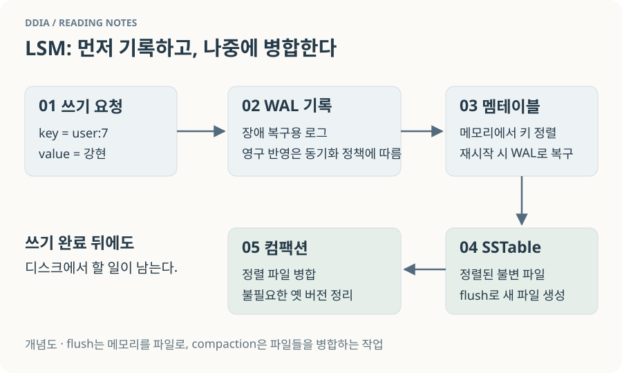
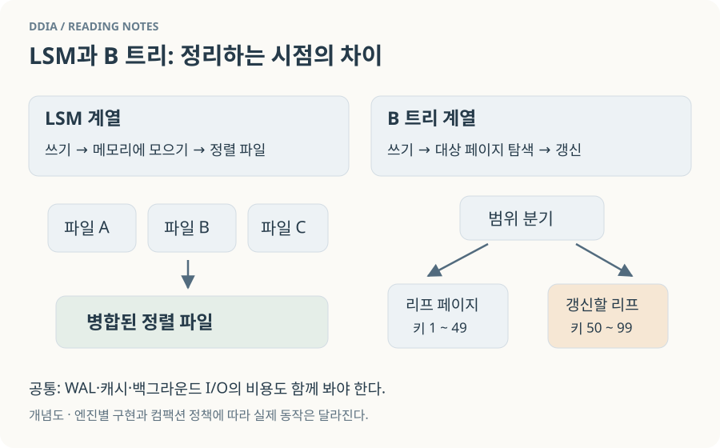
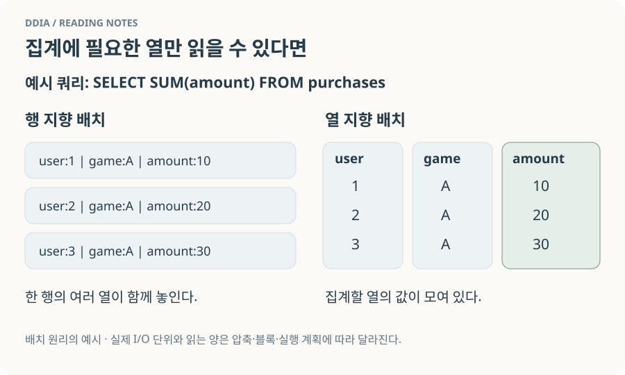

# 3장 저장소와 검색 — 쓰기 비용은 어디로 가는가

## 한 줄 요약

저장 엔진은 쓰기를 빨리 끝내고 뒤에서 정리할지(LSM), 쓸 때 제자리를 찾아 바꿀지(B 트리)를 고르는 일이고, 인덱스와 저장 방향도 같은 비용을 읽기와 쓰기 중 어디에 둘지의 문제였습니다.

## 핵심 내용

### 로그 저장소와 해시 인덱스

키·값을 파일 끝에 덧붙이고, 메모리에 `키 → 파일 위치`를 들고 있으면 쓰기와 단건 조회가 빠릅니다. 대신 한계가 있습니다.

- 모든 키가 메모리에 올라가야 함
- 범위 조회 불가 (해시에는 순서가 없음)
- 옛 값이 쌓임 → 세그먼트로 나누고 **컴팩션**으로 정리

### SSTable과 LSM 트리

키를 **정렬**해 두면 해시 인덱스의 약점이 풀립니다. 블록 시작 키만 알면 찾을 수 있고, 범위 조회와 파일 병합도 쉬워집니다.

- **쓰기:** 멤테이블(메모리, 정렬) → 가득 차면 SSTable로 flush → 백그라운드 컴팩션
- **읽기:** 멤테이블 → 최신 SSTable → 오래된 SSTable 순. 없는 키는 **블룸 필터**로 미리 거름
- **삭제:** 툼스톤을 남기고 컴팩션 때 정리

### WAL: 복구용 기록

멤테이블이 날아가는 걸 막기 위해 쓰기마다 WAL에 남기고, 재시작 시 재생합니다.

| | 로그 저장소 | WAL |
| --- | --- | --- |
| 역할 | 데이터 자체 | 장애 복구용 기록 |
| 읽기에 쓰이나 | 예 | 복구할 때만 |
| 언제 버리나 | 컴팩션으로 옛 버전만 | 반영이 끝난 뒤 |

- B 트리도 페이지 분할 중 장애에 대비해 WAL을 씁니다.
- "로그에 썼다" ≠ "디스크에 영구 반영됐다". fsync를 기다릴지는 내구성과 지연의 트레이드오프입니다.

### 쓰기 증폭

LSM이 쓰기에 강하다는 건 **적게** 쓴다는 게 아니라 **순차로** 쓴다는 뜻입니다. 같은 데이터가 WAL → flush → 컴팩션 단계마다 다시 쓰입니다.

| 증폭 | 원인 | 컴팩션을 자주 하면 |
| --- | --- | --- |
| 쓰기 | 같은 데이터를 여러 번 다시 씀 | 나빠짐 |
| 읽기 | 조회 한 번에 여러 파일 확인 | 좋아짐 |
| 공간 | 정리 안 된 옛 버전 | 좋아짐 |

> LSM은 쓰기가 무조건 빠른 게 아니라, **쓰기 비용을 뒤로 미루는** 구조입니다. 컴팩션이 쓰기 속도를 못 따라가면 결국 쓰기가 막힙니다.

### B 트리

고정 크기 페이지를 루트부터 따라 내려가 리프를 찾고, **제자리에서** 고칩니다. 페이지가 차면 분할하고, 분기 계수가 커서 깊이는 몇 단계에 그칩니다.

> 💡 예전에 만들어 둔 트리 시뮬레이터입니다: [tree.g0o0.com](https://tree.g0o0.com)
> B 트리·B+ 트리의 삽입·삭제, 분할·병합 과정을 단계별로 볼 수 있어서 B 트리 공부용으로 써 보셔도 좋아요.

> LSM과의 차이는 **비용을 언제 치르는가**입니다. 어느 쪽이 빠른지는 워크로드를 측정해 봐야 압니다.

### 보조 인덱스

인덱스가 늘수록 쓰기 때 갱신할 구조도 늘어납니다.

- **클러스터드:** 인덱스에 행 자체를 저장
- **커버링:** 필요한 열을 인덱스에 포함 → 읽기 ↑, 크기·갱신 비용 ↑
- **복합:** 열 순서가 중요. `(game_id, finished_at)`은 시각만으로 찾는 조회엔 못 씀

> 인덱스 추가 = **읽을 때 할 일을 쓸 때로 옮기는 선택**

### 열 지향 저장

OLTP는 적은 행을 자주 읽고 쓰고, OLAP는 많은 행의 몇 개 열을 집계합니다. `SUM(amount)`처럼 열 몇 개만 필요하면 열 단위로 저장하는 편이 훨씬 적게 읽습니다.

- **장점:** 압축이 잘 되고(비트맵 인코딩), 벡터화 실행이 가능
- **단점:** 한 행 쓰기에 여러 열 파일을 고쳐야 함 → LSM처럼 모아서 씀
- 머티리얼라이즈드 뷰·데이터 큐브도 쓰기를 늘려 읽기를 줄이는 같은 선택

### 방식별 비교 정리

**저장 엔진: 해시 인덱스 로그 vs LSM 트리 vs B 트리**

| | 해시 인덱스 + 로그 | LSM 트리 | B 트리 |
| --- | --- | --- | --- |
| 쓰기 방식 | 파일 끝에 덧붙임 | 멤테이블에 모았다가 SSTable로 순차 기록 | 페이지를 찾아 제자리 갱신 |
| 읽기 방식 | 해시맵으로 위치를 찾아 한 번에 | 멤테이블 → 여러 SSTable 순서로 탐색 | 루트에서 리프까지 몇 단계 |
| 범위 조회 | ❌ 불가 | ✅ 가능 | ✅ 가능 |
| 뒤에서 치르는 비용 | 컴팩션 | 컴팩션 (쓰기 증폭) | 페이지 분할, 단편화 |
| 장점 | 구조가 단순하고 단건 조회·쓰기가 빠름 | 쓰기 처리량이 높고 압축률이 좋음 | 읽기 지연이 예측 가능하고, 키가 한 곳에만 있어 트랜잭션 잠금이 쉬움 |
| 단점 | 키가 전부 메모리에 들어가야 함 | 컴팩션이 지연을 흔들고, 없는 키 조회가 비쌈 | 작은 변경에도 페이지 전체를 씀 |
| 잘 맞는 경우 | 키 수가 적고 갱신이 잦을 때 | 쓰기가 많은 워크로드 (로그, 이벤트, 시계열) | 읽기가 많고 트랜잭션이 중요한 OLTP |
| 예시 | Bitcask | LevelDB, RocksDB, Cassandra | PostgreSQL, MySQL InnoDB |

**저장 방향: 행 지향 vs 열 지향**

| | 행 지향 | 열 지향 |
| --- | --- | --- |
| 저장 단위 | 한 행의 모든 열을 함께 | 한 열의 값을 모아서 |
| 장점 | 한 행 읽기·쓰기가 빠름 | 필요한 열만 읽고, 압축·벡터화 실행에 유리 |
| 단점 | 집계할 때 필요 없는 열까지 읽음 | 한 행을 쓰려면 여러 열 파일을 고쳐야 함 |
| 잘 맞는 경우 | OLTP (주문 1건, 사용자 1명) | OLAP (많은 행의 몇 개 열을 집계) |

**공통 원리:** 인덱스, 머티리얼라이즈드 뷰, 열 지향 저장 모두 결국 **읽기 비용과 쓰기 비용 중 어디에 비용을 둘지**를 고르는 선택입니다.

**고를 때 던질 질문**

- 단건 조회가 많은가, 범위 조회가 많은가?
- 컴팩션이 쓰기 속도를 따라갈 수 있는가?
- 장애 시 어디까지 보존해야 하는가? (fsync 시점)
- 인덱스 유지 비용보다 읽기 이득이 큰가?
- 한 행을 통째로 읽는가, 많은 행의 몇 개 열을 읽는가?

## 남은 질문

LSM 트리는 쓰기가 빠르다고 하는데, 그럼 읽기는 왜 B 트리보다 느릴 수 있을까?

같은 키가 memtable과 여러 SSTable에 흩어져 있을 수 있어서 여러 곳을 확인해야 한다. B 트리는 키가 한 위치에만 있어서 트리를 한 번 내려가면 끝난다. 블룸 필터로 볼 필요 없는 SSTable을 건너뛰어 이 비용을 줄인다.

서버가 갑자기 꺼지면 아직 디스크에 안 쓴 데이터는 WAL로 어떻게 되살릴까?

데이터를 바꾸기 전에 변경 내용을 로그 파일 끝에 먼저 덧붙이고 디스크에 확실히 기록(fsync)한다. 재시작할 때 이 로그를 처음부터 다시 실행하면 메모리에만 있던 변경이 복구된다.

인덱스를 많이 만들면 조회는 빨라지는데, 왜 쓰기는 느려질까?

행 하나를 쓸 때마다 그 테이블의 모든 인덱스도 함께 갱신해야 한다. 인덱스가 5개면 쓰기 한 번이 여러 번의 쓰기로 늘어난다. 그래서 실제로 자주 쓰는 조회에만 인덱스를 만든다.

분석 쿼리에는 왜 행 지향보다 열 지향 저장이 유리할까?

분석 쿼리는 수백만 행 중 몇 개 열만 읽는 경우가 많다. 열 지향이면 필요한 열만 디스크에서 읽으면 되고, 같은 열에는 비슷한 값이 모여 있어 압축도 잘 된다.

## 참고 자료

- Martin Kleppmann, *Designing Data-Intensive Applications*, 3장 Storage and Retrieval
- [LevelDB 구현 문서](https://github.com/google/leveldb/blob/main/doc/impl.md)
- [RocksDB Wiki — Compaction](https://github.com/facebook/rocksdb/wiki/Compaction)
- [PostgreSQL 문서 — Write-Ahead Logging](https://www.postgresql.org/docs/current/wal-intro.html)
- [Tree Helper — B 트리·B+ 트리 시뮬레이터 (직접 제작)](https://tree.g0o0.com)
