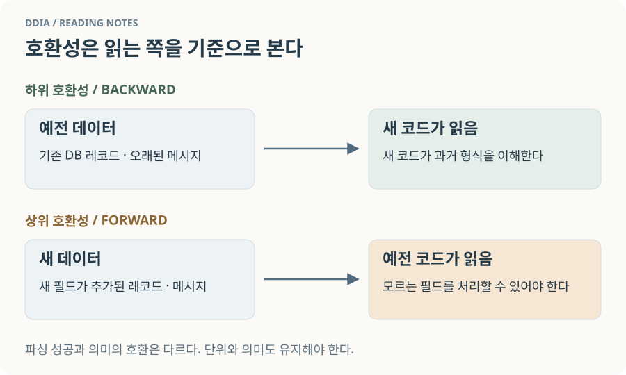
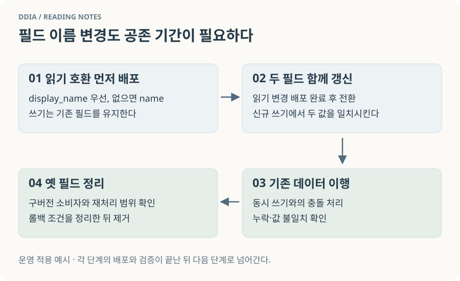

# 4장 부호화와 발전 — 배포가 끝나도 예전 데이터는 남는다

## 한 줄 요약

배포가 끝나도 예전 데이터와 예전 코드는 한동안 남아 있으므로, 인코딩 형식은 지금의 객체 모양이 아니라 서로 다른 시점의 코드가 함께 지킬 약속으로 설계해야 했습니다.

## 핵심 내용

### 인코딩과 언어 내장 직렬화

메모리의 객체를 파일·네트워크로 보내려면 바이트열로 바꿔야 합니다. Java `Serializable`, Python `pickle` 같은 내장 직렬화는 다른 언어에서 읽기 어렵고, 클래스 구조에 묶이며, 역직렬화 시 임의 코드 실행 위험이 있어 오래 남는 데이터에는 맞지 않습니다.

### 호환성은 두 방향

| | 누가 무엇을 읽나 | 언제 |
| --- | --- | --- |
| 하위 호환 | 새 코드 → 옛 데이터 | 배포 후 기존 레코드 조회 |
| 상위 호환 | 옛 코드 → 새 데이터 | 롤링 배포 중, 업데이트 안 한 모바일 앱 |



- 놓치기 쉬운 쪽은 **상위 호환**입니다.
- "읽힌다" ≠ "올바르게 이해한다". 금액 단위를 원 → 전으로 바꾸면 파싱은 돼도 계산이 틀립니다.

### JSON: 스키마는 코드 안에 숨어 있다

- 구버전이 모르는 필드를 거부하면 필드 추가만으로 깨짐
- JavaScript는 2^53보다 큰 정수를 정확히 못 다룸 → 큰 ID는 문자열로
- 바이너리는 Base64로 담아야 해서 크기 약 33% 증가

### Protocol Buffers·Thrift: 필드 번호

데이터에 필드 이름 대신 **번호와 타입**만 적습니다.

```protobuf
message User {
  string user_id = 1;
  string name = 2;
  optional string nickname = 3;   // 나중에 추가
  reserved 4;                     // 지운 번호는 재사용 금지
}
```

- **추가:** 새 번호 + optional이면 양방향 호환. 필수로 만들면 옛 데이터를 못 읽음
- **삭제:** 번호를 재사용하면 옛 값이 새 필드로 잘못 읽힘 → `reserved`
- **이름 변경:** 바이너리는 괜찮지만 JSON 매핑에서는 깨짐

### Avro: 쓰기 스키마와 읽기 스키마

데이터에 번호조차 없어 가장 작습니다. 대신 **쓸 때의 스키마**를 알아야 하고, 읽는 쪽 스키마와 필드 **이름**으로 대조합니다.

- 쓰기 스키마에만 있는 필드 → 무시
- 읽기 스키마에만 있는 필드 → 기본값으로 채움 (기본값 없으면 호환 불가)
- 쓰기 스키마는 파일 헤더나 스키마 레지스트리에 두고 ID로 참조

번호를 사람이 관리할 필요가 없어서, DB 테이블에서 스키마를 자동 생성하는 경우처럼 스키마가 동적으로 바뀔 때 유리합니다.

| 형식 | 필드를 찾는 단서 | 바꿀 때 주의 |
| --- | --- | --- |
| JSON | 필드 이름 + 애플리케이션 규칙 | 모르는 필드 처리, 숫자 정밀도 |
| Protobuf / Thrift | 필드 번호 | 번호 재사용 금지, 새 필드는 optional |
| Avro | 쓰기·읽기 스키마의 이름 대조 | 기본값, 쓰기 스키마 확보 |

### 데이터플로: DB

데이터는 코드보다 오래 삽니다. 특히 **구버전이 신버전 필드를 지우는** 문제를 조심해야 합니다. 구버전이 자기가 아는 필드만으로 객체를 만들어 통째로 저장하면 새 필드가 사라집니다.

필드 이름을 바꿀 때(`name` → `display_name`)는 단계를 나눠 배포합니다.



1. 새 이름을 먼저 읽고, 없으면 옛 이름을 읽도록 배포
2. 모든 서버가 1을 갖추면 두 필드를 함께 쓰기
3. 기존 데이터 이행 후 일치 확인
4. 구버전·롤백 가능성이 없어지면 옛 필드 삭제

### 데이터플로: RPC

원격 호출은 로컬 함수 호출이 아닙니다.

- 타임아웃은 "실패"가 아니라 "모름". 처리됐는데 응답만 유실됐을 수 있음
- 재시도하면 두 번 실행될 수 있어 **멱등성** 설계가 필요
- 보통 서버를 먼저 배포하므로 요청엔 하위 호환, 응답엔 상위 호환이 필요

### 데이터플로: 메시지 큐

쓴 시점과 읽는 시점이 다릅니다.

- 배포 후에도 큐에는 옛 형식 메시지가 남아 있음
- 생산자를 먼저 바꾸면 옛 소비자가 새 메시지를, 소비자를 먼저 바꾸면 새 코드가 옛 메시지를 받음
- 실패 메시지를 나중에 재처리한다면 그 기간만큼 옛 형식을 지원해야 함

### 정리

스키마를 바꾸기 전에 확인할 것:

- 새 코드가 기존 레코드와 큐에 남은 메시지를 읽을 수 있는가?
- 구버전이 새 필드가 있는 데이터를 받아도 깨지지 않는가?
- 읽고 다시 저장할 때 모르는 필드가 보존되는가?
- 이름·타입은 같아도 단위나 의미가 바뀌지 않았는가?
- 재처리·롤백을 위해 옛 형식을 언제까지 유지할 것인가?

## 남은 질문

<details>
<summary>하위 호환성과 상위 호환성은 각각 누가 누구의 데이터를 읽는 상황일까?</summary>

하위 호환성은 **새 코드가 옛 데이터를** 읽는 것, 상위 호환성은 **옛 코드가 새 데이터를** 읽는 것이다. 상위 호환이 더 어렵다. 옛 코드는 새 필드를 모르기 때문에 무시하고 넘어갈 수 있어야 한다.

</details>

<details>
<summary>Protocol Buffers에서 필드 이름은 바꿔도 되는데 필드 번호는 왜 바꾸면 안 될까?</summary>

인코딩된 바이트에는 필드 이름이 아니라 번호(태그)만 들어간다. 이름은 코드에서만 쓰이니 바꿔도 되지만, 번호를 바꾸면 기존 데이터가 엉뚱한 필드로 읽힌다. 지운 필드의 번호도 재사용하면 안 된다(`reserved`).

</details>

<details>
<summary>새 필드를 추가할 때 기본값을 꼭 정해야 하는 이유는 무엇일까?</summary>

새 코드가 그 필드가 없는 옛 데이터를 읽을 때 무엇으로 채울지 정해 둬야 하기 때문이다. Avro에서는 기본값이 없는 필드를 추가하면 하위 호환이 깨진다.

</details>

<details>
<summary>배포 중에 구버전과 신버전 서버가 같이 돌면 어떤 문제가 생길 수 있을까?</summary>

신버전이 쓴 데이터를 구버전이 읽고 다시 저장하면, 구버전이 모르는 새 필드가 사라질 수 있다. 롤링 배포에서는 신·구 버전이 서로의 데이터를 읽으므로 하위·상위 호환이 모두 필요하다.

</details>

## 참고 자료

- Martin Kleppmann, *Designing Data-Intensive Applications*, 4장 Encoding and Evolution
- [Protocol Buffers — Updating a Message Type](https://protobuf.dev/programming-guides/proto3/#updating)
- [Apache Avro Specification — Schema Resolution](https://avro.apache.org/docs/1.12.0/specification/#schema-resolution)
- [Confluent — Schema Evolution and Compatibility](https://docs.confluent.io/platform/current/schema-registry/fundamentals/schema-evolution.html)
