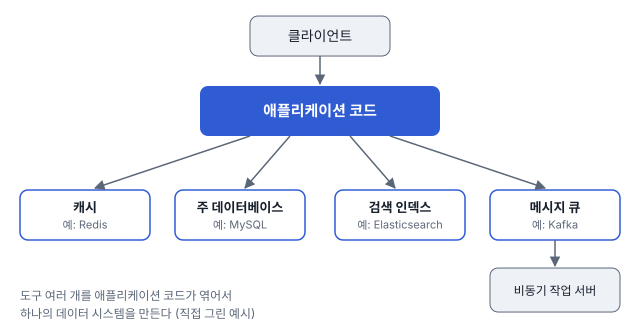

# 1장. 신뢰할 수 있고 확장 가능하며 유지보수하기 쉬운 애플리케이션

## 한 줄 요약

하나의 도구로 다 해결할 수 없는 시대라 개발자는 데이터 시스템 설계자이기도 하다. 그래서 신뢰성, 확장성, 유지보수성 세 가지를 늘 같이 고민해야 한다!

## DBMS에 대한 생각

점점 하나의 도구만으로는 복잡한 애플리케이션을 전부 구현할 수 없다.

이렇게 요구사항이 복잡해지니, 개발자는 단순 애플리케이션 개발자뿐만이 아닌, 데이터 시스템 설계자이기도 하다

데이터 시스템이나 서비스를 설계할 때는 성능, 확장성 등을 고려하게 됨. 책에서는 세 가지 관심사에 중점을 둔다

- 신뢰성 : 어떤 역경에도 시스템은 지속적으로 올바르게 동작해야한다
- 확장성 : 복잡도나 트래픽 양이 증가해도, 이를 처리할 수 있는 적절한 방법이 있어야 한다
- 유지보수성 : 시간이 지나도 모든 사용자가 시스템 상에서 생산적으로 작업할 수 있게 해야 한다

하나씩 차근차근 살펴보자

## 신뢰성

- 애플리케이션은 사용자가 기대한 기능을 수행한다
- 시스템은 사용자가 범한 실수나 예상치 못한 소프트웨어 사용법을 허용할 수 있다
- 시스템 성능은 예상된 부하와 데이터 양에서 필수적인 사용 사례를 충분히 만족한다
- 시스템은 허가되지 않은 접근과 오남용을 방지한다

사실, 모든 결함을 방지할 순 없겠지만, 우리는 그러기 위해서 노력해야할 것…

저자는 고의적으로 결함을 일으켜 내결함성(결함을 예측하고 대처할 수 있게) 시스템을 지속적으로 훈련하고 테스트하는 게 좋다고 한다. (ex. 넷플릭스의 카오스 몽키)

> 보통은 결함이 아예 안 생기게 막는 것(예방)보다, 결함이 생겨도 버티게 만드는 것(내결함성)을 더 선호한다. 근데 예방이 더 나은 경우도 있다. 한 번 터지면 되돌릴 방법이 없는 경우!

→ 보안 문제!! 데이터가 한 번 유출되면 되돌릴 수가 없으니까 이건 예방이 답이다

### 하드웨어 결함

ex) 하드디스크 고장, 램에 결함 발생, 대규모 정전 사태 등… 의 결함. 참고로 하드디스크의 MTTF(평균 장애 시간)는 10~50년 정도라는데, 디스크가 만 개쯤 있는 클러스터라면 평균적으로 거의 매일 하나씩 죽는다고 볼 수 있다고 한다.

그렇다면 이런 장애율을 줄이는 대응은 뭐가 있을까?

1. 하드웨어 구성 요소에 중복을 추가하자

   디스크를 RAID구성으로 설치한다거나, 서버는 이중 전원 디바이스와 핫스왑 가능한 CPU를 갖추는 등… 원래 이러한 작업은 고가용성이 절대적으로 필수적인 소수의 애플리케이션에서만 필요했다.

   하지만 대부분의 애플리케이션이 복잡해지며, 많은 수의 장비를 사용하게 되었고 더불어 하드웨어 결함율도 증가했다. 이제 선택이 아닌 필수의 시대?

2. 장비 하나를 통째로 잃어도 버티게 소프트웨어 쪽에서 대비하자

   장비 단위 중복만으로는 부족해서, 요즘은 소프트웨어 내결함성 기술을 같이 쓴다.

   이런 시스템의 장점 : 장비를 재부팅해야할 때 전체 시스템의 중단 시간없이 한 번에 한 노드씩 패치할 수 있다는 것(4장 순회식 업그레이드 참고)

### 소프트웨어 오류

> 하드웨어 결함은 보통 서로 독립적으로 터지는데, 소프트웨어 오류는 모든 노드에 같은 버그가 깔려 있어서 한 번에 같이 터진다. 그래서 예상하기도 어렵고, 오히려 하드웨어 결함보다 더 큰 장애를 낸다.

- 잘못된 특정 입력이 있을 때 모든 애플리케이션 서버 인스턴스가 죽는 소프트웨어 버그
- CPU 시간, 메모리, 디스크 공간, 네트워크 대역폭처럼 공유 자원을 과도하게 사용하는 일부 프로세스
- 시스템의 속도가 느려져 반응이 없거나 잘못된 응답을 반환하는 서비스
- 한 구성 요소의 작은 결함이 다른 구성 요소의 결함을 야기하며 연쇄 장애

이런 결함들은 특정 상황에 의해 발생해서, 오랫동안 나타나지 않을 수도… 따라서 신속한 해결책이 없다

그래도~ 시스템의 가정과 상호작용에 대해 깊게 생각하기, 빈틈없는 테스트, 프로세스 격리, 죽은 프로세스 재시작 허용, 모니터링, 분석하기 등을 한다면 해결할 수 있을 수도!

시스템이 뭔가 보장하길 기대한다면 이를 지속적으로 확인하며 경고 발생시키게 할 수도 있다.

### 인적 오류

사람은 실수를 한다. 그런 사람이 어떻게 시스템을 신뢰성 있게 만들지? → 다양한 접근 방식 결합해보자

- 오류의 가능성을 최소화하는 방향으로 시스템 설계 (인터페이스 사용하자!)
- 사람이 가장 많이 실수하는 부분에서 사람의 실수로 장애가 발생할 수 있는 부분을 분리
  - 샌드박스
- 단위테스트 → 전체 시스템 통합 테스트 → 수동 테스트까지 철저하게 테스트해라
  - 코너케이스
- 장애 발생의 영향을 최소화하기 위해 인적 오류를 빠르고 쉽게 복구할 수 있게 설계 (롤백 & 롤아웃)
- 모니터링 대책을 마련해라
  - OpenTelemetry 같은 걸로 로그, 메트릭, 트레이스를 한 번에 모으면 좋을 듯

## 확장성

시스템이 지금은 잘 돌아가도, 미래에는 잘 안 돌아갈 수도 있다! → 흔한 이유로는 **부하 증가**

- 시스템이 특정 방식으로 커지면 이에 대처하기 위한 선택은 무엇일까?
- 추가 부하를 다루기 위해 계산 자원을 어떻게 투입할까?

⇒ 우리는 늘 **"확장성"** 을 고려해야 한다

### 부하 기술하기

우선 현재 부하를 간결하게 기술하자~~ by **부하 매개변수 (각자 서비스에 맞게)**

ex) 웹 서버의 초당 요청 수, 데이터베이스의 읽기 대 쓰기 비율, 대화방 동시 활성 사용자, 캐시 적중률 등..

> **트위터는 어떻게 했을까?**
>
> 트위터의 확장성 문제는 팬아웃때문! 사용자들이 서로 팔로우를 한다. 그리고 홈 타임라인에서는 사용자는 팔로우한 사람이 작성한 트윗을 볼 수 있다. 이는 2가지 방식으로 구현했다
>
> 1. 사용자가 홈 타임라인 요청하면, 팔로우하는 모든 사람 찾기 → 그 사람들의 모든 트윗을 찾아 시간순으로 정렬.
> 2. 다른 방식은 캐시를 사용하는데, 만약 사용자가 트윗을 작성하면 해당 사용자를 팔로우하는 사람을 모두 찾아 팔로워 각자의 홈 타임라인 캐시에 새로운 트윗을 삽입한다
>
> 트위터는 부하로 인해 1 에서 2로 전환했다 (읽기 시점에서 적은 일을 하게)
>
> → 그러나 만약 팔로워가 많은 사용자라면? 트윗 작성 시 부가 작업이 많아진다.
>
> 따라서 트위터는 현재 두 접근 방식의 혼합형으로 바꾸고 있다. 팔로워가 많은 사용자의 트윗은 별도로 가져와서 접근 방식 1처럼 읽는 시점에 사용자의 홈 타임라인에 합친다.

→ 이 부분은 다른 SNS는 어떻게 했는지까지 따로 딥다이브했다: [feed-fanout.md](feed-fanout.md)

### 성능 기술하기

- 부하 매개변수를 증가시키고 시스템 자원은 유지하면 시스템 성능은 어떻게 영향을 받을까?
- 부하 매개변수를 증가시켰을 때 성능이 변하지않고 유지되길 원한다면 자원을 얼마나 많이 늘려야할까?

일괄 처리 시스템은 처리량에, 온라인 시스템은 응답시간에 더 관심을 가진다

참고로 응답 시간은 동일한 요청이어도 매번 다르기에, 측정 가능한 값의 분포로 생각해야 한다

이때, 가끔 오래 걸리는 특이 값(outlier)가 있다. 여러 원인으로 추가 지연이 생길 수도 ㅇㅇ

주로 서비스의 평균 응답 시간을 살피긴 하지만, 평균보다는 백분위를 사용하는 편이 더 좋다.

→ 중앙값(p50)으로 사용자 요청의 절반은 중앙값 밑, 절반은 중앙값 위로 걸린다는 걸 알 수 있다

또한, 특이 값이 얼마나 좋지 않은지 알아보려면 p95, p99, p999를 살펴보자.

꼬리 지연 시간도 살펴보자! (ex. 아마존에서는 p999로 응답시간 요구사항을 기술하는데, 응답이 제일 느린 고객들이 보통 구매를 많이 해서 계정에 데이터가 가장 많은 고객이기 때문)

근데 이런 최적화 작업은 비용이 많이 들어서,, 우리 서비스 단에서는 오버 엔지니어링이 아닐까

큐 대기 지연, 선두 차단 현상 (서버는 병렬로 소수의 작업만 처리할 수 있기에, 소수의 느린 요청처리만으로도 후속 요청 처리가 지체되는 현상) → 이런 문제때문에 응답 시간은 클라이언트 쪽에서 측정하는 게 중요하다

인위적인 부하테스트 경우, 부하 생성 클라이언트는 응답 시간과 독립적인 요청을 지속적으로 보내야 한다. 응답을 기다렸다가 다음 요청을 보내면 큐가 실제보다 짧게 유지돼서 평가를 왜곡하게 될 수도 있다 → 실제 트래픽 실험이 제일 중요

> **실전 백분위**
>
> - 서비스에서는 보통 최근 10분 같은 **롤링 윈도**로 응답 시간 백분위를 계속 계산해서 대시보드에 띄운다
> - 요청 하나를 처리하는 데 백엔드를 여러 번 호출하면, 그중 하나만 느려도 전체가 느려진다(꼬리 지연 증폭). 백엔드 호출이 많을수록 느린 요청을 만날 확률이 커진다!
> - 주의!! 서버 여러 대의 p99를 **평균 내면 안 된다**. 백분위끼리는 평균이 의미가 없어서, 각 서버의 응답 시간 **히스토그램을 합친 다음** 백분위를 다시 계산해야 한다
> - 매 요청을 다 저장하면 비싸니까 HdrHistogram, t-digest 같은 근사 알고리즘을 쓴다. Prometheus의 histogram도 같은 아이디어 (버킷별로 개수를 세 두고 나중에 합침)

### 부하 대응 접근 방식

부하 매개변수가 어느 정도 증가하더라도 좋은 성능을 유지하려면 어떻게 해야 할까?

확장성에는 스케일업과 스케일아웃이 있다. 스케일아웃 형식의 아키텍처는 주로 비공유 아키텍처라 한다.

탄력적인 시스템들은 부하 증가를 감지하고 자원을 추가하는 일이 자동화 되어있지만, 그렇지 않은 시스템은 수동으로 확장해야 한다. 부하가 예측 가능하면 수동으로 운영하는 게 좋은 거 같다

예전엔 상태를 가진 시스템(DB 같은)은 분산하기 까다로우니까, 비용이 감당될 때까지 단일 노드로 스케일업하는 게 상식이었다. 근데 분산 시스템용 도구가 좋아지면서 이 상식도 일부 바뀌었다고 한다.

흠.. 요즘 대부분 서비스가 분산 아키텍처이긴 해

## 유지보수성

레거시 소프트웨어를 최대한 효율적으로 설계할 수 있는 소프트웨어 시스템 설계 원칙

- 운용성 - 운영팀이 시스템을 원활하게 운영할 수 있게 쉽게 만들어라
- 단순성 - 시스템에서 복잡도를 최대한 제거해 새로운 엔지니어가 시스템을 이해하기 쉽게 만들어라
- 발전성 - 엔지니어가 이후 시스템을 쉽게 변경할 수 있게 해라(유연성, 수정 가능성, 적응성)

### 운용성 : 운영의 편리함 만들기

- 시스템 상태를 모니터링하고, 상태가 좋지 않다면 빠르게 서비스를 복원한다
- 시스템 장애, 성능 저하 등의 문제의 원인을 추적한다
- 보안 패치를 포함해 소프트웨어와 플랫폼을 최신 상태로 유지한다
- 다른 시스템이 서로 어떻게 영향을 주는지 확인해 문제가 생길 수 있는 변경 사항을 손상을 입히기 전에 차단한다.
- 미래에 발생 가능한 문제를 예측해 미리 해결한다
- 문서화한다

동일하게 반복되는 태스크를 쉽게 수행하게끔 만들자.

- 좋은 모니터링으로 런타임 동작과 시스템의 내부에 대한 가시성을 제공하자
- 자동화와 통합에 신경쓰자
- 개별 장비에 대한 의존성을 줄이자. 전체 시스템에 영향이 가지 않도록
- 이해하기 쉬운 문서와 운영 모델을 쓰자
- 자원이 자기 회복이 가능하게 & 관리자가 시스템 상태를 수동으로 제어할 수 있게
- 예측 가능하게 동작하게 구현하고 예기치 않은 상황을 최소화 하자

### 단순성 : 복잡도 관리

프로젝트 규모가 커질 수록 유지보수 비용이 증가하고, 때론 Big ball of mud가 된다

복잡도는 다양한 증상으로 나타난다 ex) 상태 공간 급증, tight coupling, 복잡한 의존성, 임시 해결 방안 등

그러니 복잡도를 최대한 줄여보자. 특히 문제 자체가 원래 복잡해서가 아니라 구현하다 생긴 **우발적 복잡도**를!

→ sol. 추상화하자. 세부구현을 숨겨 깔끔하기도 하고 잘하면 다른 애플리케이션에도 쓰일 수 있어 효율적이다 어떻게 해야 좋게 추상화할지는 앞으로 책을 통해 알아가자~~

### 발전성 : 변화를 쉽게 만들기

시스템의 요구사항은 계속해서 바뀔 것이다. 이런 변화에 적응하기 좋은 작업 패턴이 **애자일**이다.

그러나 애자일 기법은 대부분 규모가 작거나 로컬 규모에 초점을 맞추고 있는데, 대규모 데이터 시스템에서는 어떻게 하는지 책을 통해 알아보자

## 남은 질문

- 결함 예방 vs 내결함성: 카오스 몽키 같은 방식이 작은 서비스에도 의미가 있을까? (8장 읽을 때 다시)
- 내가 겪었던 장애는 하드웨어/소프트웨어/인적 오류 중 어디였을까?
- 우리 서비스 규모에서 p99 이상을 관리하는 게 의미가 있을까?

## 참고 자료

- 마틴 클레프만, 『데이터 중심 애플리케이션 설계』 1장
- [Netflix Chaos Monkey](https://netflix.github.io/chaosmonkey/)
- [OpenTelemetry](https://opentelemetry.io/)
- [HdrHistogram](https://hdrhistogram.github.io/HdrHistogram/)
- [Prometheus: Histograms and summaries](https://prometheus.io/docs/practices/histograms/)
