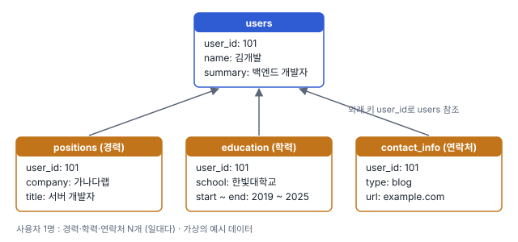
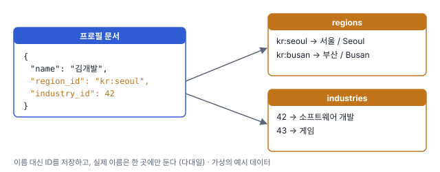
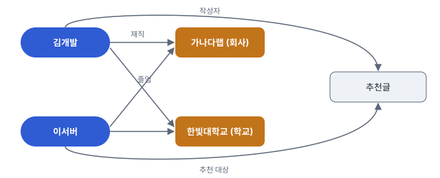
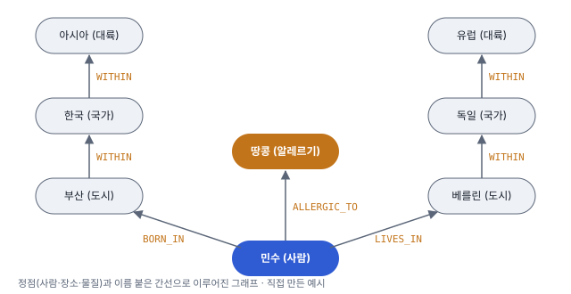

# 2장. 데이터 모델과 질의 언어

## 한 줄 요약

관계형, 문서, 그래프 모델은 각자 잘 맞는 데이터 모양이 다르다. 관계가 적은 문서형 데이터면 문서 모델, 다대다가 많으면 관계형, 연결이 엄청 복잡하면 그래프!

## 들어가며

대부분의 애플리케이션은 하나의 데이터 모델을 다른 데이터 모델 위에 계층을 둬서 만듦(복잡성 숨김)

이번 장에서는 데이터 저장과 질의를 위한 다양한 범용 데이터 모델을 살펴보자!

목표 1. 관계형 모델 vs 문서 모델 vs 그래프 기반 데이터 모델을 비교하자

목표 2. 다양한 질의 언어를 살펴보고 사용 사례도 비교하자

## 관계형 모델과 문서 모델

관계형 DB의 근원은 비즈니스 데이터 처리에 있다! (트랜잭션 처리, 일괄 처리 등)

이제는 데이터 처리를 넘어 다양한 사용 사례에서 쓰인다.

### NoSQL의 탄생

2010년대에 탄생한 NoSQL은 원래 오픈 소스, 분산 환경, 비관계형 DB 밋업용 해시태그였는데 지금은 많이 쓰이고 있다 ㅇㅇ. 왜 많이 쓰일까???

- 대규모 데이터셋이나 매우 높은 쓰기 처리량을 관계형 DB보다 쉽게 할 수 있음 (확장성 굳?)
- 상용 DB 제품보다 무료 오픈소스 SW에 대한 선호도 확산
- 관계형 모델에서 지원하지 않는 특수 질의 동작
- 관계형 스키마의 제한을 벗어날 수 있는 기회

현재는 관계형 DB랑 비관계형 데이터 스토어가 함께 쓰이고 있네요 (polyglot persistence)

### 객체 관계형 불일치

객체지향 프로그래밍 언어와 SQL 데이터 모델 사이에는 전환 계층이 필요하다 (**impedance mismatch**)

ActiveRecord나 Hibernate 같은 ORM 프레임워크는 전환 계층에 필요한 상용구 코드는 줄이지만 두 모델 간의 차이를 해결하진 못한다

링크드인 같은 이력서 프로필 설계로 알아보자!



사용자와 경력, 학력 기간, 연락처 정보 등은 일대다 관계이다. 이를 표현하는 방법은 여러 개가 있다

- 전통적인 SQL모델에서는 각 항목을 개별 테이블로 만들어 외래 키로 users 테이블 참조
- 이후 SQL 표준에 추가된 구조화된 데이터 타입과 XML 데이터 지원으로 단일 row에 다중 값을 저장할 수 있고 문서 내 질의와 색인이 가능해졌다.
- 각 정보를 JSON이나 XML 문서로 부호화해 DB의 텍스트 컬럼에 저장한다. 이후 애플리케이션이 구조와 내용을 해석하는데, 문제는 부호화된 컬럼의 값을 질의할 때 DB를 쓸 수 없음!

이력서 같은 데이터 구조는 JSON 표현에 적합하다. 일부 개발자는 JSON 모델이 그나마 impedance mismatch를 줄인다고 생각하지만, 4장에서 JSON의 문제를 알려주겠다 (흠)

JSON 표현은 다중 질의를 수행해야하는 다중 테이블 스키마보다 더 나은 locality를 갖는다. (질의 하나로 충분하다)

### 다대일과 다대다 관계



왜 여기서 각 지역명과 산업명이 아닌 `region_id`랑 `industry_id`가 주어졌을까?

자유 텍스트 필드라면 평문이 더 좋겠지만, 드롭다운 리스트나 자동 완성 기능일 땐 해당 방식이 좋다

- 프로필 간 일관된 스타일과 철자
- 모호함 해결 (이름이 같은 다른 도시 등)
- 갱신하기 쉽다 (드물지만? 지역명이 바뀐 경우 한 곳만 고치면 됨)
- 현지화 지원 (각 나라에 맞게 언어 번역)
- 검색하기 쉽다!

음? 갑자기 중복 데이터 문제 얘기

→ 이름을 그대로 저장하면 같은 값이 여러 문서에 중복으로 박힌다. ID만 저장하고 사람이 읽는 이름은 한 곳에만 두는 게 **정규화**의 핵심 아이디어!

중복된 데이터를 정규화하려면 다대일 관계가 필요한데, 이 관계는 문서 모델에 적합하지 않다. 문서 DB는 일대다 트리 구조에는 잘 맞지만, 조인에 대한 지원이 보통 약하다

DB 자체가 조인을 지원하지 않으면 애플리케이션 코드에서 DB에 다중 쿼리를 만들어서 조인을 흉내내야 한다



다대다 관계가 이력서에 필요한 이유. 회사나 학교를 문자열이 아니라 하나의 엔티티로 만들면 여러 사용자가 같은 회사를 참조하게 되고, 추천글처럼 사용자끼리 서로 연결되는 기능도 생긴다. 처음엔 조인 없는 문서로 시작해도, 기능이 붙을수록 데이터는 점점 서로 연결되는 경향이 있다!

## 문서 DB는 역사를 반복하고 있는걸까?

관계형 DB가 다대다 관계를 잘 표현함에도 불구하고 문서 DB와 NoSQL은 다대다관계 표현에 대해 논쟁 중이다.

이 문제는 1970년대 IMS에서도 있었다. IMS또한 다대다 관계 표현이 어렵고 조인 지원도 없었다.

당시 해결책으로 관계형 모델과 네트워크 모델이 있었는데, 현재도 발생하는 문제이니 이 논쟁을 다시 살펴보자

### 네트워크 모델 (= CODASYL 모델)

계층 모델에서 모든 레코드는 하나의 부모가 있는데, 네트워크 모델은 다중 부모가 있을 수 있다

→ 다대일과 다대다 관계를 모델링할 수 있다!

넽웤 모델에서 레코드 간 연결은 프로그래밍 언어의 포인터와 더 비슷하다. 레코드에 접근하는 유일한 방법이 최상위 레코드에서부터 연속된 연결 경로를 따르는 방법인데, 이 경로를 **접근 경로**라 한다.

이 경로가 간단하면 좋겠지만, 다대다 관계에서는 다양한 다른 경로가 같은 레코드로 이어지기도 하므로 다양한 접근 경로를 계속 추적해야 한다.

이런 수동 접근 경로 선택은 DB 쿼리와 갱신을 위한 코드가 복잡하고 유연하지 못한 문제가 있었다. 계층 모델과 네트워크 모델 모두 원하는 데이터에 대한 경로가 없다면 경로를 다루기 위해 쿼리를 재작성해야 한다.

즉, 애플리케이션의 데이터 모델을 바꾸는 작업은 어려운 일이었다

### 관계형 모델

관계형 DB에서 쿼리 최적화기는 쿼리의 어느 부분을 어떤 순서로 실행할지를 결정하고 사용할 색인을 자동으로 결정한다. 이 선택이 실제로 접근 경로가 되는데, 최적화기가 자동으로 만들어주기에 개발자는 편하다

새로운 방식으로 찾고 싶을 때에도 새로운 인덱스를 선언하기만 하면, 쿼리 최적화기가 자동으로 적합한 색인을 사용한다. 따라서 관계형 모델은 애플리케이션에 새로운 기능을 추가하는 작업이 훨씬 쉽다

### 문서 DB와의 비교

문서 DB는 별도 테이블이 아닌 상위 레코드 내에 중첩된 레코드를 저장한다 (계층 모델의 특징?)

하지만 다대일과 다대다 관계를 표현할 때 관계형 DB와 문서 DB는 근본적으로 다르지 않다!

둘 다 관련 항목은 고유한 식별자로 참조 (관계형에서는 외래 키, 문서 모델에서는 문서 참조라 한다)하여, 조인이나 후속 쿼리를 사용해 읽기 시점에 확인한다.

즉 문서 DB는 네트워크모델보다는 관계형 DB와 좀 더 가까운듯

## 관계형 DB와 오늘날의 문서 DB

그렇다면 둘의 차이점은 뭘까??? → 내결함성(5장)과 동시성 처리(7장)를 포함한 차이점이 있다!

2장에서는 데이터 모델의 차이점에 대해서만 얘기한다

관계형 모델의 장점 : 조인, 다대일, 다대다 관계를 더 잘 지원

문서형 모델의 장점 : 스키마 유연성, 지역성에 기인한 나은 성능, 일부 app에서의 데이터 구조와 더 가깝

### 어떤 데이터 모델이 애플리케이션 코드를 더 간단하게 할까?

- 애플리케이션에서 데이터가 문서와 비슷한 구조일 경우 → 문서 모델

  여러 테이블로 나눠서 찢는 관계형 기법은 애플리케이션을 복잡하게 만들 수도 있다. 대신! 문서 모델에도 제한이 있다.

  ex) 문서 내 중첩 항목을 바로 참조할 수 없어 "3번째 경력" 처럼 표현해야 해서 복잡해진다. 근데 중첩이 너무 깊지 않으면 큰 문제는 아님

  또, 문서 DB의 미흡한 조인 지원은 애플리케이션에 따라 문제가 될 수도,, 안 될 수도 있다

- 애플리케이션에서 다대다 관계를 사용한다면 → 관계형 모델

  만약 문서 모델을 사용하면 비정규화된 중복 데이터의 일관성 유지를 위해 추가 작업이 필요하고, 애플리케이션에서 조인을 흉내내야 해서 코드가 복잡하고 성능이 느릴 것이다

물론 서비스마다 다르다. 만약 상호 연결이 많은 데이터의 경우에는 그래프형 데이터 모델이 자연스러울 것이다.

### 문서 모델에서의 스키마 유연성

보통 관계형 DB에서 제공하는 XML은 선택적으로 스키마 유효성 검사를 포함할 수 있다. 반면 문서 DB와 관계형 DB에서 지원하는 JSON은 스키마를 강요하지 않는다. → 임의의 키와 값을 문서에 추가할 수 있다

문서 DB는 종종 스키마리스라고 불리는데, 사실 암묵적인 스키마 존재한다 (읽기 스키마)

읽기 스키마는 프로그래밍 언어에서 동적 타입 확인과 유사하고, 쓰기 스키마는 정적 타입 확인과 비슷하다

이런 접근 방식 간 차이는 애플리케이션이 데이터 타입을 변경할 때 나타난다. 살펴보자

ex) 주소를 `address` 문자열 하나로 저장하다가, 우편번호(`zip_code`)를 따로 저장하기로 바꾼 경우

읽기 스키마(문서 DB)라면 그냥 새 문서부터 새 필드로 쓰고, 예전 문서는 읽을 때 처리한다

```javascript
// 필드가 생기기 전에 저장된 문서에는 zip_code가 없음
if (order.address && !order.zip_code) {
  order.zip_code = parseZipCode(order.address);
}
```

쓰기 스키마(관계형 DB)라면 마이그레이션을 수행한다

```sql
ALTER TABLE orders ADD COLUMN zip_code text;
UPDATE orders SET zip_code = substring(address from '\d{5}'); -- PostgreSQL
```

대부분의 관계형 DB 시스템은 ALTER TABLE 문을 수 밀리초 안에 수행하는데, MySQL은 다르다

ALTER TABLE 시에 전체 테이블을 복사 (큰 테이블 변경할 땐 수 시간까지도 중단 시간이 발생할 수도)한다. 이런 제약을 피할 수 있는 다양한 도구가 있다

- **pt-online-schema-change**: 새 구조의 빈 테이블을 만들고 데이터를 조금씩 복사한다. 복사하는 동안 들어온 변경은 트리거로 새 테이블에도 반영하고, 다 끝나면 테이블 이름을 바꿔치기한다
- **gh-ost** (GitHub): 비슷하게 복사하는데 트리거 대신 binlog(변경 로그)를 읽어서 반영한다. 원본 테이블에 부하를 덜 준다
- 참고로 MySQL 8.0부터는 컬럼 추가 같은 일부 변경은 `ALGORITHM=INSTANT`로 테이블 복사 없이 바로 끝난다

만일 이 방식을 수용할 수 없다면 애플리케이션은 `zip_code`가 기본값인 `NULL`로 설정되게 남겨두고 문서 DB처럼 읽는 시점에 채울 수 있다

이러한 읽기 스키마 접근 방식은 컬렉션 안의 항목이 동일한 구조가 아닐 때 유리하다. 왜냐면

- 다른 여러 유형의 오브젝트가 있고 각 유형의 오브젝트별로 자체 테이블에 넣는 방법은 실용적 X
- 사용자가 제어할 수 없고 언제나 변경 가능한 외부 시스템에 의해 데이터 구조가 결정된다

스키마가 있는 게 좋은지, 아닌지 서비스 성격에 맞게 잘 판단하자

### 쿼리를 위한 데이터 지역성

문서는 보통 JSON, XML로 부호화된 단일 연속 문자열이나 이진 변형(MongoDB의 BSON 등)으로 저장된다. 만약 웹 페이지 상에 문서를 보여주는 기능처럼 자주 전체 문서에 접근해야 한다면 스토리지 지역성을 활용하면 좋다.

→ 쉽게 말하면, 관계형에서 프로필 하나를 보려면 users, positions, education 테이블을 각각 조회(또는 조인)해야 하고 데이터가 디스크 여기저기 흩어져 있을 수 있다. 문서 모델은 프로필 전체가 **한 덩어리로 붙어서** 저장돼 있어서 한 번에 읽힌다. 이게 지역성!

지역성의 이점은 한 번에 해당 문서의 많은 부분을 필요로 하는 경우에만 적용된다.

DB는 문서의 작은 부분만 접근하더라도 전체 문서를 적재해야하기에, 큰 문서에서는 낭비일 수 있다. (이름 하나 보려고 이력서 전체를 읽는 셈)

또 문서를 수정할 때는 보통 문서 전체를 다시 써야 한다. 부호화된 문서의 크기를 바꾸지 않는 수정만 제자리에서 쉽게 수행할 수 있다. 이런 이유로 일반적으로 문서를 아주 작게 유지하면서 문서의 크기가 증가하는 쓰기를 피하라고 권장한다. 이런 성능 제한 때문에 문서 DB가 유용한 상황이 많이 줄어든다

이렇게 지역성을 중시하는 DB는 문서 모델 뿐만이 아니다.

ex) 구글의 스패너 DB, 오라클의 멀티 테이블 인덱스 클러스터 테이블, 칼럼 패밀리 개념 등.. 3장에서 계속

### 문서 DB와 관계형 DB의 통합

MySQL을 제외한 대부분의 관계형 DB 시스템은 2000년대 중반 이후 XML을 지원한다. (XML 문서의 지역적 수정과 인덱스 및 질의 기능 포함) → 문서 DB와 비슷한 모델을 사용할 수 있다!

PostgreSQL은 9.3버전부터, MySQL은 5.7부터, IBM DB2는 10.5부터 JSON 문서에 대해 비슷한 수준의 지원 기능을 제공한다.

반면 문서DB쪽에서는 RethinkDB는 쿼리 언어에서 관계형 조인을 지원하고, MongoDB 드라이버는 자동으로 DB 참조를 확인한다 (클라이언트 측 조인을 수행. DB 조인보다 좀 더 느릴 수도)

이렇게 관계형 DB와 문서 DB는 점점 비슷해지고 있다!

## 데이터를 위한 쿼리 언어

관계형 모델이 등장하면서 SQL (선언형 쿼리 언어)도 함께 등장했다. 원래 IMS와 코다실은 명령형 코드를 사용해서 DB에 질의했다.

명령형 언어는 특정 순서로 특정 연산을 수행하게끔 컴퓨터에게 지시한다. 반면 선언형 쿼리 언어에서는 목표를 달성하기 위한 방법이 아니라 알고자 하는 데이터의 패턴, 즉 결과가 충족해야 할 조건과 데이터를 어떻게 변환할지를 지정하면 된다.

이 외의 어떤 인덱스, 어떤 조인 함수를 사용하고 어떤 순서로 실행할지는 DBMS의 쿼리 최적화기가 맡는다

```javascript
// 명령형: "어떻게" 찾을지 순서대로 지시
const result = [];
for (const user of users) {
  if (user.city === "서울") result.push(user);
}
```

```sql
-- 선언형: "무엇을" 원하는지만 말함
SELECT * FROM users WHERE city = '서울';
```

선언형 쿼리 언어의 장점은, DB 엔진의 상세 구현이 숨겨져있어 쿼리를 변경하지 않고도 성능을 향상시킬 수 있다는 것이다

또한, 종종 병렬 실행에 적합하다. 명령형 코드는 명령어를 특정 순서로 수행하게끔 지정하기에, 다중 장비에서 병렬 처리가 어려우나 선언형 언어는 결과의 패턴만 지정하기에, 병렬 실행으로 더 빨라질 수 있다

선언형 쿼리 언어는 다른 환경에서도 유용하다 (ex. 웹에서 CSS 선택자도 선언형! "이런 조건의 요소에 이 스타일"만 말하고 DOM을 어떻게 순회할지는 브라우저가 알아서 함)

### MapReduce 쿼리 (자세한 내용은 10장)

MapReduce는 많은 컴퓨터에서 대량의 데이터를 처리하기 위한 프로그래밍 모델로, 구글에 의해 널리 알려졌다. MongoDB와 카우치 DB를 포함한 일부 NoSQL 데이터 저장소는 제한된 형태의 MapReduce를 지원한다. (이 메커니즘은 많은 문서를 대상으로 읽기 전용 쿼리를 수행할 때 사용한다)

MapReduce는 선언형 쿼리 언어도 완전한 명령형 쿼리 API도 아닌 그 중간에 있다. 쿼리 로직은 처리 프레임워크가 반복적으로 호출하는 조각 코드로 표현하는데, MapReduce는 여러 함수형 프로그래밍 언어에 있는 map과 reduce 함수를 기반으로 한다.

ex) 카페 주문 기록에서 월별 아메리카노 판매 잔 수를 구해야 할 때

```sql
SELECT date_trunc('month', ordered_at) AS order_month,
       sum(quantity) AS total_cups
FROM orders
WHERE menu = '아메리카노'
GROUP BY order_month;
```

PostgreSQL에서는 아메리카노 주문만 필터링한 후, 월로 그룹화하고, 마지막으로 해당 달에 팔린 잔 수를 합친다

```javascript
db.orders.mapReduce(
  function map() {
    const d = this.orderedAt;
    emit(d.getFullYear() + "-" + (d.getMonth() + 1), this.quantity);
  },
  function reduce(key, values) {
    return Array.sum(values);
  },
  {
    query: { menu: "아메리카노" },
    out: "monthlyAmericanoReport"
  }
);
```

MongoDB에서는 이렇게 쓴다. 하나씩 뜯어보면 SQL이랑 1:1로 대응된다!

| 단계 | SQL | MapReduce |
| --- | --- | --- |
| 거르기 | `WHERE menu = '아메리카노'` | `query: { menu: "아메리카노" }` (map 전에 먼저 거름) |
| 묶을 기준 만들기 | `GROUP BY order_month` | `map`에서 `emit("2026-11", ...)` 의 첫 번째 값(키) |
| 합칠 값 고르기 | `sum(quantity)`의 `quantity` | `emit`의 두 번째 값 `this.quantity` |
| 합치기 | `sum(...)` | `reduce`에서 같은 키끼리 모인 값 배열을 `Array.sum` |

동작 순서로 보면

1. **map**: 주문 문서 하나마다 한 번씩 호출된다. "이 주문은 2026-11 키에 3잔" 처럼 (키, 값) 쌍을 내보낸다(emit)
2. 프레임워크가 같은 키끼리 값을 모아준다 → `"2026-11": [3, 1, 2, ...]`
3. **reduce**: 키마다 한 번씩 호출돼서 값 배열을 하나로 합친다 → `"2026-11": 6`

제약도 있다. map과 reduce는 **순수 함수**여야 한다. 넘겨받은 데이터만 쓰고, 다른 DB 조회나 부수효과가 있으면 안 된다. 그래야 DB가 아무 장비에서, 아무 순서로, 실패하면 다시 돌려도 결과가 같다 → 그래서 분산 환경에서 병렬 처리하기 좋다!

근데 map, reduce 함수 두 개를 짝 맞춰 짜는 게 SQL 한 줄보다 번거롭다. 그래서 MongoDB는 이후에 JSON 형태의 선언형 쿼리인 **집계 파이프라인(aggregation pipeline)**을 추가했고, 지금은 mapReduce 대신 이걸 쓰라고 권장한다. 결국 NoSQL도 다시 SQL 같은 선언형 쪽으로 돌아오는 중!

```javascript
db.orders.aggregate([
  { $match: { menu: "아메리카노" } },
  { $group: {
      _id: { year: { $year: "$orderedAt" }, month: { $month: "$orderedAt" } },
      totalCups: { $sum: "$quantity" }
  } }
]);
```

## 그래프형 데이터 모델

만약 데이터에서 다대다관계가 매우 일반적이라면 어떻게 해야할까?

관계형 모델은 단순한 다대다 관계를 다룰 수 있지만, 데이터 간 연결이 더 복잡해지면 그래프로 데이터를 모델링하기 시작하는 편이 자연스럽다.

그래프는 정점과 간선으로 이루어져있다. 소셜 그래프, 웹 그래프, 도로나 철도 네트워크 등을 주로 그래프로 모델링한다.

위의 예제는 모두 동종 데이터(사람-사람, 페이지-페이지)지만, 그래프는 이에 국한되지 않는다. 사람, 장소, 물질처럼 전혀 다른 종류의 정점을 한 그래프에 같이 넣을 수 있다.



이 노트에서는 위 그래프를 예시로 계속 쓴다! 2장에서는 속성 그래프 모델, 트리플 저장소 모델을 설명하고 그래프용 선언형 쿼리 언어 3가지 (Cypher, SPARQL, Datalog)를 살펴본다

### 속성 그래프

속성 그래프 모델에서 각 정점은 다음과 같은 요소로 구성된다

- 고유한 식별자
- outgoing 간선 집합
- incoming 간선 집합
- 속성 컬렉션(키-값 쌍)

간선은 다음과 같은 요소로 구성된다

- 고유한 식별자
- 간선이 시작하는 정점 (꼬리 정점)
- 간선이 끝나는 정점 (머리 정점)
- 두 정점 간 관계 유형을 설명하는 label
- 속성 컬렉션(키-값 쌍)

관계형 DB에서도 테이블 두 개로 속성 그래프를 표현할 수 있다. (직접 짜 본 PostgreSQL 스키마)

```sql
CREATE TABLE nodes (
  id         bigint PRIMARY KEY,
  attrs      jsonb               -- 예: {"name": "민수", "kind": "person"}
);

CREATE TABLE relations (
  id         bigint PRIMARY KEY,
  from_node  bigint REFERENCES nodes (id),  -- 꼬리 정점
  to_node    bigint REFERENCES nodes (id),  -- 머리 정점
  kind       text,                          -- 예: 'BORN_IN', 'WITHIN'
  attrs      jsonb
);

-- 정점에서 나가는/들어오는 간선을 빨리 찾기 위한 인덱스
CREATE INDEX relations_from ON relations (from_node);
CREATE INDEX relations_to   ON relations (to_node);
```

해당 모델의 중요한 면은 다음과 같다

- 정점은 다른 정점과 간선으로 연결되며, 어떤 정점끼리 연결될 수 있는지 제한하는 스키마는 없다
- 정점이 주어지면 유입과 유출 간선을 효과적으로 찾을 수 있고 그래프 순회가 가능하다 (from/to 양쪽에 인덱스 생성하는 이유)
- 다른 유형의 관계에 서로 다른 label을 사용하면 단일 그래프에 다른 유형의 정보를 저장하면서도 데이터 모델을 깔끔하게 유지할 수 있다

그래프는 이 외에도 관계형 스키마에서 표현하기 어려운 것들을 표현할 수 있다 (ex. 국가마다 다른 지역구조. 한국은 시/도 → 시/군/구, 미국은 주 → 카운티 → 시)

또한 위 그림처럼 각 사람들이 가진 알레르기를 나타내어, 어떤 음식에 어떤 물질이 포함되어있고, 알레르기있는 사람들이 피해야하는지도 알아낼 수 있다 → 발전성이 좋아, 기능 확장이 쉽다

### Cypher 쿼리 언어

: 속성 그래프를 위한 선언형 쿼리 언어로 Neo4j 그래프 DB용으로 만들어졌다

위 그래프의 왼쪽 부분을 넣는 Cypher 쿼리

```cypher
CREATE
  (asia:Location   {name: '아시아', type: 'continent'}),
  (korea:Location  {name: '한국',   type: 'country'}),
  (busan:Location  {name: '부산',   type: 'city'}),
  (minsu:Person    {name: '민수'}),
  (busan)-[:WITHIN]->(korea)-[:WITHIN]->(asia),
  (minsu)-[:BORN_IN]->(busan)
```

`(busan)-[:WITHIN]->(korea)` 에서 꼬리 노드는 `busan`, 머리 노드는 `korea`인 `WITHIN` label의 간선이 된다

이렇게 모든 정점과 간선을 DB에 추가하면 `아시아에서 태어나 유럽에 사는 사람 찾기` 같은 질문을 던질 수 있다.

```cypher
MATCH
  (p:Person)-[:BORN_IN]->()-[:WITHIN*0..]->(:Location {name: '아시아'}),
  (p)-[:LIVES_IN]->()-[:WITHIN*0..]->(:Location {name: '유럽'})
RETURN p.name
```

`-[:WITHIN*0..]->` 는 "WITHIN 간선을 0번 이상 따라가라"는 뜻이다. 부산 → 한국 → 아시아처럼 몇 단계를 거칠지 몰라도 알아서 따라간다!

### SQL의 그래프 쿼리

속성 그래프 내용에서 관계형 DB에서 그래프 데이터를 표현할 수 있음을 알 수 있었다. 그렇다면 그래프 데이터를 관계형 구조로 넣어도 SQL을 통해 질의할 수 있을까?

→ Yes! 근데 좀 어렵다. 관계형 DB에서는 대개 쿼리에 필요한 조인을 미리 알고있어야하는데, 그래프 쿼리에서는 미리 조인 수를 고정할 수 없다 (그래프에선 찾고자 하는 정점을 찾기 전에 여러 간선을 순회해야함)

그래서 **재귀 공통 테이블 식(`WITH RECURSIVE`)**을 쓴다. 위 Cypher 쿼리를 위에서 만든 `nodes`, `relations` 테이블로 직접 옮겨봤다

```sql
WITH RECURSIVE
  -- 아시아에 속한 모든 장소 (아시아 자신 + WITHIN을 거꾸로 계속 따라감)
  in_asia(id) AS (
      SELECT id FROM nodes WHERE attrs->>'name' = '아시아'
    UNION
      SELECT r.from_node FROM relations r
      JOIN in_asia ON r.to_node = in_asia.id
      WHERE r.kind = 'WITHIN'
  ),
  -- 유럽에 속한 모든 장소
  in_europe(id) AS (
      SELECT id FROM nodes WHERE attrs->>'name' = '유럽'
    UNION
      SELECT r.from_node FROM relations r
      JOIN in_europe ON r.to_node = in_europe.id
      WHERE r.kind = 'WITHIN'
  )
SELECT p.attrs->>'name'
FROM nodes p
JOIN relations b ON b.from_node = p.id AND b.kind = 'BORN_IN'
JOIN in_asia     ON b.to_node = in_asia.id
JOIN relations l ON l.from_node = p.id AND l.kind = 'LIVES_IN'
JOIN in_europe   ON l.to_node = in_europe.id;
```

Cypher는 4줄이었는데 SQL은 이만큼이다.. 매우 복잡하다. 같은 질문이라도 데이터 모델에 맞는 쿼리 언어를 쓰면 훨씬 간단해진다!

### 트리플 저장소와 스파클

트리플 저장소 모델은 속성 그래프 모델과 거의 동등하다. 표현하는 방식은 비슷하지만, 사용하는 도구가 다르다.

트리플 저장소에서는 모든 정보를 간단한 세 부분 구문 형식으로 저장한다 (주어, 서술어, 목적어). ex) (민수, 이름, "민수"), (민수, 태어난곳, 부산)

주어는 그래프의 정점과 동등하고 목적어는 원시 데이터타입의 값이거나 그래프의 다른 정점이다.

- 목적어가 값이면 → 정점의 **속성** (민수의 이름은 "민수")
- 목적어가 다른 정점이면 → **간선** (민수 → 태어난곳 → 부산)

다음은 위 그래프 일부를 터틀(Turtle) 형식의 트리플로 직접 써본 데이터이다.

```turtle
@prefix : <urn:example:>.
_:minsu   a          :Person.
_:minsu   :name      "민수".
_:minsu   :bornIn    _:busan.
_:busan   a          :Location.
_:busan   :name      "부산".
_:busan   :type      "city".
_:busan   :within    _:korea.
_:korea   a          :Location.
_:korea   :name      "한국".
_:korea   :type      "country".
_:korea   :within    _:asia.
_:asia    a          :Location.
_:asia    :name      "아시아".
_:asia    :type      "continent".
```

위의 예제에서는 그래프 정점을 `_:someName`으로 썼다. 이 이름은 파일 안에서만 쓰는 이름이고 바깥에는 의미가 없다.

### 시맨틱 웹

트리플 저장소 데이터 모델은 시맨틱 웹과는 완전히 독립적이다. (ex. 데이토믹은 트리플 저장소지만 시맨틱 웹이랑은 관계가 없음) 근데 둘을 같은 걸로 생각하는 사람이 많다! 살펴보자

시맨틱 웹은 "웹 사이트는 이미 사람이 읽을 수 있는 텍스트와 그림으로 정보를 게시하고 있으니 **컴퓨터가 읽게끔 기계가 판독 가능한 데이터로도 정보를 게시하는 건 어떨까?**" 라는 개념이다.

자원 기술 프레임워크(RDF)는 서로 다른 웹 사이트가 일관된 형식으로 데이터를 게시하기 위한 방법을 제안한다. → 서로 다른 웹 사이트의 데이터가 데이터 웹에 자동으로 결합할 수 있게 도와준다

그러나, 이런 시맨틱 웹은 실현된 흔적이 없다. 대신 이로부터 유래한 좋은 작업이 많다

### RDF 데이터 모델

위에서 사용한 터틀 언어는 RDF 데이터를 사람이 읽을 수 있는 형식으로 표현한다. 물론 XML로도 쓸 수 있지만 길어진다.

한 눈에 쉽게 보기 위해서는 터틀/N3를 선호하며 Apache Jena같은 도구는 필요한 경우 서로 다른 RDF형식으로 자동 변환할 수 있다.

RDF는 인터넷 전체의 데이터 교환을 위해 설계했기에 이상한 점이 있다. 주어, 서술어, 목적어가 주로 URI! 실제로 접속 가능한 주소일 필요는 없다. 다른 사람의 데이터와 합쳤을 때 `name` 같은 단어가 서로 다른 뜻으로 충돌하지 않게 하려고 이름 앞에 도메인을 붙이는 것 (자바 패키지 이름 `com.example.xxx` 이랑 비슷한 느낌)

### 스파클 쿼리 언어

: RDF 데이터 모델을 사용한 트리플 저장소 쿼리 언어로, Cypher보다 먼저 만들어졌다. (Cypher의 패턴 매칭 문법이 스파클에서 많이 따왔다고 한다)

앞의 쿼리 (아시아에서 태어나 유럽에 사는 사람 찾기)를 스파클로 표현해보자

```sparql
PREFIX : <urn:example:>

SELECT ?personName WHERE {
  ?person :name ?personName.
  ?person :bornIn  / :within* / :name "아시아".
  ?person :livesIn / :within* / :name "유럽".
}
```

RDF는 속성과 간선을 구별하지 않고 서술어만 사용하기에, 속성 매칭을 위해 동일 구문을 사용할 수 있다. (`:name "아시아"`도, `:bornIn`도 똑같이 서술어)

> **❓그래프 DB VS 네트워크 모델**
>
> 언뜻 보면 네트워크 모델과 그래프 모델은 비슷해 보이지만 다르다!
>
> - 코다실 DB에는 다른 레코드 타입과 중첩 가능한 레코드 타입을 지정하는 스키마가 있으나, 그래프 DB는 없다.
> - 코다실에서 특정 레코드에 도달하는 유일한 방법은 레코드의 접근 경로 중 하나를 탐색하는 방식이다. 그래프 DB는 고유 ID를 가지고 임의 정점을 직접 참조하거나 인덱스를 사용해 특정 값을 가진 정점을 빠르게 찾을 수 있다
> - 코다실에서 레코드의 하위 항목은 정렬된 집합이므로 DB는 정렬을 유지해야하고, 애플리케이션이 새로운 데이터를 DB에 삽입할 때 정렬된 집합에서 새로운 레코드의 위치를 염두해둬야한다. 그래프는 NO! 쿼리를 만들 때만 결과를 정렬할 수 있다
> - 코다실에서 모든 쿼리는 명령형이고 작성이 어려우며, 스키마 변경되면 쿼리도 손상된다. 반면 대부분의 그래프 DB는 고수준 선언형 쿼리 언어를 제공한다.

### 초석: 데이터로그 (Datalog)

데이터로그는 스파클이나 Cypher보다 훨씬 오래된 언어(1980년대)로, 이후 쿼리 언어들의 기반이 된 **초석**이다. 요즘은 데이토믹(Datomic), 하둡용 Cascalog 같은 데서 쓰인다.

데이터 모델은 트리플이랑 비슷한데, `서술어(주어, 목적어)` 형태로 쓴다.

```prolog
name(minsu, '민수').
born_in(minsu, busan).
within(busan, korea).
within(korea, asia).
name(asia, '아시아').
```

특징은 **규칙(rule)을 정의해서 조금씩 쌓아 올린다**는 것이다. 함수를 쪼개서 재사용하는 것처럼!

```prolog
% 규칙 1: 장소 L의 이름이 N이면, L은 N 안에 있다
within_recursive(L, N) :- name(L, N).

% 규칙 2: L이 V 안에 있고 V가 N 안에 있으면, L도 N 안에 있다 (재귀!)
within_recursive(L, N) :- within(L, V), within_recursive(V, N).

% 규칙 3: 위 규칙으로 "태어난 곳은 A 안, 사는 곳은 B 안"인 사람 찾기
migrated(Name, A, B) :- name(P, Name),
                        born_in(P, Born), within_recursive(Born, A),
                        lives_in(P, Live), within_recursive(Live, B).

?- migrated(Who, '아시아', '유럽').
```

`:-` 왼쪽은 "이렇게 정의한다", 오른쪽은 "이 조건들이 모두 참이면" 이라는 뜻이다. 대문자로 시작하는 건 변수다.

동작은 이렇다

1. `name(asia, '아시아')`가 있으니 규칙 1로 `within_recursive(asia, '아시아')`
2. `within(korea, asia)` + 위 결과 → 규칙 2로 `within_recursive(korea, '아시아')`
3. `within(busan, korea)` + 위 결과 → 규칙 2로 `within_recursive(busan, '아시아')`
4. 민수는 busan에서 태어났으니 → "아시아에서 태어남" 조건 만족!

Cypher나 스파클은 `*` 하나로 끝나는 걸 데이터로그는 규칙을 직접 정의해야 해서 처음엔 낯설다. 대신 규칙을 이름 붙여서 다른 쿼리에서 재사용하고 조합할 수 있어서, 데이터가 복잡할수록 유리하다고 한다.

## 남은 질문

- 문서 DB의 지역성은 정확히 디스크에서 어떻게 저장돼서 생기는 걸까? (3장 저장소 엔진에서 확인)
- MySQL에서 gh-ost와 pt-online-schema-change 중 실무에서는 뭘 더 많이 쓸까? INSTANT DDL이 생긴 지금도 필요할까?
- 그래프 DB(Neo4j)는 왜 재귀 SQL보다 순회가 빠를까? (index-free adjacency?)
- JSON의 문제는 4장에서 뭐라고 할까?

## 참고 자료

- 마틴 클레프만, 『데이터 중심 애플리케이션 설계』 2장
- [MongoDB: Map-Reduce (deprecated, aggregation pipeline 권장)](https://www.mongodb.com/docs/manual/core/map-reduce/)
- [gh-ost (GitHub)](https://github.com/github/gh-ost)
- [pt-online-schema-change (Percona)](https://docs.percona.com/percona-toolkit/pt-online-schema-change.html)
- [MySQL 8.0 Online DDL](https://dev.mysql.com/doc/refman/8.0/en/innodb-online-ddl-operations.html)
- [Neo4j Cypher Manual](https://neo4j.com/docs/cypher-manual/current/)
