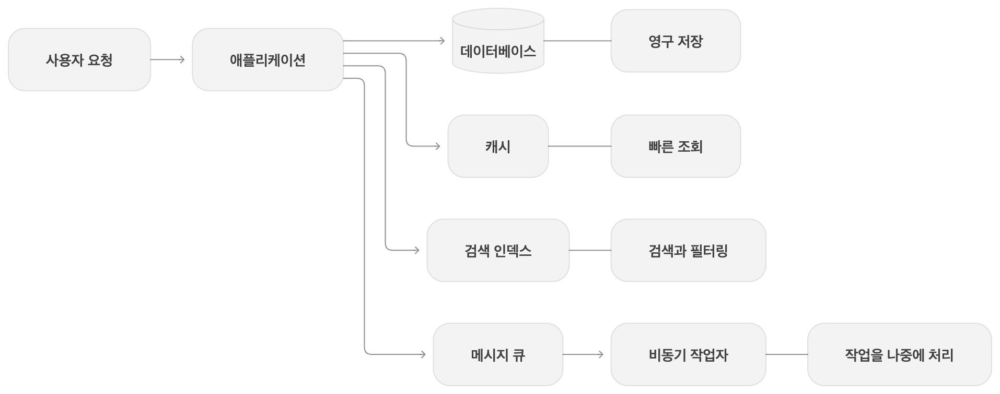
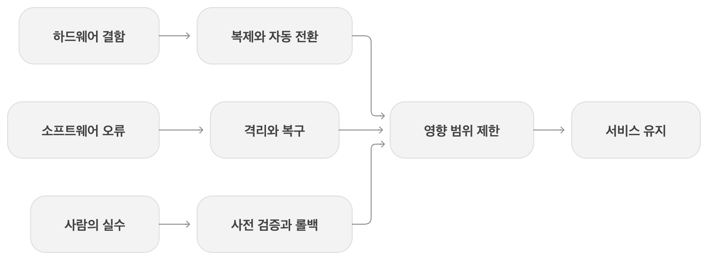
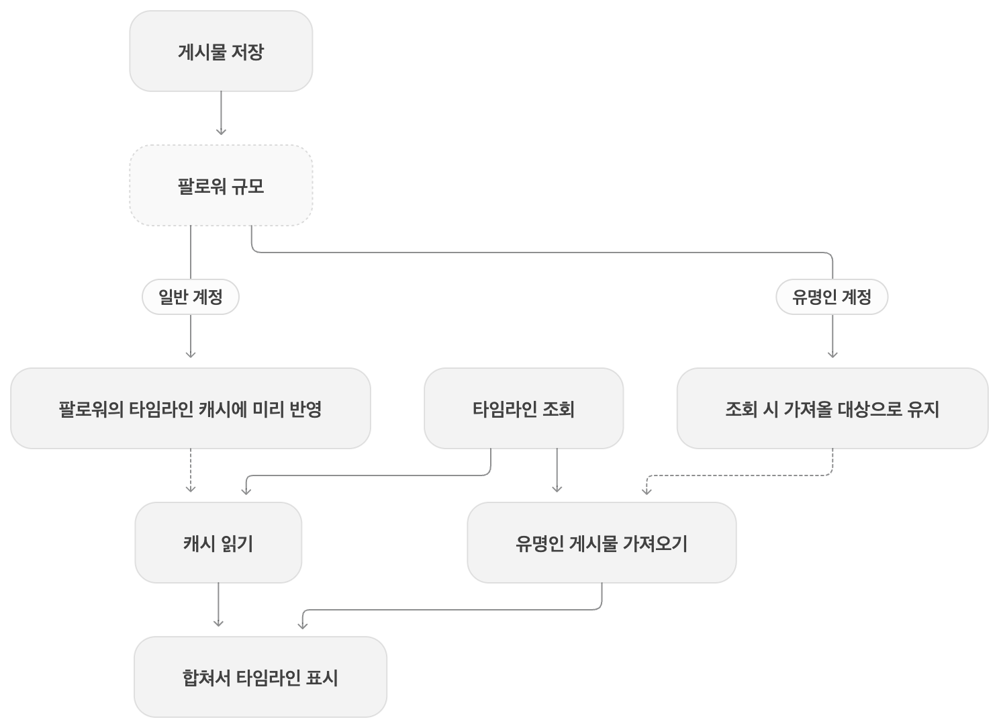
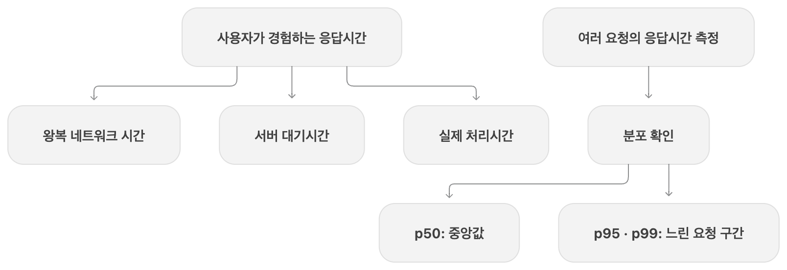
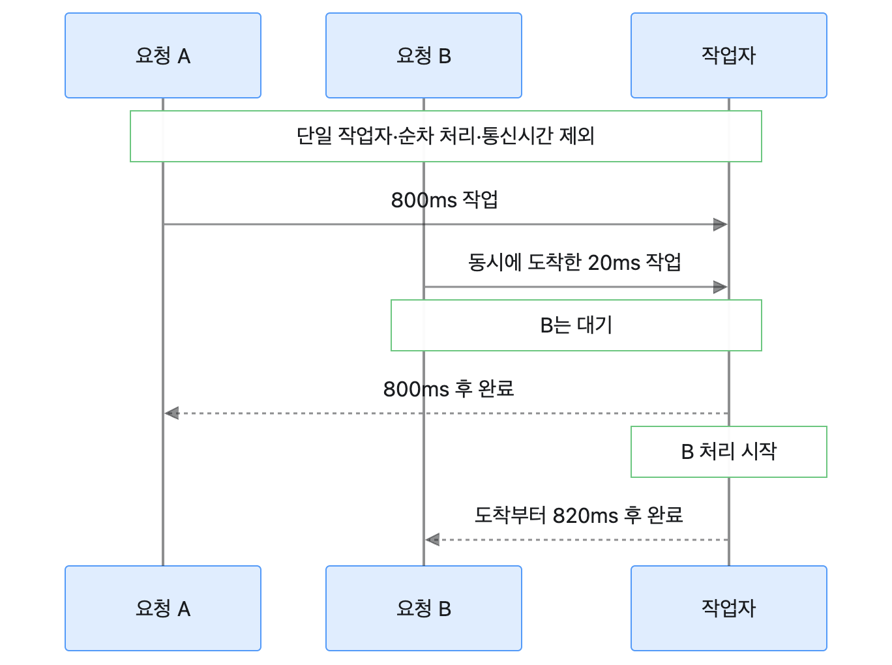
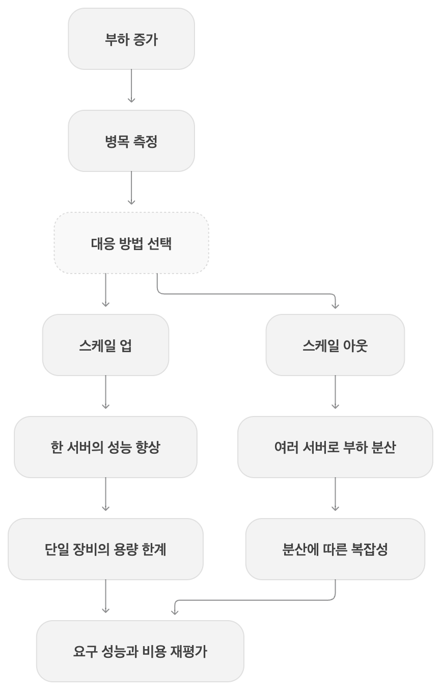
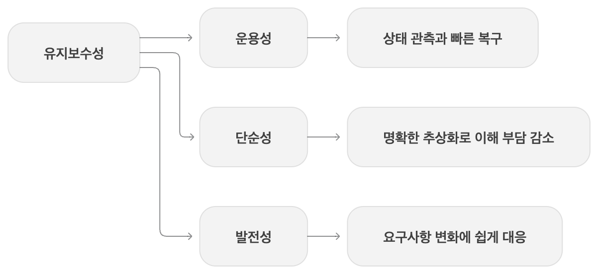
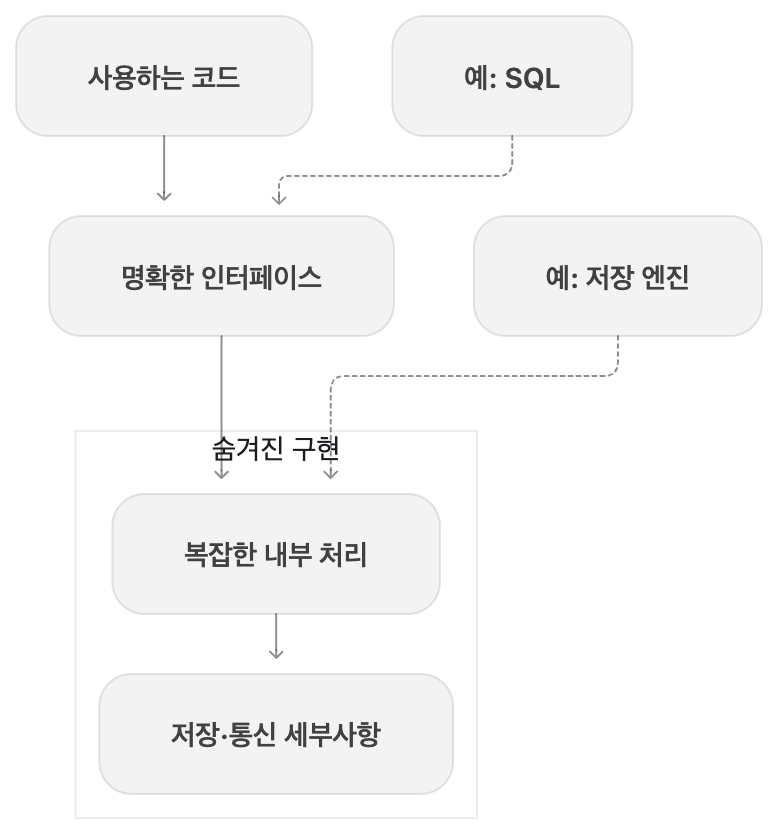

# 01. 신뢰할 수 있고 확장 가능하며 유지보수하기 쉬운 애플리케이션

## 한 줄 요약

데이터 시스템을 설계할 때는 결함이 생겨도 제 역할을 하는지, 부하가 늘면 어떻게 대응할지, 사람이 계속 운영하고 바꾸기 쉬운지를 함께 봐야 한다.

## 핵심 내용

### 데이터 중심 애플리케이션: 여러 도구를 연결한 시스템

이 장은 시스템을 어떤 기준으로 볼지에 대해 정리한다.
데이터 중심 애플리케이션에서는 CPU 계산 속도보다 데이터의 양, 복잡도, 변화 속도가 더 큰 문제가 될 수 있다.
그래서 필요한 역할에 따라 여러 도구를 조합하게 된다.

| 구성 요소 | 맡는 역할 |
| --- | --- |
| 데이터베이스 | 나중에 다시 조회할 수 있도록 데이터 저장 |
| 캐시 | 비싼 계산·조회 결과를 저장해 재사용 |
| 검색 색인 | 키워드 검색과 필터링 지원 |
| 메시지 큐·스트림 처리 | 다른 프로세스에 작업·데이터를 전달해 비동기 처리 |
| 일괄 처리 | 누적된 데이터를 한꺼번에 분석·가공 |

여기서 중요한 건 도구를 연결한 뒤의 동작도 설계 대상이라는 점이다.
데이터베이스를 수정했는데 캐시는 예전 값을 보여준다면 각 도구가 정상이어도 사용자는 잘못된 결과를 보게 된다.
검색 색인을 언제 갱신할지, 캐시를 언제 무효화할지, 갱신 중 문제가 생기면 어떻게 할지도 연결하는 쪽에서 다뤄야 한다.

책은 이 시스템을 신뢰성, 확장성, 유지보수성이라는 세 가지 관점에서 살펴본다.

### 신뢰성: 결함이 생겨도 사용자가 기대한 일을 하게 만드는 것

신뢰성은 단순히 서버가 켜져 있다는 뜻보다 넓다.
기대한 기능과 성능을 제공하고, 사용자의 실수를 어느 정도 받아들이고, 허가되지 않은 접근도 막아야 한다.

먼저 결함(fault)과 장애(failure)를 구분해야 한다.

- 결함은 시스템을 이루는 일부가 기대한 동작에서 벗어나는 것이다. 디스크 하나의 고장이 그 예다.
- 장애는 시스템 전체가 사용자에게 필요한 서비스를 제공하지 못하는 것이다.
- 따라서 부품에 결함이 생겼다고 반드시 서비스 장애로 이어지는 것은 아니다.

결함 확률을 0으로 만들기는 어려우니까 결함이 생겨도 서비스에 미치는 영향을 제한하는 구조가 필요하다.
이것이 내결함성(fault tolerance). 다만 모든 종류의 결함을 견딘다는 뜻은 아니기에 어떤 결함까지 다룰지 범위를 정해야 한다.

#### 결함 유형에 따른 대응

하드웨어 결함에는 디스크 고장, 전원 문제, 메모리 오류 등이 있다.
장비 하나의 고장은 드물어 보여도 장비가 많아지면 계속 마주칠 일이 된다.
디스크나 전원을 중복으로 두는 방법도 있고 장비 한 대가 통째로 사라져도 버티도록 소프트웨어에서 대응할 수도 있다.
후자는 노드를 한 대씩 내려 보안 패치를 적용하는 데도 도움이 된다.
다만 정전처럼 여러 장비가 공통 원인의 영향을 받을 수 있으므로 하드웨어 결함이 언제나 독립적인 것은 아니다.

소프트웨어 오류는 같은 버그를 가진 여러 노드가 함께 영향을 받을 수 있다는 점에서 까다롭다.
특정 입력에 모두 죽거나, 한 프로세스가 공유 자원을 소진하거나, 의존 서비스의 문제가 연쇄 장애로 번질 수 있다.
같은 소프트웨어를 실행하는 서버를 늘리는 것만으로는 이런 문제를 해결하기 어렵다.
환경에 대한 가정을 점검하고 테스트·프로세스 격리·재시작·모니터링을 함께 사용해야 한다.
시스템이 보장한다고 한 조건이 실행 중에도 지켜지는지 확인하는 것도 중요하다.

인적 오류는 사람에게 더 조심하라고 요구하는 것만으로 다루기 어렵다.
안전하게 실험할 환경, 실수하기 어려운 인터페이스, 변경을 되돌릴 수단을 마련하는 방향으로 접근해야 한다.
예를 들면 실제 서비스에 영향을 주지 않는 샌드박스, 점진적인 배포, 설정 롤백, 잘못 계산한 데이터의 재계산 도구가 있다.
문제가 생겼을 때 원인을 찾고 복구할 수 있도록 지표와 운영 절차도 필요하다.

고의로 프로세스를 종료하는 식의 결함 주입은, 예상한 복구 경로가 정말 동작하는지 확인하는 방법이다.
책에서는 Chaos Monkey를 예로 든다. 오류 처리 코드가 있다는 것과 실제로 버틴다는 건 별개인 셈이다.
다만 민감한 정보 유출처럼 되돌릴 수 없는 문제는 사후 복구보다 예방이 특히 중요하다.

#### 필요한 신뢰성과 비용의 판단

신뢰성은 큰 사고를 다루는 시스템에만 필요한 것은 아니다.
일상적인 서비스라도 중단이나 데이터 손실은 사용자에게 큰 피해가 될 수 있다.
그렇다고 모든 상황에 같은 비용을 쓸 수는 없으니, 시제품인지, 어떤 데이터를 맡는지, 장애의 영향이 어떤지 따져야 한다.
비용 때문에 신뢰성을 낮추기로 했다면 무엇을 감수하는 선택인지 알고 결정해야 한다.

### 확장성: 무엇이 얼마나 늘어나는지부터 정하기

확장성은 시스템에 붙이는 막연한 칭찬보다는 특정 부하가 늘 때 어떻게 대응할지에 대한 이야기.
그래서 먼저 부하 매개변수(load parameter)를 정해야 한다.

초당 요청 수, 읽기와 쓰기 비율, 동시 활성 사용자 수, 캐시 적중률 등을 사용할 수 있다.
어떤 숫자가 중요한지는 시스템마다 다르다. 평균뿐 아니라 소수의 큰 요청이나 치우친 분포가 병목을 만들 수도 있다.

#### 트위터 예시: 쓰기 한 번이 실제로는 몇 번의 일이 될까?

아래 수치는 책에서 다루는 2012년 11월 공개 자료 기준의 사례.

- 트윗 작성은 평균 초당 약 4,600건, 피크에는 12,000건 이상이었다.
- 홈 타임라인 읽기는 초당 약 300,000건이었다.
- 트윗 하나가 평균 약 75명의 팔로워에게 전달되므로, 미리 배포하면 캐시에 초당 약 345,000건을 쓰게 된다.

타임라인을 만드는 방법은 크게 둘로 나눌 수 있다.

1. 읽을 때 합치기: 트윗은 저장해 두고, 타임라인을 요청하면 팔로우한 사람들의 트윗을 모아 정렬한다.
2. 쓸 때 미리 배포하기: 트윗이 올라오면 팔로워 각자의 타임라인 캐시에 넣어 둔다. 읽을 때 할 일이 줄어든다.

읽기가 훨씬 많은 상황에서는 쓰기 시점에 일을 더 하는 게 유리할 수 있다.
그런데 팔로워가 수천만 명인 계정도 같은 방식으로 처리하면 트윗 한 번이 수천만 번의 쓰기로 커진다.
이렇게 하나의 입력이 여러 작업으로 퍼지는 팬 아웃이 핵심 부하가 된다.
평균 팔로워 수만 보고는 이런 부담을 놓칠 수 있다.

책에서 소개하는 혼합 방식은 일반 계정의 트윗은 미리 배포하고 팔로워가 아주 많은 계정은 조회할 때 합친다.
어느 한 방식을 끝까지 고집하기보다 부하의 분포에 맞춰 작업 시점을 나눈 것이다.

### 성능: 처리량과 사용자가 기다린 시간을 구분하기

부하가 늘어날 때는 두 가지 질문을 할 수 있다.
자원을 그대로 두면 성능이 얼마나 나빠지는지, 성능을 유지하려면 자원을 얼마나 늘려야 하는지다.
둘 다 비교하려면 성능을 나타낼 지표가 필요하다.

처리량(throughput)은 일정 시간에 처리한 작업의 양이다. 일괄 처리에서는 전체 데이터 처리가 끝나는 시간도 중요하다.
응답 시간(response time)은 클라이언트가 요청을 보내고 응답을 받을 때까지 걸린 시간이다.
여기에는 실제 처리 시간인 서비스 시간(service time)뿐 아니라 네트워크와 큐에서 기다린 시간도 포함된다.
책은 지연 시간(latency)을 처리되기를 기다리는 시간으로 구분해 설명한다.

같은 요청도 매번 응답 시간이 같지는 않다. GC, 네트워크 재전송, 다른 작업과의 자원 경쟁 등이 영향을 줄 수 있다.
따라서 응답 시간은 숫자 하나보다 분포로 보는 편이 좋다.

- p50은 중앙값이다. 요청의 절반 정도가 이 시간 안에 응답했다는 뜻이다.
- p95는 요청의 약 95%가 이 시간 안에 응답했다는 뜻이다.
- p99는 약 99%가 이 시간 안에 응답했다는 뜻이고, 나머지 약 1%는 더 오래 걸린다.

평균이나 p50이 좋아도 일부 요청은 아주 느릴 수 있다. 이 느린 쪽 구간을 꼬리 지연(tail latency)으로 살펴본다.
이 비율은 요청 기준이다. 사용자가 요청을 여러 번 보내면 느린 요청을 한 번이라도 겪을 가능성은 더 커질 수 있다.
응답 시간 백분위는 SLO나 SLA에서 기대하는 성능을 정할 때도 사용할 수 있다.
다만 극단적으로 드문 지연까지 줄이는 비용이 이익보다 클 수도 있으니 목표도 상황에 맞게 정해야 한다.

#### 처리는 빨랐는데 응답은 왜 느렸을까?

느린 작업이 처리 자원을 붙잡으면 뒤의 짧은 작업도 기다려야 한다. 이를 선두 차단(head-of-line blocking)이라고 한다.

이 그림은 작업자가 하나이고 순서대로 처리하며 통신 시간을 제외한 예시를 그린 것.
A가 800ms를 쓰는 동안 동시에 도착한 B는 기다린다. B 자체의 처리는 20ms여도 도착부터 완료까지는 820ms가 된다.
서버의 실제 처리 시간만 재면 이런 사용자 대기를 놓칠 수 있어서 클라이언트 쪽 응답 시간도 봐야 한다.

한 요청이 여러 백엔드를 병렬로 호출하고 모두의 응답을 기다린다면 가장 느린 호출이 전체 완료를 늦출 수도 있다.
호출 수가 많을수록 느린 호출을 하나라도 만날 가능성이 커지는 게 "꼬리 지연 증폭"이다.

부하 테스트에서도 이전 응답을 받은 뒤에만 다음 요청을 보내면 서버가 느려질수록 넣는 부하 자체가 줄어든다.
책은 이런 방식이 대기 시간을 과소평가할 수 있으므로 시험하려는 요청 부하를 응답 시간과 독립적으로 발생시켜야 한다고 설명한다.
또 여러 장비나 시간 구간의 p99를 단순 평균해 전체 p99로 볼 수는 없다. 분포를 합칠 수 있는 히스토그램 같은 형태가 필요하다.

### 부하 대응 방식과 선택의 기준

수직 확장(scale up)은 더 강한 장비로 옮기는 것, 수평 확장(scale out)은 여러 장비에 일을 나누는 것이다.
한 장비에서 처리하면 구조가 단순할 수 있지만 장비 성능과 비용에 한계가 있다.
여러 장비로 나누면 더 많은 자원을 쓸 수 있지만 특히 데이터를 가진 상태 유지 시스템에서는 복잡도가 커진다.
실제로는 적당한 사양의 장비 몇 대처럼 두 접근을 조합하는 방법도 있다.

부하에 따라 자원을 자동 추가하는 탄력성(elasticity)도 도움이 될 수 있다.
하지만 자동 확장이 항상 최선은 아니고 수동 확장이 더 단순하고 동작을 예측하기 쉬운 경우도 있다.

결국 읽기·쓰기 비율, 데이터 크기, 접근 패턴, 응답 시간 요구에 따라 선택해야 한다.
같은 양의 데이터를 처리해도 작은 요청이 아주 많은 경우와 큰 요청이 가끔 오는 경우의 구조는 달라질 수 있다.
지금의 가정이 달라지면 아키텍처도 다시 검토해야 한다. 아직 검증되지 않은 제품은 미래 규모에 대비하는 것보다 빠른 개선이 더 중요할 수 있다.

### 유지보수성: 사람이 계속 다룰 수 있게 만들기

소프트웨어는 처음 만드는 순간보다 운영하고 수정하며 보내는 시간이 길다.
여기에는 장애 조사, 버그 수정, 플랫폼 변경, 기능 추가, 기술 부채 정리까지 포함된다.
책은 유지보수성을 운용성, 단순성, 발전성이라는 세 가지 관점으로 나눈다.

운용성(operability)은 운영자가 상태를 파악하고 필요한 조치를 쉽게 할 수 있는 성질이다.
모니터링, 예측 가능한 동작, 운영 문서, 표준 도구와의 연동, 반복 작업의 자동화 등이 도움이 된다.
특정 장비를 내려도 계속 동작할 수 있어야 하고, 자동 복구가 있어도 필요할 때 사람이 개입할 수 있어야 한다.
자동화를 설정하고 제대로 작동하는지 확인하는 일도 결국 사람의 일이기 때문이다.

단순성(simplicity)은 기능을 무조건 줄이거나 코드 줄 수를 줄인다는 뜻은 아니다.
풀어야 할 문제 자체보다 구현 방식 때문에 생긴 우발적 복잡도(accidental complexity)를 줄이는 데 초점이 있다.
강한 결합, 뒤엉킨 의존성, 제각각인 용어, 임시 예외 처리가 쌓이면 시스템을 이해하고 변경하기 어려워진다.

좋은 추상화는 필요한 인터페이스를 제공하고 세부 구현을 감춰서 이런 부담을 줄여 준다.
예를 들면 SQL을 쓰는 쪽에서 저장 엔진의 내부 자료 구조를 매번 직접 다루지 않아도 된다.
내부의 복잡한 일이 사라지는 건 아니지만, 모든 사용자가 그 일을 직접 처리할 필요가 없어지는 셈이다.
공통 구성 요소를 개선하면 그걸 사용하는 여러 애플리케이션이 함께 이득을 볼 수도 있다.
다만 이름만 붙인다고 좋은 추상화가 생기는 건 아니라서, 알맞은 경계를 찾는 일 자체는 어렵다.

발전성(evolvability)은 요구사항이 달라졌을 때 시스템도 바꾸기 쉽게 만드는 성질이다.
새 기능, 플랫폼 변경, 부하 증가처럼 처음에 예상하지 못한 일이 생길 수 있다.
테스트와 리팩터링은 이런 변화에 도움이 되고, 책은 개별 코드뿐 아니라 여러 서비스로 이루어진 시스템 수준에서도 변화를 살펴본다.
타임라인을 읽을 때 합치던 구조에서 미리 배포하는 구조로 바꾸는 것도 그런 변화의 예다.
이해하기 쉬운 구조와 좋은 추상화가 결국 나중에 바꾸기 쉽게 만드는 기반이 된다.

## 남은 질문

- 캐시와 검색 색인을 함께 쓸 때, 각각 어느 정도의 갱신 지연을 허용할지 어떤 기준으로 정하면 좋을까?
- 복제본이 같은 버그나 공통 인프라에 함께 영향을 받는 상황은 어떻게 시험할 수 있을까?
- 타임라인 혼합 방식에서 미리 배포할 계정과 조회할 때 합칠 계정의 경계는 무엇으로 정할까?
- p99 목표를 정할 때 사용자 경험과 운영 비용을 어떻게 함께 비교할 수 있을까?
- 추상화를 추가하는 게 이해할 일을 줄이는 경우와, 새 계층만 늘리는 경우를 어떻게 구분할까?

## 참고 자료

- 마틴 클레프만, 『데이터 중심 애플리케이션 설계』 1장.

