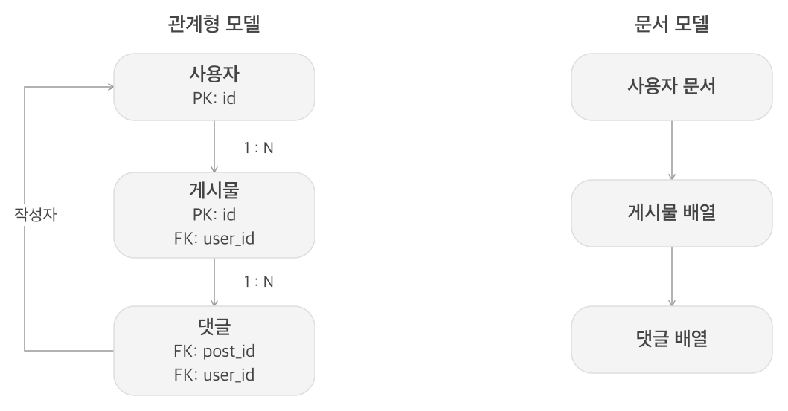
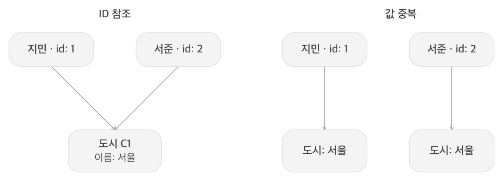
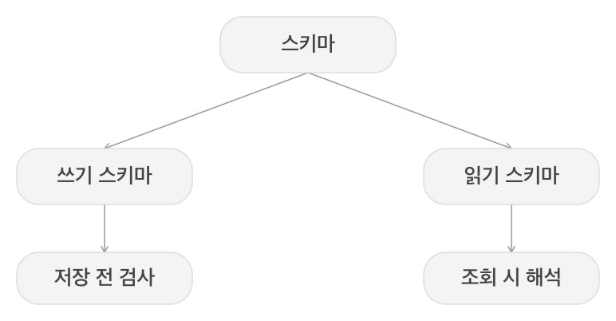
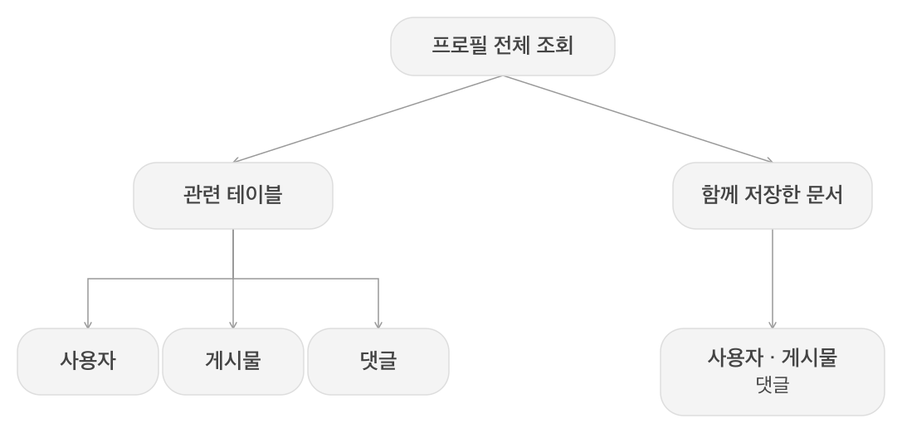
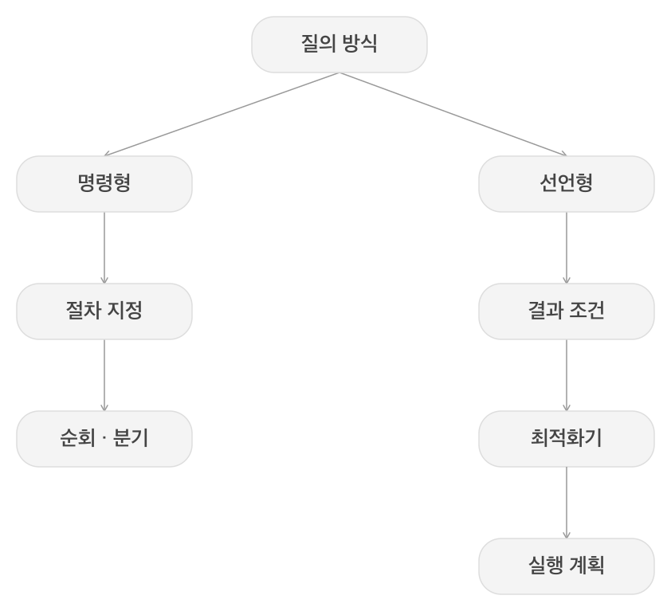
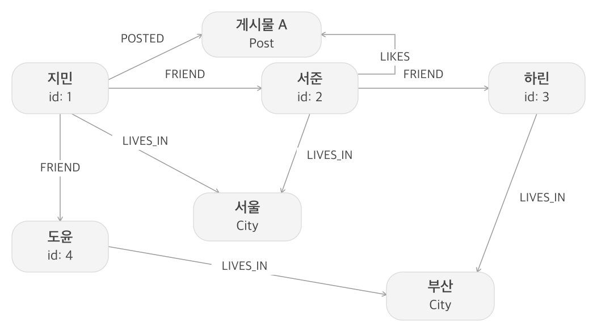
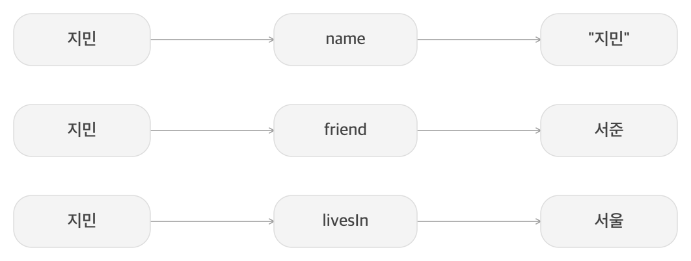
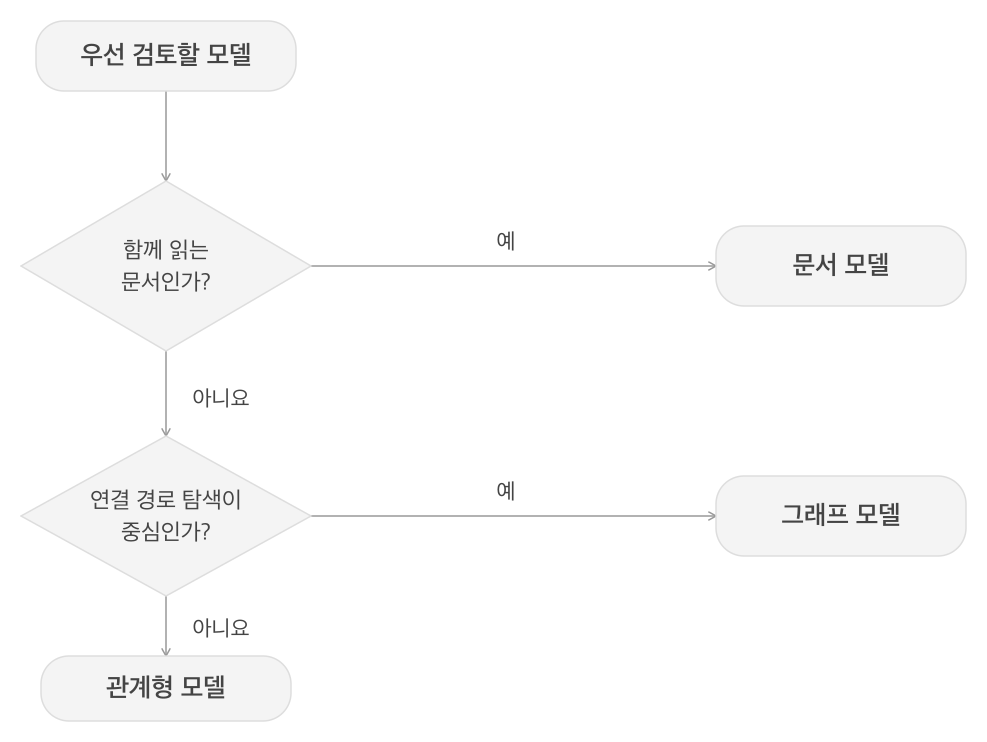

# 02. 데이터 모델과 질의 언어

## 한 줄 요약

데이터 모델은 저장 형태와 질의 방식에 대한 가정을 담고 있기에 데이터의 관계·함께 읽는 범위·변경 방식에 맞춰 선택해야 한다.

## 핵심 내용

데이터 모델은 소프트웨어를 작성하는 방법뿐 아니라 문제를 바라보는 방식에도 영향을 준다.
애플리케이션 객체와 API는 테이블·문서·그래프로 표현되고 저장소에서는 바이트로, 하드웨어에서는 물리적인 신호로 표현된다.
각 계층은 아래 계층의 복잡함을 숨기는 추상화다. 이 장은 그중 데이터의 저장과 질의에 사용하는 모델을 비교한다.

### 1. 관계형 모델과 문서 모델

#### 1.1 관계형 모델

관계형 모델은 데이터를 관계로 구성하며 SQL에서는 이를 테이블과 행으로 다룬다. 1970년 에드가 코드가 제안했다.
정보를 독립된 테이블로 나누고 키를 통해 연결하므로 같은 대상을 여러 곳에서 참조하는 구조를 표현하기 좋다.

주요 특징
- 기본 키는 각 행을 식별하고 외래 키는 다른 테이블의 행을 참조한다.
- 데이터 타입, 필수값, 고유성, 외래 키 같은 제약으로 저장할 데이터의 구조를 검사할 수 있다.
- 조인으로 테이블을 연결하고 SQL로 조회, 갱신, 집계를 표현한다.
- 구체적인 접근 경로는 질의 최적화기가 선택하므로 물리적 저장 방식과 질의를 분리할 수 있다.

예시: 사용자·게시물·댓글 스키마

```sql
CREATE TABLE users (
    id INTEGER PRIMARY KEY,
    name VARCHAR(100) NOT NULL,
    city_id VARCHAR(10)
);
CREATE TABLE posts (
    id INTEGER PRIMARY KEY,
    user_id INTEGER NOT NULL REFERENCES users(id),
    title VARCHAR(200),
    published BOOLEAN NOT NULL DEFAULT FALSE
);
CREATE TABLE comments (
    id INTEGER PRIMARY KEY,
    post_id INTEGER NOT NULL REFERENCES posts(id),
    user_id INTEGER NOT NULL REFERENCES users(id),
    body TEXT
);
```

지민은 사용자 1, 서준은 사용자 2라고 하면. 게시물 101·102는 지민이, 103은 서준이 작성했다.
댓글은 게시물과 작성자를 각각 참조한다. 사용자 이름을 게시물과 댓글에 계속 복사하지 않아도 된다.
외래 키는 참조의 유효성을 검사하는 장치. 여러 변경을 한 단위로 처리하는 트랜잭션 보장과는 구분한다.

#### 1.2 문서 모델

문서 모델은 JSON, BSON, XML 같은 중첩 구조로 관련 데이터를 묶는다.
사용자 프로필처럼 하나의 대상으로 묶어서 읽는 정보가 많다면 애플리케이션의 객체 구조와 가깝게 표현할 수 있다.

주요 특징
- 배열과 중첩 객체로 일대다 관계를 문서 안에 표현할 수 있다.
- 관련 정보가 문서에 포함돼 있다면 문서 한 건을 읽어 함께 가져올 수 있다.
- 항목마다 다른 필드나 구조를 허용하기 쉬우며 실제 검증 범위는 구현과 설정에 따라 달라진다.
- 공유되는 대상은 문서 안에 복사하거나 ID로 참조할 수 있다.

예시: 사용자와 게시물·댓글을 중첩한 문서

```json
{
  "id": 1,
  "name": "지민",
  "posts": [
    {
      "id": 101,
      "title": "게시물 A",
      "published": true,
      "comments": [{"id": 1001, "user_id": 2, "body": "잘 읽었습니다."}]
    },
    {"id": 102, "title": "게시물 B", "published": true, "comments": []}
  ]
}
```



비교: 객체 관계형 임피던스 불일치

객체는 중첩 구조를 가지기 쉽지만 정규화된 테이블은 관련 정보를 분리한다. 이 둘 사이의 표현 차이를 임피던스 불일치라고 한다.
ORM은 변환용 반복 코드를 줄이지만 객체와 테이블의 차이를 모두 숨기지는 못한다.

| 관점 | 관계형 표현 | 문서 표현 |
| --- | --- | --- |
| 관련 데이터 | 키로 연결한 여러 테이블 | 중첩 객체·배열 또는 참조 |
| 읽기 결과 | 조인 결과를 객체 구조로 조합할 수 있음 | 이미 중첩된 구조를 가져올 수 있음 |
| 변경 시 확인 | 테이블의 구조·제약과 관계 | 문서 구조·크기와 복사된 정보 |

NoSQL은 하나의 모델이 아니라 여러 비관계형 접근을 포괄하는 이름이다.
Not Only SQL이라는 해석처럼 요구에 맞는 저장소들을 함께 쓰는 다중 저장소 지속성(polyglot persistence)도 가능하다.

#### 1.3 일대다 관계: 분리해서 연결할까, 함께 넣을까?

사용자 한 명이 여러 게시물을 작성하는 것은 일대다 관계다.
관계형에서는 게시물에 작성자 ID를 두고 문서에서는 사용자 안에 게시물을 중첩할 수 있다.

예시: 지민과 지민의 게시물 조회

```sql
SELECT u.id, u.name, p.id AS post_id, p.title
FROM users AS u
LEFT JOIN posts AS p ON p.user_id = u.id
WHERE u.id = 1;
```

MongoDB에서 위 중첩 문서를 `users` 컬렉션에 저장했다면 다음처럼 조회한다.

```javascript
db.users.findOne({ id: 1 });
```

반환된 사용자 문서의 `posts` 배열에 게시물 101과 102가 포함된다.

| 기준 | 테이블로 분리 | 문서에 중첩 |
| --- | --- | --- |
| 사용자와 전체 게시물 읽기 | 조인이나 여러 조회로 구성 | 한 문서에서 함께 읽기 가능 |
| 게시물만 독립적으로 다루기 | 별도 행으로 조회·수정 | 중첩 위치와 문서 갱신 방식 고려 |
| 게시물이 계속 증가 | 관련 행 증가 | 배열·문서 크기 증가 고려 |

핵심은 일대다라는 이유만으로 중첩하는 것이 아니라 실제로 함께 읽고 변경하는 범위인가를 보는 것

#### 1.4 다대일·다대다 관계와 정규화

다대일은 여러 사용자가 같은 도시를 참조하는 관계다.
지민과 서준이 모두 서울에 산다면 각 사용자에 `서울`을 복사하거나 공통 도시 ID `C1`을 참조할 수 있다.



ID 참조의 장점

- 표시 이름이 바뀌어도 대상의 식별자는 유지할 수 있다.
- 이름을 한곳에서 바꾸므로 여러 복사본의 불일치를 줄인다.
- 동일한 표기, 현지화, 지역 계층을 이용한 검색 등을 다루기 좋다.

이렇게 중복을 줄이는 것이 정규화의 핵심. 참조한 이름이 필요하면 조인이나 추가 조회로 가져온다.
이름을 복사하는 비정규화는 읽기를 단순하게 만들 수 있지만 복사본을 갱신하는 책임도 생긴다.
문서 모델에서도 ID 참조가 가능하며 DB가 필요한 조인을 제공하지 않으면 애플리케이션이 조회 결과를 합쳐야 한다.

다대다 예시: 학생과 강좌

한 학생은 여러 강좌를 듣고 한 강좌에도 여러 학생이 등록한다.
관계형에서는 `enrollments(student_id, course_id)` 같은 연결 테이블로 표현한다.
양쪽 문서에 상대의 정보를 모두 넣으면 중복이 늘어나므로 어느 대상을 독립시키고 어떤 방향으로 참조할지 정해야 한다.

역사적 배경

IMS의 계층 모델은 트리로, CODASYL의 네트워크 모델은 개발자가 연결을 따라가는 접근 경로로 데이터를 다뤘다.
관계형 모델은 원하는 조건과 접근 경로의 선택을 분리했다. 최적화기가 실행 방법을 결정하므로 질의 코드를 덜 묶어 두는 방향이다.
문서의 중첩 구조가 트리와 닮았더라도 식별자 참조를 읽을 때 해결하는 방식까지 과거의 접근 경로 방식과 동일한 것은 아니다.

#### 1.5 스키마 유연성

DB가 구조를 강제하지 않아도 데이터를 읽는 코드는 보통 특정 필드와 타입을 기대한다.
따라서 스키마가 없다는 말보다 구조를 언제 확인하고 해석하는가로 구분하는 편이 정확하다.



| 구분 | 쓰기 스키마(schema-on-write) | 읽기 스키마(schema-on-read) |
| --- | --- | --- |
| 적용 시점 | 저장할 때 명시한 구조를 검사 | 읽는 코드가 데이터 구조를 해석 |
| 장점 | 공통 구조를 문서화하고 잘못된 입력 차단 | 항목별 구조와 여러 버전을 유연하게 수용 |
| 잘 맞는 경우 | 구조가 일정하고 공통 제약이 중요함 | 외부 입력처럼 구조를 통제하기 어려움 |
| 변경 시 책임 | 스키마, 기존 데이터, 코드 호환 | 필드 누락, 타입 차이, 이전 버전 해석 |

예시: phone 필드 추가

```sql
ALTER TABLE users ADD COLUMN phone VARCHAR(30);
```

문서에서는 새 데이터에 필드를 추가하고 읽는 쪽에서 기존 데이터를 처리할 수 있다.

```javascript
const oldUser = { id: 1, name: "지민" };
const phoneForDisplay = oldUser.phone ?? "미등록";
```

읽기 스키마도 이전 형식을 처리할 코드가 필요하다. 쓰기 스키마도 선택 필드를 추가하고 점진적으로 값을 채울 수 있다.
DDL의 시간, 잠금, 재작성 비용은 DB 구현, 버전, 변경 작업에 따라 달라진다. 스키마 변경이 언제나 즉시 끝나거나 항상 오래 걸리는 것은 아니다.

#### 1.6 데이터 지역성

지역성은 함께 필요한 데이터를 가까이 저장하는 성질이다.
프로필, 게시물, 댓글을 한꺼번에 읽는다면 중첩 문서가 분리된 정보를 찾아 조합하는 부담을 줄일 수 있다.



이점과 한계

- 문서의 많은 부분을 함께 읽을 때 묶음 저장의 이점이 크다.
- 작은 필드만 필요하다면 큰 문서 전체를 가져오는 것이 낭비일 수 있다.
- 문서 크기가 늘거나 일부를 자주 바꾸면 구현에 따라 재작성 비용이 생길 수 있다.
- 관계형도 색인, 저장 배치로 지역성을 활용하므로 모델 이름만으로 디스크 접근 횟수를 단정할 수는 없다.

관계형의 JSON, XML 지원과 문서 DB의 조인, 집계 기능처럼 두 계열의 기능은 겹치기도 한다.
문서 내부의 묶음과 문서 사이의 관계를 함께 다룰 수 있는지가 중요하다.

### 2. 질의 언어

#### 2.1 선언형과 명령형

명령형은 데이터를 순회하고 조건을 검사하는 절차를 지정한다.
선언형은 원하는 결과와 변환을 설명하고 구체적인 실행 방법은 시스템에 맡긴다.



예시: 서울에 사는 사용자 조회

도시 ID `C1`이 서울인 사용자 데이터를 사용한다.

명령형 접근 방식(JavaScript)

```javascript
function getUsersInSeoul(users) {
    const results = [];
    for (let i = 0; i < users.length; i++) {
        if (users[i].city_id === 'C1') {
            results.push(users[i]);
        }
    }
    return results;
}
```

선언형 접근 방식(SQL)

```sql
SELECT * FROM users WHERE city_id = 'C1';
```

선언적 프로그래밍이 더 나은 이유

- DB가 결과를 구하는 실행 계획을 선택할 수 있다.
- 조건에 적합한 색인이 있다면 이를 자동으로 활용할 수 있다.
- 실행 방법을 고정하지 않아 병렬화할 기회를 얻을 수 있다.
- 순회 절차 대신 결과의 조건을 표현하므로 코드가 짧고 명확해진다.
- 직접 작성할 제어 흐름과 상태 변경이 줄어 버그 발생 여지도 줄일 수 있다.

#### 2.2 SQL: 조회와 조인,집계

SQL은 데이터의 조건, 연결, 집계를 선언적으로 표현한다.
조회는 `SELECT`, 추가/변경/삭제는 각각 `INSERT`, `UPDATE`, `DELETE`로 나타낸다.

자주 쓰는 질의 구성

| 구문 | 역할 |
| --- | --- |
| WHERE | 행을 조건으로 필터링 |
| JOIN | 관련 테이블 연결 |
| GROUP BY | 같은 키로 묶어 집계 |
| HAVING | 집계된 그룹에 조건 적용 |
| ORDER BY | 결과 정렬 |
| 서브쿼리 | 다른 질의의 결과를 조건이나 입력으로 사용 |

예시: 사용자별 게시물 수

```sql
SELECT u.id, u.name, COUNT(p.id) AS post_count
FROM users AS u
LEFT JOIN posts AS p ON p.user_id = u.id
GROUP BY u.id, u.name
ORDER BY u.id;
```

지민은 2건, 서준은 1건이다. `LEFT JOIN`은 게시물이 없는 사용자도 남기며 `COUNT(p.id)`는 실제 연결된 게시물만 센다.
집계 뒤 2건 이상인 사용자만 남기려면 `HAVING COUNT(p.id) >= 2`를 적용한다.

예시: 서울 거주자가 작성한 게시물

```sql
SELECT id, title FROM posts
WHERE user_id IN (SELECT id FROM users WHERE city_id = 'C1');
```

이 데이터에서는 두 사용자 모두 C1에 살기 때문에 게시물 101/102/103이 해당한다.

#### 2.3 MapReduce

MapReduce는 대량 데이터를 나눠 처리하는 프로그래밍 모델이다.
사용자는 변환과 집계 함수를 작성하고 프레임워크는 실행과 같은 키의 그룹화를 맡는다.


처리 단계

1. 입력: 각 게시물 레코드를 읽는다.
2. map: 작성자 ID를 키로 삼아 `(user_id, 1)`을 만든다.
3. shuffle: 같은 작성자 ID의 값들을 모은다.
4. reduce: 작성자별 값을 합산한다.
5. 출력: 작성자별 게시물 개수를 얻는다.

예시: 게시물 세 건의 처리

```text
입력: 101(작성자 1), 102(작성자 1), 103(작성자 2)
map: (1, 1), (1, 1), (2, 1)
shuffle: 1 → [1, 1], 2 → [1]
reduce·출력: 1 → 2건, 2 → 1건
```

변환과 집계 로직은 다음처럼 표현할 수 있다. 함수 호출, 그룹화는 프레임워크가 담당한다고 가정한 설명용 함수.

```javascript
function mapPost(post) {
    return [post.user_id, 1];
}
function reduceCounts(values) {
    return values.reduce((total, value) => total + value, 0);
}
```

같은 계산은 `SELECT user_id, COUNT(*) FROM posts GROUP BY user_id`로도 표현할 수 있다.

SQL과 비교

| 관점 | SQL | MapReduce |
| --- | --- | --- |
| 작성하는 것 | 원하는 결과와 집계 조건 | map, reduce의 함수 로직 |
| 추상화 | 고수준 선언형 질의 | 함수 로직과 프레임워크 실행을 결합 |
| 구현 부담 | 일반적인 조인, 집계를 간결하게 표현 | 연결된 함수들을 맞춰 작성 |
| 실행 | 최적화기가 실행 계획 선택 | 프레임워크가 분배/그룹화/재실행 담당 |

책은 MapReduce를 완전한 선언형도 전체 절차를 정하는 명령형 API도 아닌 중간 형태로 설명한다.
SQL도 분산 실행할 수 있으며 사용자 정의 로직이 MapReduce에만 가능한 것도 아니다.

#### 2.4 집계 파이프라인

집계 파이프라인은 필터, 그룹화, 정렬 같은 연산을 단계로 연결해 문서들을 변환한다.
함수 두 개를 직접 맞추는 대신 각 단계의 의도를 표현하므로 일반적인 집계를 읽기 쉽게 만들 수 있다.


예시: 공개 게시물의 작성자별 개수

집계 입력은 사용자 문서에 중첩된 배열 대신 게시물을 한 건씩 저장한 `posts` 컬렉션이라고 하자.
게시물 101·102의 `user_id`는 1, 103은 2이며 세 게시물 모두 `published: true`다.

```javascript
db.posts.aggregate([
    { $match: { published: true } },
    { $group: { _id: "$user_id", post_count: { $sum: 1 } } },
    { $sort: { post_count: -1, _id: 1 } }
]);
```

- `$match`: 공개 게시물만 남긴다.
- `$group`: 작성자 ID로 묶고 각 레코드를 1씩 더한다.
- `$sort`: 개수 내림차순, 같은 개수라면 ID 오름차순으로 정렬한다.

같은 집계를 SQL로 표현하면 다음과 같다.

```sql
SELECT user_id, COUNT(*) AS post_count
FROM posts
WHERE published = TRUE
GROUP BY user_id
ORDER BY post_count DESC, user_id ASC;
```

두 결과는 작성자 1의 2건, 작성자 2의 1건이다.
SQL과 파이프라인은 제공된 연산으로 질의 의도를 표현하고 MapReduce는 변환/집계 함수의 로직을 직접 표현하는 쪽에 가깝다.

### 3. 그래프 데이터베이스

#### 3.1 속성 그래프

그래프는 대상인 노드와 대상 사이의 관계인 간선으로 데이터를 표현한다.
속성 그래프에서는 노드와 간선 모두 키, 값 형태의 속성을 가질 수 있다.

**구성 요소**

- 노드: 고유 식별자, 속성, 들어오고 나가는 간선.
- 간선: 고유 식별자, 시작과 끝 노드, 관계 레이블, 속성.
- 서로 다른 종류의 노드와 관계를 하나의 그래프에 함께 둘 수 있다.



예시에서는 지민→서준→하린, 지민→도윤의 `FRIEND` 관계가 있다.
지민·서준은 서울에, 하린·도윤은 부산에 산다. 지민은 게시물 A를 작성했고 서준은 그 게시물을 좋아한다.
이름은 노드의 속성, 거주와 친구는 다른 노드를 연결하는 간선으로 표현된다.
관계에 생성 시점 같은 속성을 추가하면 대상의 속성과 관계 자체의 속성도 구분할 수 있다.

#### 3.2 Cypher로 그래프 질의하기

Cypher는 노드와 관계의 패턴을 선언하는 언어다. 괄호는 노드를, 화살표는 관계의 방향을 나타낸다.
다음 질의들은 그림의 방향을 따라 탐색한다. 친구 관계를 양방향으로 볼지는 별도로 정해야 한다.

예시 1: 지민의 친구

```cypher
MATCH (:Person {name: '지민'})-[:FRIEND]->(friend:Person)
RETURN friend.name;
```

결과는 서준과 도윤이다.

예시 2: 친구를 제외한 친구의 친구

```cypher
MATCH (me:Person {name: '지민'})-[:FRIEND]->()
      -[:FRIEND]->(candidate:Person)
WHERE candidate <> me AND NOT (me)-[:FRIEND]->(candidate)
RETURN DISTINCT candidate.name;
```

서준을 거쳐 하린에 도달한다. 자기 자신과 친구를 제외하며 같은 사람에게 여러 경로로 도달할 수 있어 중복을 제거한다.

예시 3: 지민과 같은 도시에 사는 사람

```cypher
MATCH (me:Person {name: '지민'})-[:LIVES_IN]->(city:City)
      <-[:LIVES_IN]-(other:Person)
WHERE other <> me
RETURN other.name, city.name;
```

결과는 서준과 서울이다. 공유하는 도시 노드를 통해 두 사람을 연결한다.

#### 3.3 SQL로 그래프를 질의한다면?

그래프도 노드, 간선 테이블이나 `friendships(user_id, friend_id)` 같은 관계형 구조로 표현할 수 있다.
고정된 두 단계의 친구 탐색은 자기 조인으로 나타낼 수 있다.

```sql
SELECT DISTINCT f2.friend_id
FROM friendships AS f1
JOIN friendships AS f2 ON f1.friend_id = f2.user_id
WHERE f1.user_id = 1;
```

이 질의는 두 단계로 도달한 ID를 찾는 핵심 부분이다. 위 Cypher처럼 추천 후보를 만들려면 자기 자신과 친구를 제외하는 조건도 필요하다.

| 탐색 | Cypher 등 그래프 질의 | SQL |
| --- | --- | --- |
| 직접 연결 | 한 관계 패턴 | 단순 조회, 조인 |
| 고정된 두 단계 | 관계 패턴 두 개 | 자기 조인 |
| 깊이가 가변적인 경로 | 가변 길이 경로 패턴 | 재귀 CTE 등으로 반복 확장 |

`WITH RECURSIVE`는 시작 집합에서 다음 연결을 반복해서 확장하는 질의를 표현한다.
차이는 SQL로 가능한지보다 얼마나 자연스럽게 표현되는지에 있다. 실제 성능은 데이터, 색인, 탐색 범위에 따라 확인해야 한다.

#### 3.4 트리플 저장소와 RDF·SPARQL

트리플 저장소는 모든 정보를 주어(subject), 서술어(predicate), 목적어(object)로 표현한다.
목적어가 문자열·숫자이면 속성처럼 다른 대상이면 간선처럼 해석할 수 있다.



예시: Turtle로 표현한 RDF

```turtle
@prefix ex: <urn:example:> .
ex:jimin ex:name "지민" ;
         ex:friend ex:seojun ;
         ex:livesIn ex:seoul .
ex:seojun ex:name "서준" .
ex:seoul ex:name "서울" .
```

RDF는 사실을 표현하는 데이터 모델이고 Turtle과 RDF/XML은 기록 구문이다.
식별자에 URI 등을 사용해 서로 다른 데이터의 이름 충돌을 줄일 수 있다.
SPARQL은 이런 RDF의 트리플 패턴을 질의하는 언어다.

예시: 지민의 친구 이름 조회

```sparql
PREFIX ex: <urn:example:>
SELECT ?friendName WHERE {
    ?person ex:name "지민" .
    ?person ex:friend ?friend .
    ?friend ex:name ?friendName .
}
```

결과는 서준이. 친구 노드를 찾은 뒤 그 노드의 이름 사실을 연결한다.
RDF는 시맨틱 웹과 관련되지만 트리플 저장소는 내부 애플리케이션에도 사용할 수 있다. 웹 전체에 데이터를 공개해야 하는 것은 아니다.

#### 3.5 그래프가 잘 맞는 경우

- 소셜 관계: 친구, 팔로우를 이어 추천 후보나 연결을 찾는 경우.
- 추천, 지식 그래프: 사람·상품·주제 등 서로 다른 대상의 관계를 함께 탐색하는 경우.
- 거래, 의존성 분석: 여러 계좌나 시스템을 거치는 경로와 패턴이 중요한 경우.

다대다 관계 자체는 관계형도 잘 표현한다. 그래프의 필요성은 여러 종류의 연결을 반복해서 따라가는 질의가 중심인가에서 더 분명해진다.

책에서 추가로 다루는 Datalog는 사실과 규칙을 조합해 관계를 도출한다.
직접 연결로 도달할 수 있다는 규칙에 중간 대상을 거쳐서도 도달할 수 있다는 재귀 규칙을 더하는 식이다.
작은 규칙을 재사용해 복잡한 질의를 구성한다는 점이 특징이다.

### 4. 데이터 모델 선택

모델 선택은 데이터의 모양뿐 아니라 읽기, 쓰기, 변경의 패턴까지 함께 보는 일이다.



| 기준 | 관계형 모델 | 문서 모델 | 그래프 모델 |
| --- | --- | --- | --- |
| 데이터 구조 | 테이블과 행 | 중첩 문서·배열 | 노드와 간선 |
| 스키마 | 명시적인 타입·제약을 두기 쉬움 | 다양한 구조 수용과 검증 범위 선택 | 노드·관계의 유형과 속성 설계 |
| 관계 표현 | 키와 연결 테이블·조인 | 중첩 또는 ID 참조 | 관계를 독립된 간선으로 표현 |
| 질의 방식 | SQL의 필터·조인·집계 | 문서 질의·집계 파이프라인 등 | Cypher·SPARQL 등의 관계 패턴 |
| 강점 | 여러 데이터의 조합과 공통 제약 관리 | 객체와 가까운 구조, 묶음 단위 접근 | 연결 중심 표현과 경로 탐색 |
| 확인할 한계 | 객체 변환·질의와 색인 설계 | 큰 문서·복사본 갱신·참조 처리 | 관계 의미·탐색 범위·실행 비용 |
| 적용 예시 | 주문·재고·매출 보고 | 구조가 다양한 콘텐츠 | 추천·소셜 관계·의존성 탐색 |

구체적인 선택 예시

- 은행 업무: 계좌·거래의 구조와 여러 변경을 묶는 보장이 중요하다. 관계형과 트랜잭션을 우선 검토할 수 있다. ACID 지원은 관계형만의 독점적인 속성은 아니다.
- 콘텐츠 관리: 글마다 다른 메타데이터를 함께 읽는다면 문서가 자연스럽다. 작성자처럼 공유되는 정보와 무한히 늘어날 댓글은 별도 참조도 고려한다.
- 소셜 서비스: 친구와 관심사를 여러 단계로 연결하는 추천이 핵심이라면 그래프 표현을 검토한다. 단순 프로필 목록은 관계형으로도 충분할 수 있다.

관계형 안에서 JSON을 쓰거나 여러 저장소를 조합하는 선택도 가능하다.

정리할 세 가지

1. 함께 읽고 변경하는 데이터의 경계를 먼저 정한다.
2. 공유하는 대상과 중복 데이터의 갱신 책임을 드러낸다.
3. 필요한 질의를 작성해 보고 표현의 복잡도와 실제 실행 비용을 비교한다.

## 남은 질문

- 사용자 문서 안에 게시물을 넣는다면 언제 독립된 컬렉션으로 분리하는 것이 좋을까?
- 이름을 복사한 조회용 데이터를 만든다면 원본 변경과 동기화 실패는 어떻게 다룰까?
- 새 필드를 추가할 때 이전 데이터와 구버전 코드의 호환성은 어떻게 유지할까?
- 그래프 탐색에서 순환·경로 수 증가·탐색 깊이는 어떻게 제한할까?

## 참고 자료
- 마틴 클레프만, 『데이터 중심 애플리케이션 설계』 2장.