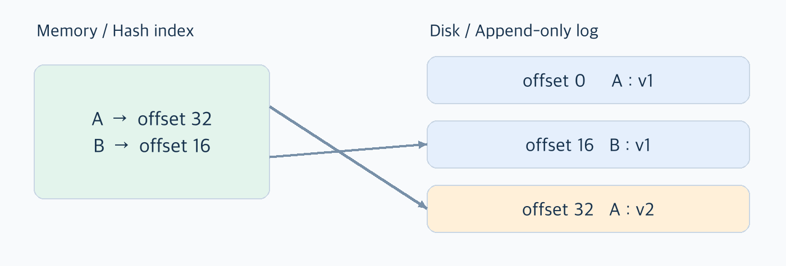
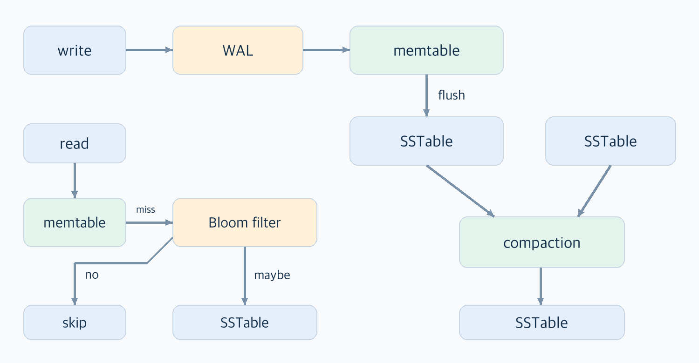
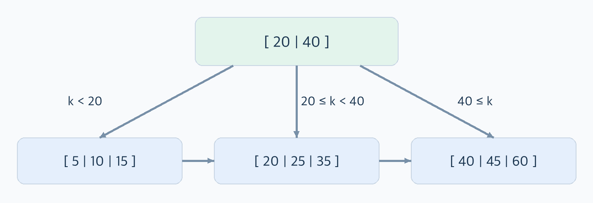
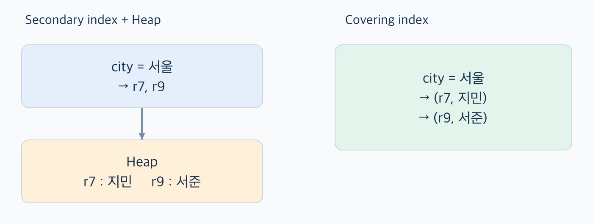
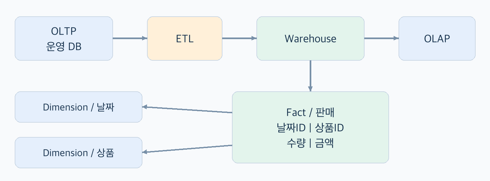
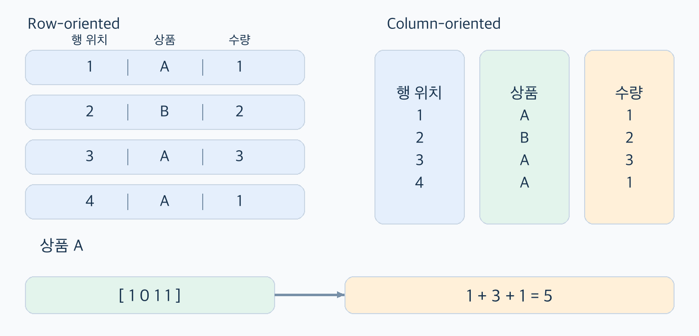

# 03. 저장소와 검색

## 이번에 답하려는 질문

- 파일 끝에 데이터를 계속 붙이면 쓰기는 쉬운데 원하는 값은 어떻게 빨리 찾을까?
- LSM 트리와 B 트리는 같은 정렬된 데이터를 왜 다르게 저장할까?
- 주문 한 건 조회와 한 달 매출 집계에 같은 저장 방식이 적합할까?

## 먼저 짚고 갈 용어

| 용어 | 여기서는 이렇게 이해하기 |
| --- | --- |
| 로그(log) | 레코드를 뒤에 계속 붙이는 기록. 오류 메시지 파일만을 뜻하지 않는다 |
| 색인(index) | 원하는 데이터를 빨리 찾기 위해 원본에서 만들어 둔 탐색 구조 |
| 오프셋(offset) | 파일의 시작에서 얼마나 떨어져 있는지를 나타내는 위치 |
| 세그먼트(segment) | 큰 로그를 관리하기 좋게 나눈 파일 단위 |
| 컴팩션(compaction) | 같은 키의 오래된 버전 등 불필요한 기록을 정리하는 작업 |
| SS테이블(SSTable) | 키 순서로 정렬해 저장한 키-값 파일 |
| 멤테이블(memtable) | 아직 파일로 내리지 않은 쓰기를 모아 두는 메모리의 정렬된 구조 |
| WAL | 장애 후 복구할 수 있도록 변경을 먼저 기록하는 로그 |
| OLTP / OLAP | 소수 레코드의 빠른 읽기, 쓰기 / 많은 레코드를 읽는 분석 작업 |

## 핵심 내용

3장은 DB 안에서 그 데이터를 어떻게 저장하고 다시 찾는지를 설명한다.
같은 `get(key)`라도 해시 맵에서 위치를 찾을 수 있고, 여러 파일을 확인할 수도 있고, 트리 페이지를 따라 내려갈 수도 있다.

이 장은 새로운 용어를 각각 외우기보다 한 방법에서 생긴 문제가 다음 구조에서 어떻게 해결되는지 따라가면 연결된다.
파일에 추가하기 → 위치를 색인으로 찾기 → 키를 정렬하기 → 읽고 쓰는 작업에 맞춰 구조 고르기의 순서로 정리했다.

### 1. 가장 단순한 저장소에서 색인까지

#### 1.1 값을 바꿀 때 기존 데이터를 꼭 수정해야 할까?

키와 값을 파일 끝에 계속 붙이는 저장소를 생각해보자.

```text
기록 순서     key       value
1             user:1    서울
2             user:2    부산
3             user:1    제주
```

`user:1`의 값은 `서울`에서 `제주`로 바뀌었다. 기존 줄을 고치지 않고 새 값을 한 줄 더 적었다.
조회할 때 같은 키의 마지막 기록을 반환하면 된다. 이런 식의 추가 전용 로그는 쓰기 방법이 단순하다.

문제는 읽기다. 별도 단서가 없으면 파일 전체를 읽어야 마지막 값을 알 수 있다.
레코드 수가 n이라면 이런 조회의 비용은 O(n)이다. 데이터가 쌓일수록 한 건을 찾는 일도 오래 걸린다.
순차 추가 자체는 유리하지만 실제 쓰기 시간에는 레코드 크기와 디스크 동기화 비용도 들어간다.

#### 1.2 어디에 있는지 따로 적어 두면?

색인(index)은 데이터를 찾는 데 필요한 단서다. 원본을 처음부터 뒤지는 대신 필요한 위치로 이동하게 해준다.
원본에서 다시 만들 수 있는 구조지만 원본이 바뀌면 색인도 맞춰 바꿔야 한다.

| 색인이 없을 때 | 색인이 있을 때 |
| --- | --- |
| 원본만 기록 | 원본과 색인을 함께 갱신 |
| 조회할 때 직접 검색 | 색인으로 읽을 범위를 좁힘 |
| 별도 색인 공간이 필요 없음 | 색인 공간과 유지 비용 발생 |

색인은 읽는 일을 미리 준비해 두는 셈이다. 조회는 빨라질 수 있지만 그 준비를 쓰기 때마다 해야 한다.
그래서 모든 열에 색인을 만드는 것보다 실제로 자주 사용하는 조건을 먼저 살펴봐야 한다.

### 2. 해시 색인: 키에서 최신 위치로 바로 이동하기

메모리의 해시 맵에 `키 → 파일의 바이트 오프셋`을 저장하면 어떨까?
새 값을 파일에 추가할 때마다 맵이 가리키는 위치도 바꾼다.



그림에서 `A`는 처음에 `v1`이었지만 나중에 `v2`가 추가됐다.
해시 맵이 최신 위치인 `offset 32`를 가리키므로 읽을 때는 그곳으로 이동하면 된다.
메모리 해시 탐색은 평균 O(1)이다. 다만 값을 실제로 가져오는 시간에는 디스크 접근과 값의 크기도 영향을 준다.

책의 비트캐스크(Bitcask)가 이런 방식을 이해하는 예다.
전체 키의 색인이 메모리에 들어간다면 같은 키의 값이 자주 바뀌어도 최신 위치를 빠르게 찾을 수 있다. 값 전체까지 메모리에 둘 필요는 없다.

#### 2.1 파일이 계속 커지는 문제는?

로그를 일정 크기의 세그먼트로 나눈다. 현재 파일에만 추가하고 다 쓴 파일은 닫아서 변경하지 않는다.
그다음 오래된 파일들을 정리한다.

- 컴팩션: 같은 키가 여러 번 기록되어 있으면 필요한 최신 기록만 남긴다.
- 병합: 여러 세그먼트를 하나로 합친다. 컴팩션과 함께 진행할 수 있다.
- 삭제 표시(tombstone): 키를 지웠다는 기록을 남겨 과거 파일의 값이 다시 조회되지 않게 한다.

새 파일을 만드는 동안에는 기존 파일로 읽기를 처리하고, 준비가 끝나면 새 파일을 사용하도록 전환한다.
삭제 표시도 바로 버리면 안 된다. 더 오래된 값이 다시 살아날 가능성이 없어지는 조건에서 제거해야 한다.

#### 2.2 단순해 보여도 복구까지 생각해야 한다

| 상황 | 필요한 처리 |
| --- | --- |
| 재시작해서 메모리 색인이 사라짐 | 세그먼트를 읽거나 힌트 파일을 사용해 색인 복원 |
| 레코드를 쓰던 중 중단됨 | 길이, 체크섬 등으로 불완전하거나 손상된 기록 탐지 |
| 읽기와 쓰기가 동시에 발생 | 파일 추가, 색인 갱신, 파일 교체 순서 보장 |
| 지운 값이 과거 파일에 남아 있음 | 삭제 표시를 필요한 병합 단계까지 유지 |

여기서 생기는 한계: 키가 너무 많으면 색인을 메모리에 두기 어렵다.
또 해시 맵은 키 순서를 알려주지 않는다. 한 키를 찾는 데는 좋지만 정렬된 범위를 읽는 데는 불리하다.
이 문제에서 다음의 SS테이블로 이어진다.

### 3. SS테이블과 LSM 트리: 정렬해서 쓰고 나중에 합친다

#### 3.1 키를 정렬해 두면 무엇이 달라질까?

SS테이블(Sorted String Table, SSTable)은 키 순서로 정렬된 키-값 파일이다.
책의 기본 설명에서는 한 파일 안에 각 키가 한 번씩 들어간다. 서로 다른 파일에는 같은 키의 여러 버전이 있을 수 있다.

정렬되어 있으면 모든 키의 위치를 메모리에 적지 않아도 된다.
예를 들어 `apple`과 `banana`의 위치를 안다면, `avocado`는 그 사이에서 찾으면 된다.
이렇게 일부 키와 위치만 저장하는 것이 희소 색인(sparse index)이다.

| 정렬 덕분에 가능한 일 | 이유 |
| --- | --- |
| 파일 병합 | 각 파일의 다음 키를 비교하며 순서대로 읽고 쓸 수 있음 |
| 작은 색인 유지 | 일부 키의 위치만으로 검색 구간을 좁힐 수 있음 |
| 범위 조회 | 시작 위치를 찾은 뒤 필요한 범위를 순서대로 읽음 |
| 블록 압축 | 레코드를 묶어 압축하고 색인이 블록의 시작을 가리킴 |

파일이 여러 개라면 범위 조회 결과도 병합해야 한다.

#### 3.2 입력은 순서 없이 들어오는데 어떻게 정렬할까?

매번 디스크 파일에 정렬해서 끼워 넣는 대신 먼저 메모리에 모은다.
이때 쓰는 정렬된 구조가 멤테이블(memtable)이다.



1. 복구용 로그에 변경을 남긴다. 언제 디스크에 동기화하느냐에 따라 내구성 보장 시점이 달라진다.
2. 멤테이블에 값을 반영한다.
3. 충분히 커지면 멤테이블을 동결하고 SS테이블로 디스크에 내린다. 새 쓰기는 새 멤테이블이 받는다.
4. 백그라운드에서 파일을 병합하고 필요 없어진 버전과 삭제 표시를 정리한다.

이 구조가 LSM 트리(Log-Structured Merge-Tree)다.
메모리에 모으기, 정렬된 파일로 내리기, 파일들을 계속 병합하기가 연결되어 있다.

그런데 멤테이블만 쓰면 장애가 났을 때 아직 파일로 내려가지 않은 변경이 사라진다.
그래서 별도 로그가 필요하다. 재시작 시 로그를 재생해 복원하고 대응하는 SS테이블이 안전하게 기록되면 필요 없어진 로그를 정리한다.

멤테이블은 쓰기를 받아 정렬하는 역할이고 로그는 그 메모리 내용이 사라졌을 때 복구하는 역할이다.
둘 다 최근 변경을 다루지만 필요한 이유가 다르다.

#### 3.3 여러 파일에 같은 키가 있으면 무엇을 읽을까?

기본 흐름은 현재 멤테이블, 플러시 중인 멤테이블, 최신 SS테이블부터 확인하는 것이다.
같은 키의 여러 버전 중 최신 값을 사용하고 삭제 표시를 만나면 과거 값을 반환하지 않는다.
실제 레벨 구조에서는 파일의 키 범위와 버전 정보를 사용해 읽을 후보를 좁힌다.

없는 키를 찾는 것도 비용이다. 없다는 사실을 확인하려고 여러 파일을 열 수 있기 때문이다.
블룸 필터는 읽지 않아도 될 파일을 거르는 데 도움을 준다.

| 필터 결과 | 다음 행동 |
| --- | --- |
| 없다 | 그 필터가 나타내는 파일은 건너뛰기 |
| 있을 수 있다 | 오탐일 수 있으므로 실제 파일이나 색인 확인 |

정상적으로 구성·유지된 필터는 거짓 양성은 허용하지만 거짓 음성은 만들지 않는다.
파일 하나의 필터가 `없다`고 했다고 DB 전체에 없다는 뜻은 아니다.

#### 3.4 컴팩션에도 여러 방법이 있다

- 크기 계층: 비슷한 크기의 파일들을 묶어 더 큰 파일로 만든다. 병합 전까지 중복 버전과 여러 파일이 남을 수 있다.
- 레벨: 키 범위로 나눈 파일들을 여러 레벨로 관리한다. 보통 L0를 제외한 같은 레벨의 파일 범위는 겹치지 않게 한다. 읽을 후보와 공간 사용을 줄이는 대신 재작성 비용을 고려한다.

파일을 정리하는 작업도 디스크 대역폭을 사용한다.
컴팩션이 새 쓰기를 따라가지 못하면 파일이 쌓여 읽기도 느려지고 엔진에 따라 쓰기가 제한될 수 있다.

데이터를 받아들이는 속도뿐 아니라 뒤에서 정리하는 속도도 함께 봐야 지속적인 쓰기 성능을 알 수 있다.

### 4. B 트리: 필요한 페이지를 찾아 갱신한다

#### 4.1 큰 파일 대신 페이지로 나누기

B 트리도 키를 정렬해서 유지한다. 다만 큰 불변 파일을 새로 만드는 방식과 달리 데이터를 고정 크기의 페이지(page)로 나눈다.
책에서는 전통적인 예로 4KB를 들지만 실제 크기는 저장소 엔진마다 다르다.



루트에서 키 범위를 고르고 자식 페이지를 따라가면 최종적으로 리프에 도달한다.
그림에서 `25`를 찾는다면 `20 ≤ k < 40`인 가지를 따라간다. 리프에는 값이나 그 값을 찾을 참조가 있다.

한 페이지가 여러 자식을 가리킬 수 있어 데이터가 많아도 트리가 비교적 얕다.
이 자식 수를 분기 계수(branching factor)라고 한다.

그림은 데이터를 리프에 두고 리프끼리 연결한 B+ 트리의 단순 예시다.
`25`부터 `45`까지 읽는다면 시작 리프를 찾고 형제 링크로 다음 리프를 읽을 수 있다.
다만 키 순서가 가깝다고 디스크의 물리적 위치까지 가까운 것은 아니다.

#### 4.2 꽉 찬 페이지에 새 키를 넣으면?

기존 키의 값은 해당 페이지에서 갱신한다.
새 키를 넣을 공간이 없으면 페이지를 둘로 나누고 부모의 경계와 참조도 바꾼다.
부모도 가득 찼다면 분할이 위로 이어질 수 있다. 이 과정에서도 트리의 균형은 유지한다.

여러 페이지를 바꾸다 중단되면 일부만 기록될 수 있다.
일반적으로 변경을 WAL(write-ahead log)에 먼저 남기고 페이지에 반영해서, 장애 후 일관된 상태로 복구한다.
일부 구현은 바뀐 페이지를 새 위치에 쓰는 쓰기 시 복사(copy-on-write)를 사용한다.
동시에 접근하는 스레드가 변경 중인 트리를 잘못 읽지 않도록 래치 같은 보호도 필요하다.

B 트리를 이해할 때는 검색 경로뿐 아니라 페이지를 갱신하고 나누는 과정도 봐야 한다.
조회용 트리도 실제 DB에서는 쓰기 중단과 동시 접근을 견뎌야 하기 때문이다.

### 5. B 트리와 LSM 트리, 어느 쪽이 좋을까?

| 관점 | B 트리 계열 | LSM 트리 계열 |
| --- | --- | --- |
| 쓰기 | 해당 페이지 갱신 | 로그·멤테이블에 기록한 뒤 파일로 내림 |
| 최신 값 찾기 | 트리 경로를 따라 리프로 이동 | 메모리와 후보 파일의 버전 확인 |
| 범위 읽기 | 시작 리프부터 키 순서로 순회 | 정렬 파일의 결과 병합 |
| 추가 작업 | 페이지 분할, WAL, 동시성 제어 | 플러시, 컴팩션, 파일/버전 관리 |
| 공간 부담 | 페이지 여유 공간과 단편화 | 중복 버전과 컴팩션 중 임시 공간 |
| 지연에 영향 주는 작업 | 캐시 미스, 페이지 I/O, 분할 | 후보 파일 수, 캐시 미스, 컴팩션과 I/O 경쟁 |

책에서 설명하는 일반적인 경향은 LSM 트리가 쓰기 처리량에 유리하고 B 트리는 읽기에 유리할 수 있다는 것이다.
그러나 이것만으로 엔진을 고르기는 어렵다. 같은 읽기와 쓰기 비율이어도 키 분포, 값 크기, 범위 조회 길이, 캐시와 내구성 설정에 따라 결과가 달라진다.

#### 5.1 한 번 쓴 데이터가 디스크에도 한 번만 기록될까?

그렇지 않을 수 있다. B 트리는 WAL과 페이지를 기록하고, LSM은 WAL, 플러시 이후 컴팩션으로 같은 데이터를 다시 쓸 수 있다.
이런 쓰기 증폭 때문에 애플리케이션이 쓴 양보다 저장 장치에 실제로 쓰는 양이 커진다.

함께 볼 비용은 세 가지다.

- 쓰기 증폭: 한 번의 변경 때문에 데이터를 얼마나 더 쓰는가?
- 읽기 증폭: 결과를 얻으려고 페이지·파일·바이트를 얼마나 더 읽는가?
- 공간 증폭: 유효한 최신 데이터 외에 버전과 여유 공간 등을 얼마나 유지하는가?

순차 쓰기에 유리하다는 것과 전체 쓰기 양이 적다는 것은 다른 말이다.
LSM이 항상 쓰기 증폭도 작다고 단정할 수 없다. 평균 처리량과 함께 컴팩션 중의 긴 응답 지연도 확인해야 한다.

### 6. 기타 색인 구조: 키를 찾은 다음에는?

#### 6.1 기본 키 말고 다른 조건으로 찾고 싶다면

사용자 ID뿐 아니라 `city`, `email`로 찾으려면 보조 색인을 둘 수 있다.
같은 도시에 여러 사용자가 있으므로 `서울 → 여러 행의 위치`를 저장하거나 `(도시, 행 ID)`처럼 키를 구분한다.

보조 색인이라고 반드시 중복을 허용하는 것은 아니다. 이메일처럼 고유성 제약을 둘 수도 있다.
기본, 보조 색인의 구분과 고유/비고유의 구분은 별개다.

#### 6.2 색인에 위치만 둘까, 필요한 값도 둘까?



`서울에 사는 사용자의 이름`을 찾는다고 해보자.
색인에 행 위치만 있으면 그 위치의 행을 다시 읽어야 한다. 색인에 이름까지 있으면 필요한 답을 거기서 얻을 수도 있다.

| 구조 | 이해하기 | 비용 |
| --- | --- | --- |
| 힙 파일 + 색인 | 행은 별도 힙 파일에 두고 색인은 위치를 가리킴 | 색인 다음에 행을 읽는 접근 필요 |
| 클러스터드 색인 | 실제 행 데이터를 색인 구조에 저장 | 해당 키 순서의 접근에 유리하나 다른 색인과 갱신 비용 고려 |
| 커버링 색인 | 특정 질의에 필요한 열을 색인에 포함 | 색인이 커지고 쓰기 때 갱신할 내용도 늘어남 |

커버링 여부는 질의에 따라 달라진다. 이름은 포함해도 다른 열이 필요하면 행을 더 읽어야 할 수 있다.
실제 index-only scan 가능 여부에는 엔진의 가시성 확인 방식도 영향을 준다.

#### 6.3 조건이 여러 개이거나 검색 방식이 달라진다면

- 복합 색인: `(성, 이름)`처럼 사전식으로 정렬한다. 성으로 범위를 좁히기는 좋지만 이름만으로 같은 효과를 보장하지 않는다.
- 다차원 색인: 지도에서 위도·경도 범위를 함께 좁힐 때처럼 여러 축을 다룬다. R 트리나 공간 채우기 곡선 등의 접근이 있다.
- 전문/유사 검색: 단어에서 문서 ID 목록으로 가는 역색인, 편집 거리로 오타를 허용하는 검색 등은 정렬 키 탐색을 넘어서는 구조가 필요하다.

결국 색인도 원하는 질문에 맞춰 골라야 한다. `ID가 같은가`, `범위 안에 있는가`, `비슷한 단어인가`는 서로 다른 검색이다.

#### 6.4 전부 메모리에 두면 끝일까?

인메모리 DB는 디스크 접근뿐 아니라 메모리 객체를 디스크 형식으로 변환하는 부담도 줄일 수 있다.
하지만 메모리에 저장한다는 말이 곧 데이터를 잃어도 된다는 뜻은 아니다.

로그, 스냅숏, 복제 등을 결합해 내구성을 제공할 수 있다.
다시 시작할 때 상태를 어떻게 복원하고 어떤 시점까지의 데이터를 보장하는지는 별도로 확인해야 한다.

### 7. 주문 한 건을 읽는 것과 전체 매출을 구하는 것은 다르다

지금까지는 주로 키로 적은 양의 데이터를 찾았다.
그런데 질문이 `주문 101의 상태는?`에서 `지난달 상품별 매출은?`으로 바뀌면 읽는 방식도 달라진다.

| 구분 | OLTP: 온라인 트랜잭션 처리 | OLAP: 온라인 분석 처리 |
| --- | --- | --- |
| 질문 예시 | 주문 101의 현재 상태 | 지난달 상품별 총매출 |
| 읽기 범위 | 보통 소수 레코드 | 많은 레코드의 일부 열 |
| 쓰기 형태 | 사용자 요청에 따른 작은 삽입, 수정 | 대량 적재 또는 이벤트 스트림 |
| 주요 관심 | 짧은 응답 시간과 동시 처리 | 스캔, 집계 처리량 |
| 대표 사용자 | 서비스와 최종 사용자 | 분석가와 의사결정자 |

트랜잭션 처리는 결제만을 뜻하지 않는다. 서비스의 일상적인 읽기·쓰기도 포함한다.
이 작업부하 구분 자체가 특정 격리 수준이나 ACID 보장을 결정하는 것도 아니다.

#### 7.1 운영 DB에서 분석까지 하면 안 될까?

데이터가 적다면 가능하지만 많은 행을 읽는 분석이 오래 실행되면 사용자 요청과 자원을 두고 경쟁할 수 있다.
그래서 운영 데이터를 별도 분석 저장소인 데이터 웨어하우스로 옮겨 분석에 맞게 구성한다.



여러 시스템의 데이터를 추출하고(Extract), 분석하기 좋게 변환하고(Transform), 적재하는(Load) 과정이 ETL이다.
운영 요청과 분석의 자원 사용을 분리할 수 있지만 적재 지연도 고려해야 한다.
분석 결과가 현재 상태인지와 마지막 적재 시점의 상태인지 확인할 필요가 있다.

#### 7.2 사실 테이블과 차원 테이블

판매 분석에서는 다음처럼 나눌 수 있다.

```text
fact_sales(date_id, product_id, store_id, quantity, amount)
dim_date(date_id, year, month, day)
dim_product(product_id, name, category)
dim_store(store_id, name, region)
```

사실 테이블은 판매 같은 사건과 수량, 금액을 담는다.
차원 테이블은 그 사건을 날짜/상품/매장 같은 기준으로 설명한다.
중앙의 사실 테이블을 여러 차원이 둘러싸면 별 모양 스키마, 차원을 더 나눠 정규화하면 눈꽃송이 모양 스키마다.
예를 들어 상품의 카테고리를 별도 테이블로 분리하는 식이다.

테이블을 나누기 전에 사실 테이블 한 행의 의미부터 정해야 한다.
주문 한 건인지, 주문에 담긴 상품 한 줄인지가 달라지면 행 수와 집계 방법도 달라진다.

### 8. 칼럼 지향 저장소: 분석할 때 필요한 열만 읽기

#### 8.1 주문 한 행이 필요한가, 여러 행의 수량만 필요한가?

행 저장은 한 행의 값을 함께 배치한다. 주문 한 건의 여러 필드를 읽고 바꾸는 데 잘 맞는다.
칼럼 저장은 같은 열의 값들을 모은다. 많은 행에서 일부 열만 읽어 집계할 때 읽는 양을 줄일 수 있다.



```sql
SELECT SUM(quantity)
FROM sales
WHERE product = 'A';
```

그림에서 상품이 `[A, B, A, A]`이면 해당 위치는 `1011`이다.
수량 `[1, 2, 3, 1]`에서 그 위치만 더하면 `1 + 3 + 1 = 5`다. 이 질문에는 상품과 수량 열만 필요하다.

열마다 따로 저장해도 같은 위치의 값은 같은 행을 가리켜야 한다.
또 분석용 칼럼 저장과, 넓은 행이나 칼럼 패밀리를 제공하는 모델은 구분해서 이해해야 한다.

#### 8.2 같은 열끼리 모으면 압축에도 유리하다

같은 열은 타입과 값의 분포가 비슷하고 반복되는 값도 많을 수 있다.

- 사전 부호화: 반복 문자열을 작은 ID로 바꾼다.
- 비트맵: 특정 값이 있는 행 위치를 비트로 표시한다. 여러 조건을 AND, OR로 조합할 수 있다.
- 런 길이 부호화(RLE): 연속되는 반복을 값과 길이로 적는다. 긴 0, 1 구간에도 적용할 수 있다.

어떤 방식이 좋은지는 값의 종류 수와 정렬 상태에 달려 있다.
압축하면 디스크 I/O와 메모리 대역폭 사용도 줄일 수 있다.
또 데이터를 묶음으로 처리하는 벡터화 처리, 여러 값을 한 명령으로 처리하는 SIMD 등을 활용할 수 있다.

#### 8.3 각 열을 따로 정렬하면 안 되는 이유

상품 열만 정렬하고 수량 열은 그대로 두면 어떤 상품의 수량인지 알 수 없게 된다.
따라서 하나의 행 순서를 정하고 모든 열을 함께 재배열해야 한다.
날짜 기준으로 정렬하면 특정 기간의 범위를 좁힐 수 있고 반복 값이 이어져 압축에도 도움이 될 수 있다.

질의마다 유리한 정렬 순서가 다르면 같은 데이터를 다른 순서로 가진 복사본을 둘 수도 있다.
대신 그만큼 저장 공간과 갱신 비용이 늘어난다.

#### 8.4 읽기 좋게 만든 구조에 새 행을 넣으려면?

정렬,압축된 여러 열에 새 행을 바로 끼워 넣기는 부담스럽다.
그래서 변경을 메모리에 모았다가 대량으로 병합하는 LSM과 유사한 방식을 사용할 수 있다.
조회할 때는 디스크의 열 데이터와 메모리의 최근 변경을 함께 반영해야 한다.

#### 8.5 자주 구하는 합계는 미리 저장하면 어떨까?

매번 `날짜 × 상품별 매출 합계`를 구한다면 계산 결과를 저장해 둘 수 있다.
질의 정의만 저장하는 일반 뷰와 달리 구체화 뷰(materialized view)는 결과를 실제로 저장한다.
데이터 큐브는 여러 차원의 조합으로 집계한 결과를 미리 구성하는 접근이다.

조회할 때 할 일은 줄지만 원본이 바뀌면 결과도 갱신해야 한다.
또 미리 집계하지 않은 상세 조건이 필요하면 원본 데이터로 돌아가야 한다.

이해한 점: 색인과 사전 집계 모두 자주 하는 읽기를 위해 준비하는 방식이다.
무엇을 미리 만들어 둘지에 따라 조회 시간, 쓰기 비용, 저장 공간이 함께 달라진다.

## 정리

| 원하는 작업 | 먼저 살펴볼 것 |
| --- | --- |
| 키 한 건 조회 | 해시/트리 탐색, 색인 메모리 크기, 캐시 |
| 많은 쓰기를 지속적으로 처리 | 로그/멤테이블, 컴팩션 속도, 쓰기 증폭 |
| 정렬된 범위 읽기 | B 트리 순회 또는 SS테이블 병합, 실제 읽는 범위 |
| 많은 행의 일부 열 집계 | 칼럼 저장, 압축, 벡터화, 사전 집계 |
| 응답 지연을 안정적으로 유지 | 캐시 미스, 분할·컴팩션 중 지연과 I/O 경쟁 |

저장소 엔진을 고르려면 이름보다 먼저 애플리케이션이 어떤 질문을 얼마나 자주 하는지 알아야 한다.

## 남은 질문

- 내 서비스의 키 분포와 읽기,쓰기 패턴으로 비교하면 B 트리와 LSM 트리의 차이는 얼마나 날까?
- 컴팩션이 밀릴 때 어떤 지표로 읽기 지연과 쓰기 제한을 미리 알아볼 수 있을까?
- 어떤 분석은 원본 칼럼 스캔으로 충분하고 어떤 집계는 구체화 뷰로 유지할 가치가 있을까?

## 참고 자료

- 마틴 클레프만, 『데이터 중심 애플리케이션 설계』, 03장 저장소와 검색.
