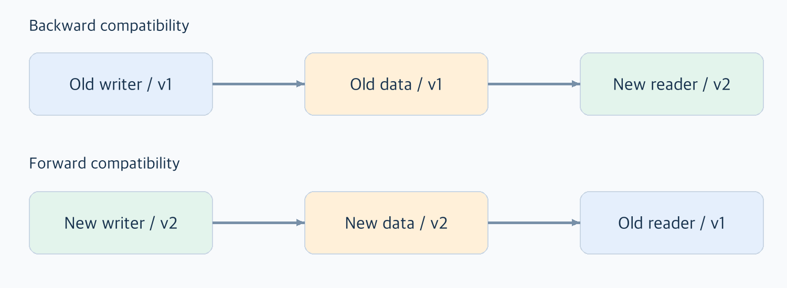
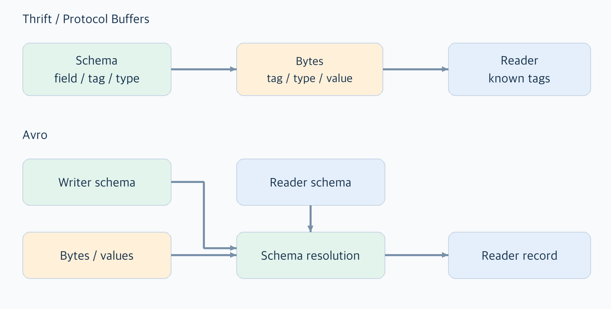
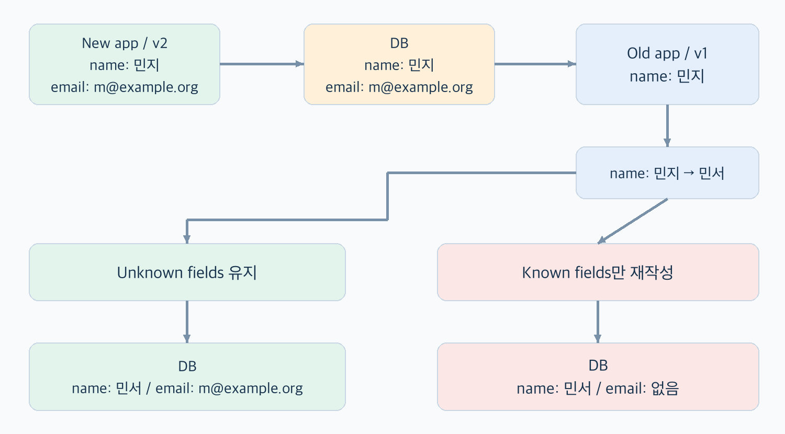
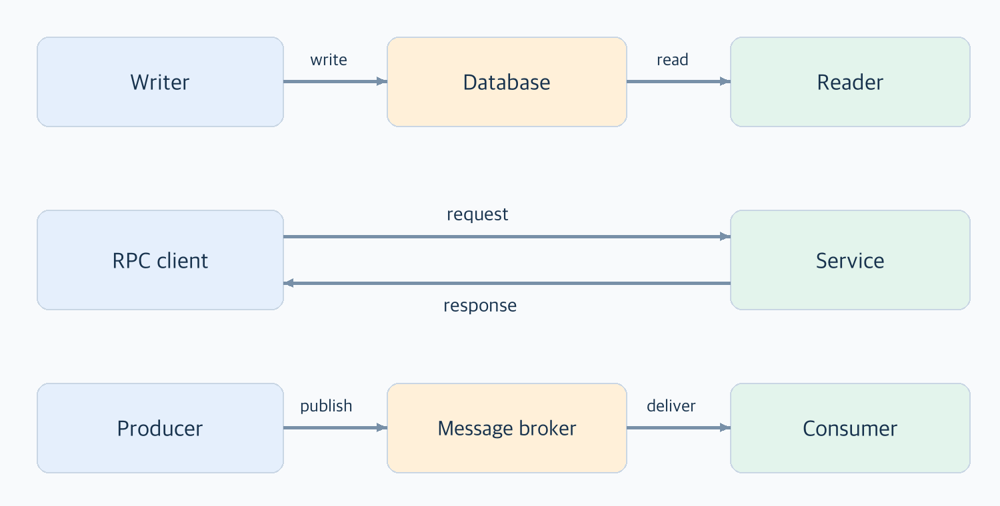

# 04. 부호화와 발전

## 이번에 답하려는 질문

- 새 필드 하나를 추가했는데 왜 예전 앱에서 문제가 생길까?
- JSON으로 보내면 충분할까, 별도의 스키마가 필요한 이유는 뭘까?
- DB에 저장한 데이터, API 응답, 큐의 메시지는 어떤 호환성이 필요할까?

## 먼저 짚고 갈 용어

| 용어 | 여기서는 이렇게 이해하기 |
| --- | --- |
| 부호화(encoding) / 직렬화(serialization) | 메모리의 데이터를 저장, 전송할 수 있는 바이트열로 바꾸는 일 |
| 복호화(decoding) / 역직렬화(deserialization) | 바이트열을 프로그램이 사용할 데이터로 다시 해석하는 일 |
| 스키마(schema) | 필드 이름·타입·기본값 등 데이터 구조를 정하는 규칙 |
| 스키마 발전(schema evolution) | 기존 데이터를 다루면서 데이터 구조를 변경하는 것 |
| 하위 호환성(backward compatibility) | 새로운 코드가 예전 코드가 쓴 데이터를 읽는 능력 |
| 상위 호환성(forward compatibility) | 예전 코드가 새로운 코드가 쓴 데이터를 읽는 능력 |
| 쓰기 스키마 / 읽기 스키마 | 데이터를 기록할 때 사용한 구조 / 읽는 코드가 기대하는 구조 |
| 필드 태그(field tag) | 필드 이름 대신 바이트열에서 필드를 식별하는 번호 |
| RPC | 다른 프로세스의 기능을 네트워크 요청으로 호출하는 방식 |
| 메시지 브로커 | 송신자와 수신자 사이에서 메시지를 받아 보관, 전달하는 중간 시스템 |
| 멱등성(idempotence) | 같은 작업을 여러 번 실행해도 한 번 실행한 것과 같은 효과를 내는 성질 |

## 핵심 내용

3장은 DB가 데이터를 어디에 놓고 어떻게 찾는지 다뤘다.
4장은 그 데이터가 프로그램 밖으로 나갈 때 어떤 모습이 되고 프로그램이 바뀐 뒤에도 읽힐 수 있는지를 다룬다.

핵심은 새 코드가 잘 동작하는지만 확인해서는 부족하다는 점이다.
예전에 저장한 데이터가 남아 있고 배포 중에는 이전 서버가 함께 실행되며 사용자가 앱을 바로 업데이트하지 않을 수도 있다.
부호화 형식 → 스키마 변경 규칙 → 실제 데이터가 흐르는 경로 순서로 연결해 본다.

### 1. 코드는 바뀌는데 예전 데이터는 남아 있다

#### 1.1 모든 프로그램을 동시에 바꿀 수 있을까?

서버를 한 대씩 바꾸는 롤링 업그레이드 중에는 새 버전과 예전 버전이 함께 실행된다.
모바일 앱은 업데이트 시점이 사용자마다 달라서 이런 공존 기간이 더 길어질 수 있다.

예를 들어 사용자 데이터에 `email` 필드를 추가했다고 하자.
새 서버는 이메일을 기록하지만 아직 바뀌지 않은 서버는 이름만 알고 있을 수 있다.
어느 쪽이 먼저 기록하고 어느 쪽이 읽는지에 따라 필요한 호환성도 달라진다.



| 방향 | 예시 | 필요한 처리 |
| --- | --- | --- |
| 하위 호환: 예전 데이터 → 새 코드 | 새 코드가 이메일 없는 예전 사용자 읽기 | 누락 필드를 어떻게 처리할지 정하기 |
| 상위 호환: 새 데이터 → 예전 코드 | 예전 코드가 이메일이 추가된 사용자 읽기 | 모르는 필드를 안전하게 다루기 |

새 버전을 배포하는 일은 한동안 여러 버전이 같은 데이터를 읽고 쓰게 만드는 일이기도 하다.

### 2. 메모리의 객체를 그대로 보낼 수는 없다

#### 2.1 프로그램 안의 데이터와 밖의 데이터

메모리에는 객체, 배열, 해시 맵, 포인터 같은 구조가 있다.
다른 프로세스는 내 프로세스의 메모리 주소를 그대로 사용할 수 없으므로 디스크나 네트워크로 보낼 때는 바이트열로 표현해야 한다.

```text
메모리의 데이터 → 부호화 → 파일 / 네트워크의 바이트열 → 복호화 → 사용할 데이터
```

여기서 부호화는 암호화와 다르다. 데이터를 읽고 쓸 수 있는 표현으로 바꾸는 것이다. 비밀로 만드는 작업은 아니다.

#### 2.2 언어에 내장된 기능을 쓰면 편하지 않을까?

Java의 내장 직렬화나 Python의 `pickle`처럼 객체를 바로 저장하고 복원하는 기능은 편리하다.
하지만 오래 보관하거나 여러 시스템과 주고받는 데이터에는 다음 문제가 생길 수 있다.

- 언어와 클래스에 묶임: 다른 언어에서 읽거나 클래스가 바뀐 뒤 복원하기 어려울 수 있다.
- 안전하지 않은 역직렬화: 일부 방식은 객체 복원 중 코드를 실행할 수 있어 신뢰하지 않는 입력을 처리하기 위험하다.
- 버전 변경: 어떤 필드를 추가, 삭제해도 되는지 규칙이 충분하지 않을 수 있다.
- 효율성: 부호화 크기와 CPU 비용이 용도에 비해 클 수 있다.

편하게 객체를 저장하는 것과 오래 유지할 데이터 교환 규칙을 만드는 것은 다른 요구다.

### 3. JSON, XML, CSV라면 무엇을 약속해야 할까?

#### 3.1 사람이 읽을 수 있어도 해석까지 같은 것은 아니다

JSON, XML, CSV는 여러 언어에서 다룰 수 있고 내용을 직접 확인하기도 쉽다.
다만 문법을 읽는 데 성공했다고 값의 의미까지 같아지는 것은 아니다.

| 형식 | 다루기 편한 점 | 함께 정해야 할 것 |
| --- | --- | --- |
| JSON | 객체, 배열을 간결하게 표현 | 숫자의 범위/정밀도, 누락과 null, 이진 데이터 표현 |
| XML | 구조를 표현하고 스키마를 사용할 수 있음 | 타입 해석과 스키마, 장황한 표현의 비용 |
| CSV | 표 형태의 데이터를 쉽게 교환 | 열의 의미/타입, 헤더, 구분자와 이스케이프 규칙 |

예를 들어 JSON에 큰 정수 ID를 넣으면, 받는 쪽의 숫자 타입에 따라 정확히 유지되지 않을 수 있다.
JavaScript의 일반적인 `Number`로 `9007199254740993`을 다루는 경우가 그런 예다.
JSON을 사용하면 항상 정수가 손실된다는 뜻은 아니다. 사용하는 파서와 언어의 숫자 표현이 중요하다.
ID를 문자열로 주고받기로 약속하는 것도 한 가지 방법이다.

이진 데이터도 그대로 텍스트에 넣기 어려워 Base64 같은 표현이 필요할 수 있다.
그 경우 받는 쪽은 이 문자열을 일반 텍스트로 볼지 바이트로 다시 바꿀지도 알아야 한다.

스키마 파일이 없어도 규칙이 사라지지는 않는다.
규칙이 코드나 문서 속에 흩어져 있을 수 있으므로 타입과 누락 값의 의미를 따로 맞춰야 한다.

#### 3.2 이진 형식으로 바꾸면 다 해결될까?

MessagePack 같은 형식은 값을 이진으로 표현하고 타입을 더 구분할 수 있다.
하지만 필드 이름을 매번 기록한다면 그 비용은 여전히 남는다.

이진 형식이 얼마나 작고 빠른지는 데이터와 구현에 따라 다르다.
여기서 더 봐볼 부분은 몇 바이트를 줄였는지뿐 아니라 필드를 식별하고 변경하는 규칙이다.

### 4. Thrift와 Protocol Buffers: 이름 대신 태그로 구분하기

#### 4.1 필드 이름을 매번 보내지 않으려면

Thrift와 Protocol Buffers는 먼저 스키마를 정의하고 이를 읽고 쓰는 코드를 생성하는 방식으로 사용할 수 있다.
바이트열에서는 긴 이름 대신 필드 태그 번호로 어떤 필드인지 나타낸다.

```text
스키마의 약속             전송할 정보의 개념적 표현
1 → name / 문자열        태그 1 / 타입 / "지민"
2 → score / 정수         태그 2 / 타입 / 27
```

실제 부호화 규칙은 형식마다 다르다. 타입, 길이 등의 정보를 이용해 값을 읽거나 건너뛸 수 있다.
가변 길이 정수처럼 작은 수에 적은 바이트를 쓰는 기법도 사용한다.



#### 4.2 새 필드는 추가하고, 예전 번호는 다시 쓰지 않는다

새로운 `email` 필드를 태그 3으로 추가했다고 하자.
예전 읽기는 태그 3을 몰라도 그 필드를 건너뛰고 알고 있는 필드를 읽을 수 있다.
반대로 새 읽기는 예전 데이터에 태그 3이 없어도 동작해야 한다.

| 변경 | 호환성을 위해 확인할 점 |
| --- | --- |
| 필드 추가 | 예전 데이터에 없어도 읽히도록 선택적 필드나 기본값 규칙 사용 |
| 필드 삭제 | 예전 읽기가 해당 필드의 부재를 허용하는지 확인 |
| 필드 이름 변경 | 태그가 같더라도 코드, JSON 표현 등 다른 사용 경로의 영향 확인 |
| 태그 변경/재사용 | 과거 데이터를 다른 의미로 해석할 수 있으므로 피하기 |

책에서 설명하는 `required` 필드를 새로 추가하면 예전 데이터에는 그 값이 없어 새 읽기가 실패할 수 있다.
기존 필수 필드를 지우는 경우도 예전 읽기의 기대를 깨뜨릴 수 있다.
필수 여부와 기본값의 세부 동작은 사용하는 형식과 버전에서 확인해야 한다.

#### 4.3 타입을 더 크게 바꾸면 안전할까?

`int32`를 `int64`로 넓히는 예를 보면 호환성의 방향이 다시 드러난다.
새 읽기가 예전의 작은 값을 읽는 쪽은 처리할 수 있어도 예전 읽기는 새 쓰기가 보낸 큰 값을 담지 못할 수 있다.
바이트를 읽는 데 성공해도 값이 잘리거나 의미가 달라지면 올바른 호환이라고 보기 어렵다.

Protocol Buffers의 단일 값과 반복 값 변경도 단순히 같은 태그를 쓴다고 모두 안전한 것은 아니다.
책의 예처럼 예전 읽기에 마지막 값만 보이는 경우에는 파싱이 가능해도 여러 값의 정보는 유지되지 않는다.
지원되는 변경인지와 애플리케이션이 같은 의미로 사용할 수 있는지를 나눠 확인해야 한다.

### 5. Avro: 쓸 때의 스키마와 읽을 때의 스키마를 연결한다

#### 5.1 태그가 없으면 필드를 어떻게 알까?

Avro도 스키마를 쓰지만 데이터에 필드 태그를 하나씩 넣는 대신에 쓰기 스키마의 순서와 타입을 이용해 값을 부호화한다.
따라서 읽는 쪽은 그 데이터를 기록할 때 사용한 쓰기 스키마를 알아야 한다.

Avro는 쓰기 스키마와 읽기 스키마를 함께 보고 호환되는 차이를 스키마 해석(schema resolution)으로 맞춘다.

- 쓰기 쪽에만 있는 필드는 읽기 결과에서 무시할 수 있다.
- 읽기 쪽에만 있는 필드는 읽기 스키마에 선언된 기본값으로 채운다.
- 필드 순서가 달라도 이름을 기준으로 대응시킬 수 있다.
- 타입 변경은 허용된 변환 규칙 안에서 처리해야 한다.

#### 5.2 null을 허용하는 것과 기본값이 있는 것은 다르다

새 읽기 스키마에 이메일을 추가하는 예

```json
{"name": "email", "type": ["null", "string"], "default": null}
```

이 타입은 이메일 값으로 null 또는 문자열을 허용한다.
그리고 예전 쓰기 스키마에 `email`이 없을 때는 읽기 스키마의 `default`로 null을 채운다.

타입에 null이 있다고 누락 필드의 기본값이 자동으로 생기는 것은 아니다.
기본값은 예전 데이터를 읽을 때 차이를 메우는 규칙이며 쓰기에서 필드를 마음대로 생략해도 된다는 뜻도 아니다.

양방향 호환을 유지하려면 필드 추가 시 새 읽기가 사용할 기본값이 필요하고
필드 삭제 시에는 예전 읽기가 기대하던 필드를 기본값으로 채울 수 있는지 확인해야 한다.
필드 이름이나 유니온 타입의 변경도 이름 대응, 허용 타입의 방향에 따라 호환성이 달라진다.

Thrift, Protocol Buffers는 태그 번호를 오래 유지하는 것이 중요하고
Avro는 데이터를 쓸 때 사용한 스키마를 확보하고 읽기 스키마와 맞추는 과정이 중요하다.
스키마가 있다는 공통점만으로 변경 규칙까지 같다고 보면 안 된다.

#### 5.3 쓰기 스키마는 어디서 가져올까?

모든 레코드에 전체 스키마를 반복해서 넣으면 절약한 공간을 다시 쓸 수 있다.
그래서 데이터가 전달되는 상황에 맞춰 관리한다.

| 상황 | 책에서 설명하는 방법 |
| --- | --- |
| 동일 스키마의 많은 레코드를 담은 파일 | 파일 앞에 쓰기 스키마를 한 번 포함 |
| 여러 버전의 레코드가 섞인 DB | 레코드에 스키마 버전·식별자를 두고 해당 스키마 조회 |
| 네트워크 연결 | 연결 과정에서 사용할 스키마를 교환·합의 |

Avro는 태그 번호를 수동으로 유지하지 않아도 되어 DB 테이블 구조에서 스키마를 동적으로 만드는 용도에도 잘 맞는다.
코드 생성 없이 스키마를 읽어 데이터를 다루는 방식도 가능하다.


### 6. 스키마는 변경을 막는 장치일까?

스키마가 있으면 구조를 바꾸기 어렵다고 느낄 수 있다.
하지만 변경 규칙이 명확하면 여러 버전이 함께 살아가는 범위를 오히려 확인하기 쉬워진다.

- 필드 이름 등을 매번 기록하지 않아 부호화 크기를 줄일 수 있다.
- 실제 읽기·쓰기에 사용하는 데이터 구조를 문서로 확인할 수 있다.
- 새 스키마를 배포하기 전에 과거 스키마와 호환되는지 검사할 수 있다.
- 코드 생성과 타입 검사를 통해 잘못된 사용을 일찍 찾을 수 있다.

유연하다는 것은 아무 규칙 없이 바꿀 수 있다는 뜻보다 기존 데이터를 깨뜨리지 않고 바꿀 수 있다는 뜻에 가깝다.
이제 그 규칙이 실제로 필요한 경로를 DB, 서비스, 메시지로 나눠 본다.

### 7. DB에 저장하는 것은 미래의 코드에 데이터를 보내는 일이다

#### 7.1 데이터는 코드보다 오래 남는다

코드는 몇 분 사이에 바뀌어도 몇 년 전에 쓴 레코드는 다시 기록하지 않았다면 예전 형식으로 남아 있을 수 있다.
새 코드는 이런 레코드를 읽어야 하므로 하위 호환성이 필요하다.
롤링 업그레이드 중에는 예전 코드가 새 코드의 기록을 읽을 수도 있어 상위 호환성도 필요하다.

모든 데이터를 새 형식으로 다시 쓰는 마이그레이션도 가능하지만 데이터가 많으면 비용이 크다.
레코드의 쓰기 스키마를 보관하고 읽을 때 해석하는 접근은 그 부담을 줄이는 방법이다.
백업, 분석용 덤프처럼 어차피 복사하는 시점에는 한 스키마로 맞추거나 분석용 형식으로 바꿀 수도 있다.

#### 7.2 읽기는 성공했는데 다시 저장하면서 데이터가 사라진다면?

새 코드가 `name="민지"`, `email="m@example.org"`를 저장했다고 하면
이름만 아는 예전 코드가 이름을 `민서`로 바꾸면서 자기 모델에 있는 필드만 새 객체로 만들고 통째로 저장하면 이메일이 사라질 수 있다.



모르는 필드를 무시하고 읽는 능력과 읽고 다시 쓸 때 그 필드를 보존하는 능력은 다르다.
사용하는 형식의 미지 필드 보존 기능, 모델 변환 코드, 부분 갱신 방식까지 함께 확인해야 한다.
메시지를 읽어 다른 토픽으로 다시 내보낼 때도 같은 문제가 생길 수 있다.

### 8. 서비스 호출에서도 요청과 응답의 방향이 다르다

#### 8.1 REST, SOAP, RPC는 무엇이 다를까?

서비스는 클라이언트에게 정해진 기능과 입력/출력을 API로 제공한다.
서비스를 독립적으로 배포하려면 서로의 버전이 달라도 약속한 요청과 응답을 처리할 수 있어야 한다.

| 접근 | 중심이 되는 생각 |
| --- | --- |
| REST | 리소스를 식별하고 HTTP의 의미, 기능을 활용하는 설계 방식 |
| SOAP | XML 기반 메시지 프로토콜과 서비스 기술, 관련 표준 활용 |
| RPC | 원격 기능을 호출하는 인터페이스로 요청과 응답 표현 |

HTTP를 사용하거나 JSON을 보낸다는 사실만으로 REST가 되는 것은 아니다.
반대로 RPC라고 반드시 특정 이진 형식만 쓰는 것도 아니다. 호출 방식과 부호화 형식은 구분한다.

#### 8.2 원격 호출을 로컬 함수처럼 생각하면 놓치는 것

네트워크에서는 요청이 유실되거나 서버가 처리한 뒤 응답만 사라지거나 지연 때문에 타임아웃이 날 수 있다.
타임아웃은 서버에서 작업이 실행되지 않았다는 증거가 아니다.

예를 들어 주문 생성 요청을 보낸 뒤 응답을 받지 못해 재시도하면 주문이 두 번 만들어질 수 있다.
같은 요청 ID를 이용한 중복 제거처럼 재시도해도 효과가 중복되지 않게 설계해야 한다.
부호화 비용, 네트워크 지연, 언어별 타입 차이도 로컬 호출과 다르다.

#### 8.3 서버를 먼저 바꾸는 경우에는?

새 서버가 예전 클라이언트의 요청을 읽는다면 하위 호환성이 필요하다.
예전 클라이언트가 새 서버의 응답을 읽는다면 상위 호환성이 필요하다.
동일한 연결에서도 요청과 응답에서 데이터를 쓰는 쪽이 바뀐다.

새 필드를 무시하는지와 빠진 필드를 어떻게 채우는지는 실제 클라이언트의 동작까지 봐야 한다.
호환성을 깨는 변경이라면 API 버전을 나눠 일정 기간 함께 제공하는 방법도 있다.
버전 번호를 붙이는 것 자체가 호환성을 해결해 주는 것은 아니다.

### 9. 메시지를 바로 전달하지 않고 브로커에 맡긴다면



메시지 전달에서는 생산자가 메시지를 게시하고 브로커가 이를 소비자에게 전달한다.
수신자가 잠시 느리거나 사용할 수 없어도 버퍼링하고 여러 소비자로 나누어 전달하며 송신자와 수신자의 직접 연결을 줄일 수 있다.
일반적으로 생산자는 소비자의 처리 결과를 즉시 응답받는 형태로 기다리지 않는다.

#### 9.1 비동기라면 호환성 문제도 없어질까?

오히려 큐에 남아 있던 예전 메시지를 새 소비자가 읽거나 새 생산자의 메시지를 예전 소비자가 읽을 수 있다.
양방향 호환성이 있으면 생산자와 소비자의 배포 순서를 더 유연하게 정할 수 있다.
브로커가 바이트열을 전달해 줘도 메시지의 필드와 의미까지 대신 맞춰 주지는 않는다.

전달, 보관, 재전달 보장은 제품과 설정에 따라 다르다.
브로커를 쓴다는 이유만으로 메시지가 절대 유실되지 않거나 처리가 정확히 한 번만 일어난다고 가정하면 안 된다.
재전달된 메시지의 중복 처리도 애플리케이션에서 고려해야 한다.

#### 9.2 분산 액터도 메시지의 버전은 맞춰야 한다

액터 모델은 각 액터가 자신의 상태를 다루고 비동기 메시지로 다른 액터와 통신하는 모델이다.
원격 노드의 액터로 메시지를 보내려면 역시 부호화와 네트워크 전송이 필요하다.

프레임워크가 위치를 감춰 주더라도 지연이나 유실 가능성까지 없어지는 것은 아니다.
롤링 업그레이드를 하려면 액터 사이에 오가는 메시지도 서로 다른 버전에서 해석할 수 있어야 한다.

## 정리하며

부호화 형식을 고를 때는 크기와 속도에 더해 변경 이후에도 데이터를 읽고 다시 쓸 수 있는지를 봐야 한다.
DB의 오래된 레코드, 업데이트되지 않은 앱, 큐에 남은 메시지는 모두 다른 시점의 코드가 만나는 장소다.

독립적인 배포는 코드를 따로 올릴 수 있다는 것만으로 완성되지 않는다.
서로 다른 버전이 데이터를 주고받는 기간을 견딜 수 있어야 한꺼번에 바꾸지 않아도 된다.

## 남은 질문

- API의 응답이나 이벤트를 받는 코드가 모르는 필드를 만났을 때 실제로 어떻게 동작할까?
- 보관 기간이 긴 데이터와 메시지는 과거 스키마를 어디까지 유지해야 할까?

## 참고 자료

- 마틴 클레프만, 『데이터 중심 애플리케이션 설계』, 04장 「부호화와 발전」.
- [Protocol Buffers 언어 가이드](https://protobuf.dev/programming-guides/proto3/)
- [Avro 명세](https://avro.apache.org/docs/1.12.0/specification/)