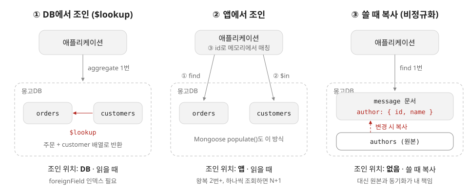
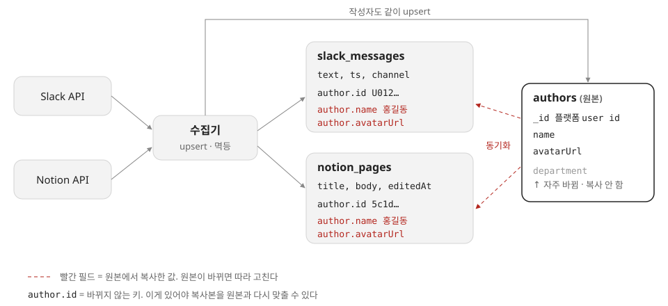
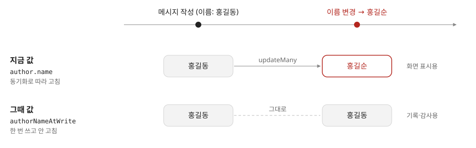
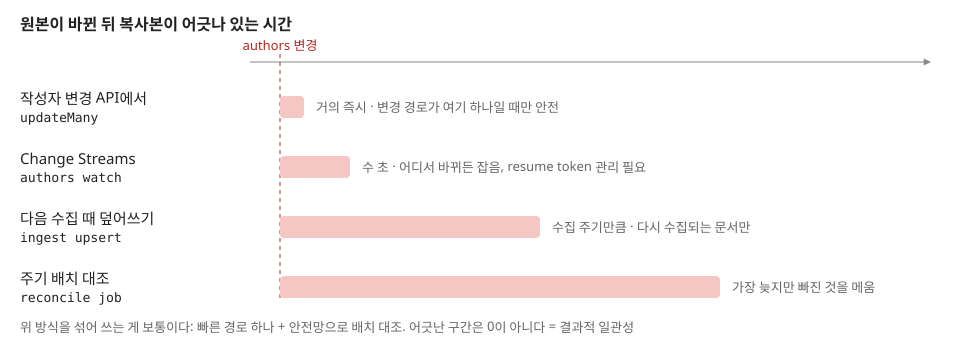
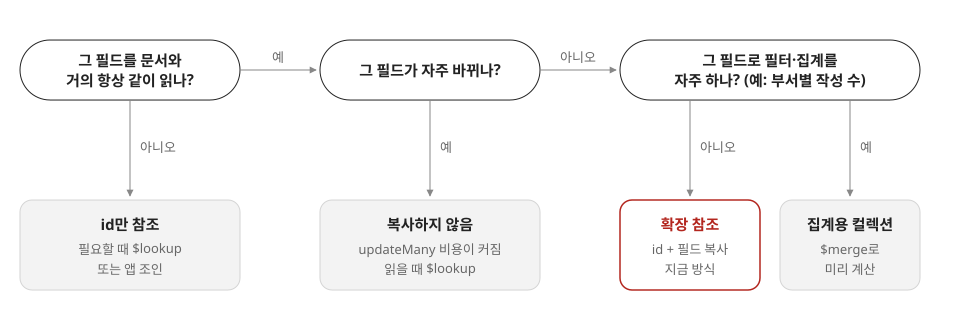

# 01. 몽고DB는 다른 컬렉션 데이터를 어떻게 찾나

## 이번에 답하려는 질문

- 2장에서 "문서 DB는 조인 지원이 약하다"고 하는데, 몽고DB에서는 다른 컬렉션 데이터를 어떻게 가져오나?
- 조인을 애플리케이션에서 흉내 내야 하나, 아니면 DB가 제공하는 기능이 있나?

## 한 줄 요약

몽고DB에도 집계 파이프라인의 `$lookup`(왼쪽 외부 조인)과 `$graphLookup`(재귀 조회)이 있지만, 기본 전제는 "함께 읽는 데이터는 한 문서에 넣는다"이고 조인은 그 전제가 깨지는 곳에 쓰는 보조 수단이다.

## 핵심 내용

### 1. 책에서 말하는 "조인이 없다"의 뜻

문서 모델은 일대다(한 사람의 경력 목록처럼 트리 모양) 관계를 한 문서에 넣으면 지역성 덕분에 한 번에 읽힌다.
문제는 다대일·다대다(여러 사람이 같은 회사·지역을 참조) 관계다. 정규화해서 ID로 참조하면 이 ID를 따라가는 조인이 필요한데,
초기 문서 DB는 이를 DB 안에서 해 주지 않아 **조인 작업이 DB에서 애플리케이션 코드로 옮겨 갔다.** 책이 지적하는 것은 이 이동이다.

지금의 몽고DB는 "조인이 전혀 없다"기보다 "조인이 있긴 하지만 관계형 DB처럼 중심 도구는 아니다"에 가깝다.
다른 컬렉션 데이터를 가져오는 길은 세 가지다.



### 2. DB가 제공하는 것

| 기능                                  | 하는 일                                                  | 도입                 |
| ----------------------------------- | ----------------------------------------------------- | ------------------ |
| `$lookup` (localField/foreignField) | 다른 컬렉션에서 값이 같은 문서를 찾아 배열 필드로 붙임. SQL의 LEFT OUTER JOIN | 3.2                |
| `$lookup` + `pipeline`              | 조인 조건·필터·프로젝션을 하위 파이프라인으로 표현 (상관 서브쿼리)                | 3.6, 5.0에서 두 문법 결합 |
| `$graphLookup`                      | 같은/다른 컬렉션을 따라 재귀적으로 탐색 (조직도, 친구의 친구)                  | 3.4                |
| `$unionWith`                        | 두 컬렉션 결과를 합침. 조인이 아니라 SQL의 UNION ALL                  | 4.4                |
| 뷰 / `$merge`                        | `$lookup`이 든 파이프라인을 뷰로 저장하거나, 결과를 컬렉션에 써서 구체화 뷰처럼 사용  | 3.4 / 4.2          |

```js
// 주문에 고객 정보를 붙이기
db.orders.aggregate([
  { $match: { status: "paid" } },
  { $lookup: {
      from: "customers",
      localField: "customerId",
      foreignField: "_id",
      as: "customer"
  } },
  { $unwind: "$customer" }   // 배열 → 단일 객체
])
```

알아 둘 점

- `find()`가 아니라 **집계 파이프라인**에서만 쓴다.
- 결과가 **배열 필드**로 붙는다. 일대일로 쓰려면 `$unwind`를 이어 붙인다.
- 조인 대상의 `foreignField`에 인덱스가 없으면 입력 문서마다 대상 컬렉션을 훑는다.
- 결과 문서도 16MB 문서 크기 제한을 받는다.
- 샤딩 환경에서 `from` 컬렉션이 샤딩돼 있어도 되는 것은 5.1부터다.

### 3. 애플리케이션에서 하는 조인

DB 기능을 안 쓰면 애플리케이션이 쿼리를 여러 번 보낸다.

```js
const orders = await db.orders.find({ status: "paid" }).toArray();
const ids = [...new Set(orders.map(o => o.customerId))];
const customers = await db.customers.find({ _id: { $in: ids } }).toArray();
// 메모리에서 customerId로 매칭
```

- `$in`으로 한 번에 모으면 2회 왕복이다. 주문마다 고객을 조회하면 N+1 쿼리가 된다.
- ODM이 이 패턴을 감싸 준다: Mongoose `populate()`, Spring Data MongoDB `@DBRef` / `@DocumentReference`.
  겉보기엔 조인 같지만 실제로는 추가 쿼리를 보내는 애플리케이션 조인이다.
- `DBRef`는 `{ $ref, $id }` 형태의 참조 **규약**일 뿐, 서버가 자동으로 따라가 주지 않는다.
- 여러 번 나눠 읽으므로 그 사이에 데이터가 바뀌면 일관된 스냅숏이 아닐 수 있다.

### 4. 몽고DB가 먼저 권하는 것: 조인이 필요 없게 모델링

| 패턴 | 방법 | 대가 |
|---|---|---|
| 임베딩 | 함께 읽는 하위 데이터를 문서 안에 넣음 | 문서가 커지고, 공유 데이터면 중복 |
| 확장 참조 | 참조 ID와 함께 자주 쓰는 필드(이름 등)만 복사 | 원본이 바뀌면 복사본 갱신 필요 |
| 사전 계산 | `$merge`로 조인 결과를 별도 컬렉션에 미리 만들어 둠 | 최신성 지연, 갱신 작업 필요 |

결국 책의 트레이드오프와 같다. **읽기 시점에 조인할지(정규화), 쓰기 시점에 복사할지(비정규화)** 를 데이터의 관계와 접근 패턴을 보고 고른다.
다대다 관계가 많고 조회 조건이 다양하면 관계형이나 그래프 모델이 더 자연스럽다.

### 5. 실제로 쓰는 방식: 노션·슬랙 수집 데이터의 작성자

회사에서 노션·슬랙 데이터를 수집할 때 위 ③(확장 참조)을 쓰고 있다.
각 문서에 작성자 정보를 복사해 넣고, 작성자 컬렉션은 원본으로 따로 관리하면서 둘을 동기화한다.



**복사본이 "지금 값"인지 "그때 값"인지** 먼저 정한다. 둘 다 맞는 설계라서 의도를 필드 이름으로 드러낸다.



**동기화는 즉시 끝나지 않는다.** 원본과 복사본이 잠깐 어긋나는 결과적 일관성을 받아들이고, 빠른 경로와 안전망을 같이 둔다.



**모든 필드를 복사하지는 않는다.** 필드마다 아래 순서로 판단한다.



책과 연결하면, 작성자 컬렉션은 원본 데이터(system of record)이고 문서 속 작성자 필드는 거기서 파생된 데이터다.
11~12장의 변경 데이터 캡처·파생 데이터 이야기가 이 구조를 일반화한 것이다.

## 남은 질문

- `$lookup`의 실행 방식(인덱스 중첩 루프 vs 해시 조인)은 버전·조건에 따라 어떻게 달라지나? `explain()`으로 확인해 보기.
- 확장 참조로 복사한 필드를 원본과 맞추는 방법 — 트랜잭션, Change Streams, 배치 중 무엇을 쓰나?
- 관계형 DB의 JSON 컬럼(PostgreSQL `jsonb`)과 몽고DB의 `$lookup`으로 두 모델이 수렴한다는 책의 주장을 어디까지 받아들일 수 있나?

## 참고 자료

- DDIA 2장 "관계형 모델과 문서 모델", "문서 데이터베이스는 역사를 반복하고 있나?"
- [MongoDB Manual — $lookup](https://www.mongodb.com/docs/manual/reference/operator/aggregation/lookup/)
- [MongoDB Manual — $graphLookup](https://www.mongodb.com/docs/manual/reference/operator/aggregation/graphLookup/)
- [MongoDB Manual — Database References (DBRef)](https://www.mongodb.com/docs/manual/reference/database-references/)
- [MongoDB Manual — Data Modeling](https://www.mongodb.com/docs/manual/data-modeling/)
- [Mongoose — Populate](https://mongoosejs.com/docs/populate.html)
