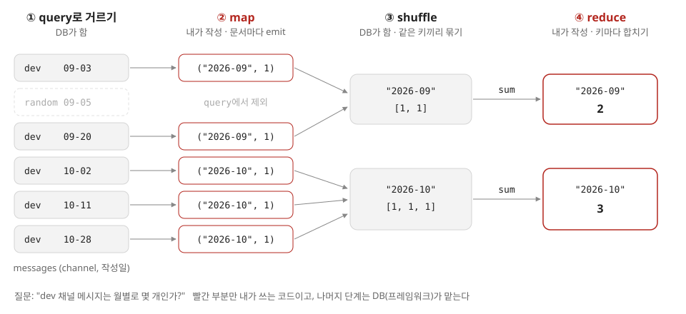
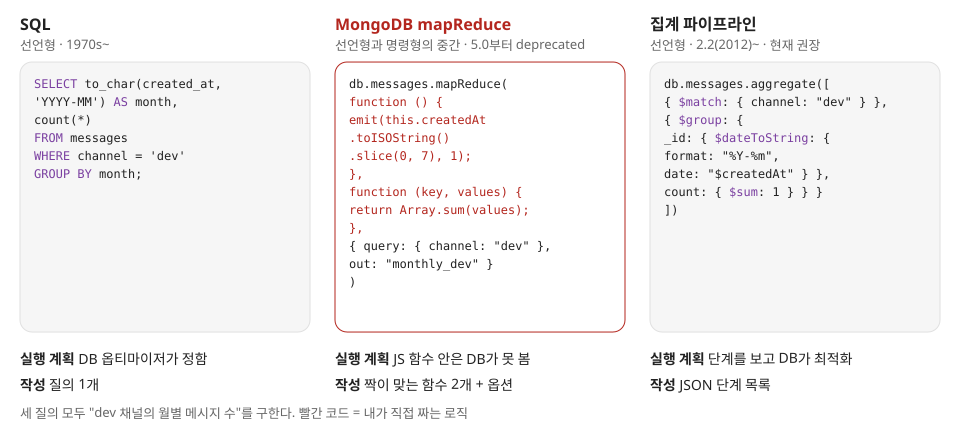
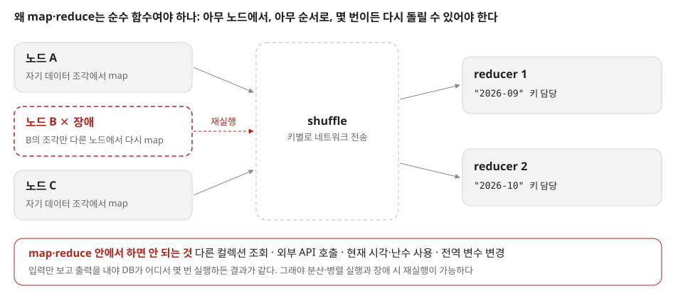
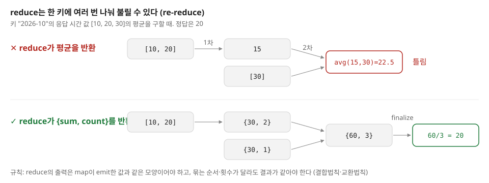
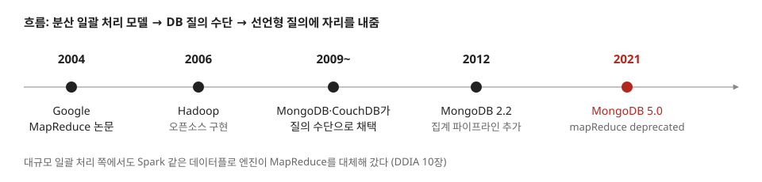

# 02. MapReduce 질의

## 이번에 답하려는 질문

- 2장에 나오는 MapReduce는 무엇이고, 왜 데이터 모델·질의 언어 장에 나오나?
- map과 reduce가 순수 함수여야 한다는 건 무슨 뜻이고, 왜 그래야 하나?
- 지금 몽고DB에서도 쓰나?

## 한 줄 요약

MapReduce는 "문서마다 키·값을 뽑는 map"과 "같은 키의 값을 합치는 reduce" 두 함수만 내가 쓰고 나머지 실행은 DB가 맡는 질의 방식으로, 선언형과 명령형의 중간에 있으며 몽고DB에서는 선언형인 집계 파이프라인에 자리를 내줬다.

## 핵심 내용

### 1. 네 단계로 보는 MapReduce

예시 질문은 "dev 채널 메시지가 월별로 몇 개인가?"다. 내가 쓰는 건 map과 reduce 두 함수뿐이다.

### 2. 같은 질의를 세 가지 방식으로

책이 MapReduce를 2장에서 다루는 이유는 **질의를 어떻게 표현하느냐**의 한 예라서다.
SQL은 원하는 결과만 말하고(선언형), MapReduce는 로직을 JS 함수로 직접 짠다.
DB는 함수 안을 들여다볼 수 없어서 최적화 여지가 줄어든다.

### 3. 왜 순수 함수여야 하나

map과 reduce는 입력만 보고 출력을 내야 한다. 그래야 DB가 데이터를 나눠 여러 노드에서 돌리고, 한 노드가 죽으면 그 부분만 다시 돌릴 수 있다.

### 4. 함정: reduce는 여러 번 나눠 불린다

몽고DB는 한 키의 값이 많으면 reduce를 부분적으로 먼저 돌리고, 그 결과를 다시 reduce에 넣는다.
합계·개수는 괜찮지만 평균을 바로 반환하면 틀린다.

### 5. 지금은

- 몽고DB는 5.0부터 `mapReduce`를 deprecated로 두고 집계 파이프라인을 쓰라고 안내한다. 사용자 정의 로직이 꼭 필요하면 `$accumulator`, `$function` 연산자를 쓴다.
- 그래도 MapReduce의 생각(데이터를 나눠 같은 함수를 병렬로 돌리고, 키로 모아 합친다)은 10장 일괄 처리의 바탕이라 다시 나온다.

## 남은 질문

- 집계 파이프라인의 `$group`도 샤딩 환경에서는 샤드별로 부분 집계 후 합치는데, 이것도 결국 MapReduce와 같은 구조 아닌가?
- `$accumulator`의 `merge` 함수에도 re-reduce와 같은 규칙(결합법칙)이 적용되나?
- Spark는 MapReduce의 어떤 한계(중간 결과를 매번 디스크에 쓰는 것 등)를 풀었나? 10장에서 확인하기.

## 참고 자료

- DDIA 2장 "데이터를 위한 질의 언어" — 맵리듀스 질의
- [MongoDB Manual — Map-Reduce](https://www.mongodb.com/docs/manual/core/map-reduce/)
- [MongoDB Manual — Map-Reduce to Aggregation Pipeline](https://www.mongodb.com/docs/manual/reference/map-reduce-to-aggregation-pipeline/)
- [MapReduce: Simplified Data Processing on Large Clusters (OSDI 2004)](https://research.google/pubs/mapreduce-simplified-data-processing-on-large-clusters/)
