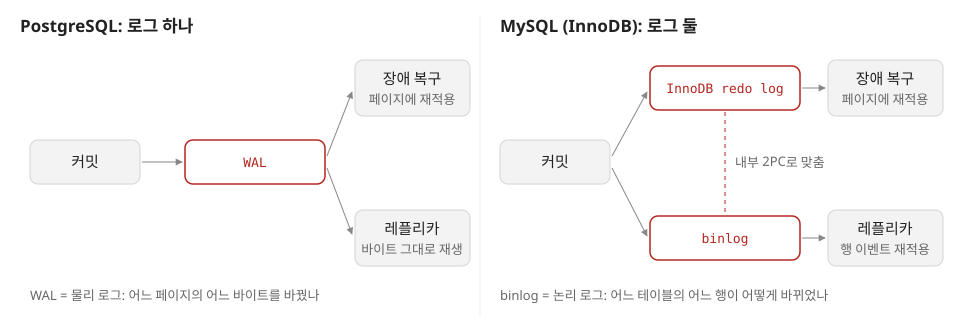
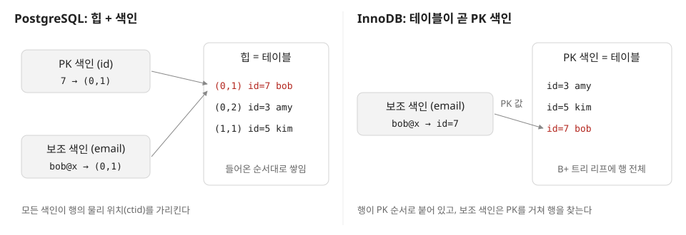

# 06. PostgreSQL과 MySQL(InnoDB), 둘 다 B 트리인데 무엇이 다른가

## 이번에 답하려는 질문

- PostgreSQL은 WAL로 복제하고 MySQL은 InnoDB라고 들었는데, 둘은 무엇이 다른가?
- 둘 다 B 트리라면 실제로 차이가 나는 곳은 어디인가?

## 한 줄 요약

둘 다 B 트리 색인과 WAL을 쓰지만, PostgreSQL은 WAL 하나로 장애 복구와 복제를 함께 하고 MySQL은 복제용 binlog를 따로 두며, 행을 두는 곳도 PostgreSQL은 힙, InnoDB는 PK B 트리 안이다.

## 핵심 내용

### 0. 비교 대상부터 바로잡기

"PG는 WAL, MySQL은 InnoDB"는 층위가 다른 둘을 견준 것이다.
InnoDB는 MySQL의 저장소 엔진 이름이고, InnoDB 안에도 redo log라는 WAL이 있다.
3장 "B 트리를 신뢰할 수 있게 만들기"에 나오는 쓰기 전 로그는 두 DB 모두 갖고 있다.

### 1. 로그: PostgreSQL은 하나, MySQL은 둘

| | PostgreSQL | MySQL (InnoDB) |
|---|---|---|
| 장애 복구용 로그 | WAL | InnoDB redo log |
| 복제용 로그 | 같은 WAL | binlog (서버 계층) |
| 복제 로그 형태 | 물리 로그 | 논리 로그 (행 기반이 기본) |
| 레플리카 버전 | 메이저 버전이 같아야 함 | 달라도 됨 |
| 일부 테이블만 복제 | 물리 복제로는 불가 (논리 복제를 따로 씀) | 필터로 가능 |

- **PostgreSQL (WAL 전달)**: 레플리카가 원본과 바이트 단위로 같아진다. 로그를 한 번만 쓰면 된다. 대신 WAL이 저장소 엔진의 내부 형식에 묶여 있어서 버전을 섞을 수 없다.
- **MySQL (binlog)**: 레플리카가 행 변경 이벤트를 받아 자기 엔진으로 다시 적용한다. 엔진과 분리돼 있어서 버전이 달라도 되고, Debezium 같은 CDC 도구도 binlog를 읽는다. 대신 커밋마다 두 로그를 모두 써야 하고, 둘이 어긋나지 않게 내부에서 2단계 커밋을 한다.

5장 "복제 로그 구현"이 나누는 **쓰기 전 로그 전달**과 **논리적(로우 기반) 로그 복제**가 바로 이 둘이다.
책도 PostgreSQL을 앞쪽 예로, MySQL binlog를 뒤쪽 예로 든다.

### 2. 행을 두는 곳: 힙 vs 클러스터드 색인

| | PostgreSQL | InnoDB |
|---|---|---|
| 테이블 | 힙: 행을 순서 없이 쌓음 | 클러스터드 색인: PK B+ 트리의 리프에 행 전체 |
| 보조 색인이 가리키는 것 | 행의 물리 위치(ctid) | PK 값 (PK 트리를 한 번 더 탐색) |
| UPDATE | 새 버전 행을 힙에 추가 | 행을 제자리에서 고치고 옛 값은 undo log에 |
| 옛 버전 정리 | VACUUM | purge 스레드 |

3장 "색인 안에 값 저장하기"에서 말하는 **힙 파일**과 **클러스터드 색인**의 차이다. 실무에서는 이렇게 드러난다.

- **PK 범위 조회는 InnoDB가 유리하다.** 행이 PK 순서로 붙어 있어서 디스크를 연달아 읽는다.
- **InnoDB는 PK를 작게 잡아야 한다.** 보조 색인마다 PK가 들어가므로 UUID 같은 큰 PK는 색인 전체를 키우고, 무작위 값이면 삽입 위치도 흩어져 페이지 분할이 잦다.
- **PostgreSQL은 UPDATE가 잦으면 테이블과 색인이 부푼다.** 업데이트마다 새 행 버전이 생기고, 그 위치를 모든 색인에 새로 넣어야 한다. 색인 컬럼이 안 바뀌고 같은 페이지에 자리가 있으면 HOT 업데이트로 색인 갱신을 건너뛴다. 운영에서는 autovacuum 설정이 중요하다.

## 남은 질문

- PostgreSQL의 논리 복제(logical decoding)는 WAL에서 어떻게 행 단위 변경을 다시 뽑아내나?
- MySQL 8.0의 binlog와 redo log 2단계 커밋에서, 크래시가 나면 어느 쪽을 기준으로 맞추나?
- MongoDB(WiredTiger)는 이 둘 중 어느 쪽에 가깝나? oplog는 binlog와 같은 논리 로그로 보인다. 05 노트와 이어서 5장에서 확인하기.

## 참고 자료

- 『데이터 중심 애플리케이션 설계』 3장 "B 트리를 신뢰할 수 있게 만들기", "색인 안에 값 저장하기" 절, 5장 "복제 로그 구현" 절
- [Write-Ahead Logging (WAL) — PostgreSQL 문서](https://www.postgresql.org/docs/current/wal-intro.html)
- [Log-Shipping Standby Servers — PostgreSQL 문서](https://www.postgresql.org/docs/current/warm-standby.html)
- [Heap-Only Tuples (HOT) — PostgreSQL 문서](https://www.postgresql.org/docs/current/storage-hot.html)
- [Clustered and Secondary Indexes — MySQL 8.0 Reference Manual](https://dev.mysql.com/doc/refman/8.0/en/innodb-index-types.html)
- [Redo Log — MySQL 8.0 Reference Manual](https://dev.mysql.com/doc/refman/8.0/en/innodb-redo-log.html)
- [The Binary Log — MySQL 8.0 Reference Manual](https://dev.mysql.com/doc/refman/8.0/en/binary-log.html)
