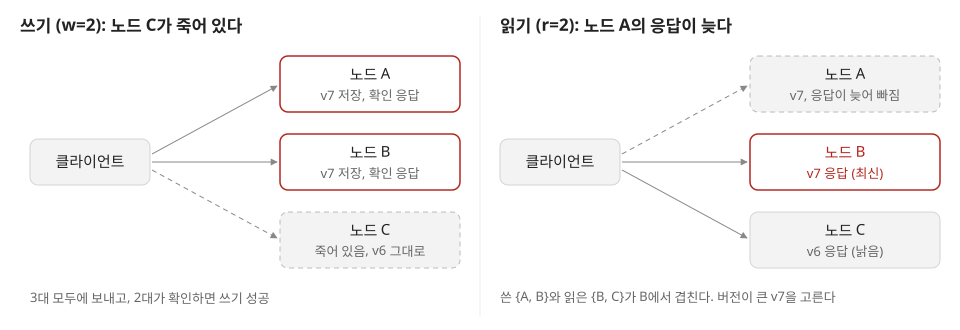
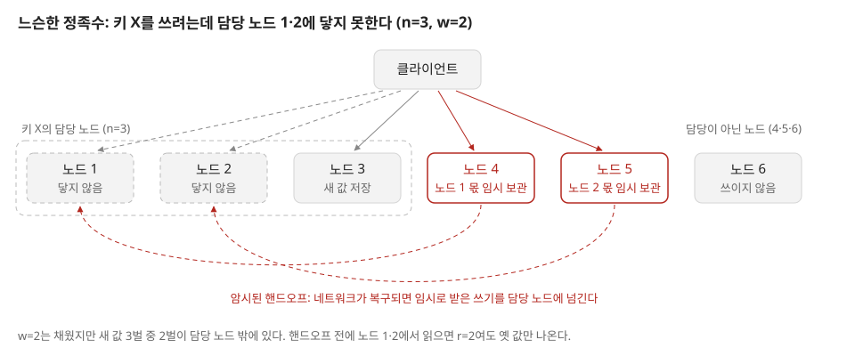

# 07. 리더 없는 복제

## 이번에 답하려는 질문

- 리더가 없으면 쓰기는 누가 받고, 놓친 쓰기는 어떻게 따라잡나?
- 정족수 조건 w + r > n은 무엇을 보장하고 무엇을 보장하지 않나?
- n, w, r은 각각 무엇을 세는 수인가? 노드·키와는 어떤 관계인가?
- 순서를 정해 줄 리더가 없는데, 같은 키에 동시에 들어온 쓰기는 어떻게 가리나?

## 한 줄 요약

리더 없는 복제는 클라이언트가 복제본 n대 전부에 읽기·쓰기를 보내고 w대·r대의 응답으로 성공을 판정해 장애 복구 없이 버티는 방식이고, 그 대가로 낡은 값 읽기와 동시 쓰기 충돌을 버전 번호로 직접 다뤄야 한다.

## 핵심 내용

### 0. 용어부터: 노드, 키, n

| 용어 | 뜻 |
|---|---|
| 노드 | DB 소프트웨어가 돌아가는 서버 한 대 |
| 키 | 레코드 하나의 식별자. 관계형 DB의 기본 키와 같다 |
| n | 한 키의 값을 저장하는 복제본 수. 클러스터의 노드 수가 아니다 |
| w | 쓰기를 성공으로 치려면 확인 응답을 보내야 하는 노드 수 |
| r | 읽을 때 응답을 받아야 하는 노드 수 |

Dynamo 스타일 DB는 키-값 저장소라서 읽기·쓰기 요청은 항상 키 하나에 대한 것이다.
정족수도, 버전 번호도, 동시 쓰기 충돌도 모두 키 단위로 따진다.

5장은 데이터 전체가 노드 한 대에 들어간다고 가정한다. 이 가정에서는 모든 노드가 같은 데이터를 통째로 갖고 있어서 n을 노드 수로 읽어도 맞다.
파티셔닝(6장)을 함께 쓰면 달라진다. 노드가 6대이고 n=3이면 각 키는 6대 중 3대에만 저장되고, 키마다 담당 노드 3대가 다르다.

### 1. 기본 동작: 클라이언트가 n대 전부에 보낸다

단일 리더에서는 리더가 죽으면 장애 복구(failover)를 해야 쓰기가 재개된다. 리더 없는 복제에는 이 과정이 없다.
Amazon의 Dynamo가 이 방식을 썼고, Riak·Cassandra·Voldemort가 따랐다.

- **쓰기**: 클라이언트가 n대 모두에 병렬로 보낸다. w대가 확인하면 성공으로 친다. 죽은 노드가 놓친 쓰기는 무시한다.
- **읽기**: n대 모두에 병렬로 보낸다. r대의 응답이 오면 값에 붙은 버전 번호를 비교해 가장 새 값을 고른다.

읽기도 여러 대에 보내는 이유는, 죽었다 돌아온 노드가 낡은 값을 갖고 있기 때문이다. 한 대에만 물어보면 그 낡은 값을 최신으로 믿게 된다.

클라이언트가 직접 보내지 않고, 코디네이터 노드가 클라이언트 대신 n대에 보내는 구현도 있다.

### 2. 놓친 쓰기를 따라잡는 두 방법

리더가 없으니 "리더의 로그를 다시 받는" 방법을 쓸 수 없다. 대신 두 가지를 쓴다.

| | 읽기 복구 | 안티 엔트로피 |
|---|---|---|
| 언제 | 클라이언트가 읽을 때 | 백그라운드에서 계속 |
| 방법 | 응답 중 낡은 값을 준 노드에 새 값을 다시 쓴다 | 복제본끼리 데이터를 비교해 빠진 것을 복사한다 |
| 한계 | 읽히지 않는 값은 고쳐지지 않는다 | 쓰기 순서대로 복사하지 않고, 지연이 클 수 있다 |

안티 엔트로피가 없는 시스템에서는 거의 읽히지 않는 값이 일부 복제본에 계속 빠져 있을 수 있다. 그만큼 내구성이 떨어진다.

### 3. 정족수: w + r > n

w + r > n이면 쓴 노드 집합과 읽은 노드 집합이 반드시 한 대 이상 겹친다. 그래서 읽은 r대 안에 최신값을 가진 노드가 적어도 하나 있다.

**w와 r은 특정 노드가 아니라 응답 개수다.** 키마다 정해져 있는 것은 담당 노드 n대뿐이다.
요청은 n대 전부에 보내고, 먼저 응답한 w대(또는 r대)로 판정한다. 어느 노드가 거기에 드는지는 요청마다 달라진다.
어떤 w대와 어떤 r대가 걸려도 겹치게 하려고 개수로 조건을 건다.

| 설정 | 견디는 장애 |
|---|---|
| n=3, w=2, r=2 | 노드 1대 |
| n=5, w=3, r=3 | 노드 2대 |

- n은 보통 홀수(3 또는 5)로 두고, w = r = (n+1)/2로 맞춘다.
- 응답한 노드가 w대나 r대에 못 미치면 쓰기·읽기는 오류를 반환한다.
- w + r ≤ n으로 낮출 수도 있다. 낡은 값을 읽을 가능성이 커지는 대신 지연이 줄고 가용성이 오른다.

### 4. 정족수를 만족해도 낡은 값을 읽는 경우

w + r > n은 최신값을 읽을 가능성을 높일 뿐, 보장하지 않는다. 책이 드는 경우는 다음과 같다.

| 상황 | 낡은 값이 나오는 이유 |
|---|---|
| 느슨한 정족수를 쓴다 | 쓴 노드와 읽는 노드가 겹치지 않을 수 있다 (5절) |
| 두 쓰기가 동시에 일어난다 | 어느 쪽이 최신인지 정해지지 않는다. 타임스탬프로 고르면 시계 차이 때문에 쓰기가 유실될 수 있다 (6절) |
| 쓰기와 읽기가 동시에 일어난다 | 쓰기가 일부 복제본에만 반영된 상태라, 읽기가 옛 값을 줄지 새 값을 줄지 알 수 없다 |
| 쓰기가 일부 복제본에서만 성공해 w를 못 채웠다 | 실패로 보고되지만 성공한 복제본에서는 롤백되지 않는다. 실패한 쓰기의 값이 나중에 읽힐 수 있다 |
| 새 값을 가진 노드가 죽어 낡은 복제본으로 복원했다 | 새 값을 가진 복제본 수가 w 밑으로 떨어진다 |

모니터링도 단일 리더보다 어렵다. 단일 리더는 리더와 팔로워의 로그 위치 차이로 복제 지연을 잰다.
리더 없는 복제에는 쓰기가 적용되는 고정된 순서가 없어서 "얼마나 뒤처졌는지"를 재기 어렵다.

### 5. 느슨한 정족수와 암시된 핸드오프

네트워크가 끊겨 클라이언트가 담당 노드 n대 중 w대에 닿지 못할 때, 선택지는 둘이다.

| | 엄격한 정족수 | 느슨한 정족수 |
|---|---|---|
| 동작 | 오류를 반환한다 | 닿을 수 있는 다른 노드에 일단 쓴다 |
| w개의 응답 | 담당 노드 n대 안에서만 센다 | 담당이 아닌 노드의 응답도 센다 |
| 얻는 것 | 쓴 노드와 읽는 노드가 겹친다 | 쓰기 가용성이 오른다 |

네트워크가 복구되면 임시로 쓰기를 받은 노드가 원래 담당 노드에 그 쓰기를 넘긴다. 이것이 **암시된 핸드오프**다.

느슨한 정족수에서는 w + r > n이어도 최신값을 읽는다는 보장이 없다. 읽기는 담당 노드에 물어보는데 최신값은 담당 노드 밖에 있을 수 있어서다.
보장하는 것은 "어딘가의 w대에 저장됐다"는 내구성뿐이다.

Riak은 느슨한 정족수가 기본으로 켜져 있고, Cassandra와 Voldemort는 기본으로 꺼져 있다.

### 6. 동시 쓰기 감지

**문제.** 클라이언트 A와 B가 같은 키에 동시에 쓴다. 네트워크 사정으로 노드마다 도착 순서가 다르다.

| 노드 | 받은 순서 | 최종값 |
|---|---|---|
| 노드 1 | A만 받음 (B의 쓰기는 유실) | A |
| 노드 2 | A → B | B |
| 노드 3 | B → A | A |

각 노드가 받은 순서대로 덮어쓰면 복제본이 영구히 어긋난다. 단일 리더였다면 리더가 순서를 정했겠지만, 여기에는 정해 줄 노드가 없다.

**최종 쓰기 승리(LWW).** 쓰기마다 타임스탬프를 붙이고 가장 큰 것만 남긴다.
복제본은 같은 값으로 수렴한다. 하지만 클라이언트에 성공이라고 응답한 쓰기가 조용히 버려진다. 노드 간 시계가 어긋나 있으면 동시가 아닌 쓰기까지 버려질 수 있다.
키를 한 번만 쓰고 그 뒤로 바꾸지 않을 때만 안전하다. Cassandra는 LWW만 지원하고, Riak에서는 선택 사항이다.

**"동시"의 정의.** 시각이 같다는 뜻이 아니다.

- B가 A를 알고 썼거나 A의 결과에 덧붙여 썼다면 A가 B보다 **이전에 발생**한 것이다. B가 A를 덮어써도 된다.
- 어느 쪽도 상대를 모르고 썼다면 **동시**다. 둘 다 보존해야 한다.

**버전 번호로 구분하기.** 복제본이 한 대일 때의 규칙이다.

1. 서버는 키마다 버전 번호를 두고, 쓰기가 올 때마다 올린다.
2. 클라이언트는 쓰기 전에 반드시 읽는다. 서버는 덮어쓰이지 않은 값 전부와 최신 버전 번호를 준다.
3. 클라이언트는 읽은 값을 모두 병합해서 쓰고, 읽을 때 받은 버전 번호를 함께 보낸다.
4. 서버는 받은 버전 번호 이하의 값을 덮어쓰고, 그보다 큰 버전 번호의 값은 남긴다.

두 클라이언트가 같은 장바구니에 번갈아 상품을 담는 예다.

| 단계 | 누가 | 보낸 값 (읽은 버전) | 서버에 남은 값 |
|---|---|---|---|
| 1 | 클라이언트 1 | [우유] (없음) | v1 [우유] |
| 2 | 클라이언트 2 | [달걀] (없음) | v1 [우유], v2 [달걀] |
| 3 | 클라이언트 1 | [우유, 밀가루] (v1) | v2 [달걀], v3 [우유, 밀가루] |
| 4 | 클라이언트 2 | [달걀, 우유, 햄] (v2) | v3 [우유, 밀가루], v4 [달걀, 우유, 햄] |
| 5 | 클라이언트 1 | [우유, 밀가루, 달걀, 베이컨] (v3) | v4 [달걀, 우유, 햄], v5 [우유, 밀가루, 달걀, 베이컨] |

3단계에서 클라이언트 1은 v1을 읽고 썼다. 그래서 서버는 v1 [우유]를 덮어쓴다. v2 [달걀]은 클라이언트 1이 몰랐던 값이라 남긴다.
마지막에 남은 두 값을 병합하면 우유·밀가루·달걀·베이컨·햄이다. 유실된 쓰기가 없다.

**형제 값 병합.** 동시에 쓰여 함께 남은 값들을 형제라고 한다. 병합은 클라이언트가 한다.
장바구니는 합집합을 구하면 되지만, 삭제가 있으면 틀린다. 한 형제에서만 뺀 상품이 합집합에서 되살아난다.
그래서 지울 때 값을 실제로 지우지 않고 삭제 표시(툼스톤)를 버전 번호와 함께 남긴다.

**버전 벡터.** 여러 복제본이 각자 쓰기를 받으면 버전 번호 하나로는 부족하다. 키마다, 복제본마다 버전 번호를 따로 둔다.
모든 복제본의 버전 번호를 모은 것이 버전 벡터다. 클라이언트는 읽을 때 받은 버전 벡터를 쓸 때 돌려보내고, DB는 이것으로 덮어쓰기와 동시 쓰기를 구분한다.

### 7. 헷갈렸던 것 정리

- **w + r > n은 강한 일관성이 아니다.** 낡은 값을 읽을 가능성을 낮출 뿐이다 (4절).
- **버전 벡터는 충돌을 해결하지 않는다.** 두 쓰기가 동시인지 감지할 뿐이고, 병합은 애플리케이션이 한다.
- **다중 리더와 겪는 문제는 같다.** 둘 다 여러 노드가 쓰기를 받아서 충돌이 생긴다. 다중 리더는 리더끼리 변경을 전파하고, 리더 없는 복제는 클라이언트가 n대에 직접 보내 정족수로 판정한다.

## 남은 질문

- 책은 읽기 요청도 n대 전부에 보낸다고 설명한다. Cassandra도 그렇게 하나, 아니면 일관성 수준에 필요한 수만큼만 골라 보내나?
- 버전 벡터와 벡터 시계는 무엇이 다른가? 책은 미묘하게 다르다고만 적는다.
- CRDT는 형제 값 병합을 어떻게 자동으로 하나? 삭제는 어떻게 다루나?
- w + r > n인데 선형성이 깨지는 구체적인 순서는 어떤 것인가? 9장에서 확인하기.

## 참고 자료

- 『데이터 중심 애플리케이션 설계』 5장 "리더 없는 복제" 절 (읽기와 쓰기를 위한 정족수, 정족수 일관성의 한계, 느슨한 정족수와 암시된 핸드오프, 동시 쓰기 감지)
- [Dynamo: Amazon's Highly Available Key-value Store (SOSP 2007)](https://www.allthingsdistributed.com/files/amazon-dynamo-sosp2007.pdf)
