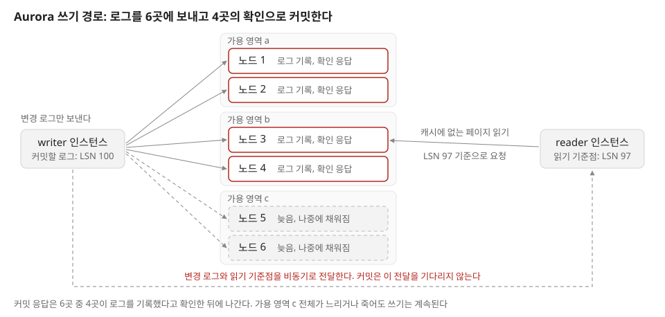

# 08. Aurora의 정족수 쓰기: 동기 복제인가, 비동기 복제인가

## 이번에 답하려는 질문

- Amazon Aurora의 복제는 동기인가, 비동기인가?
- 사본 6개 중 4개의 확인을 기다린다는 것은 5장의 동기식·비동기식·반동기식 중 어디에 드나?
- 스토리지에는 최신 값이 있는데, reader 인스턴스는 왜 낡은 값을 읽나?
- 리더 없는 복제(07번 노트)의 정족수와 무엇이 같고 무엇이 다른가?

## 한 줄 요약

Aurora는 writer가 변경 로그를 스토리지 사본 6개에 보내 4개의 확인으로 커밋하는 정족수 쓰기를 하고, reader 인스턴스는 같은 스토리지를 함께 쓰면서 어디까지 읽어도 되는지만 비동기로 전달받는다. 그래서 reader는 잠깐 낡은 값을 읽을 수 있지만, 커밋된 데이터는 잃지 않는다.

## 핵심 내용

### 0. 먼저: PostgreSQL의 기능이 아니라 Aurora 스토리지의 기능이다

"Aurora PostgreSQL은 6개 중 4개에 쓴다"고 하면 PostgreSQL의 복제 기능처럼 들린다. 그렇지 않다.
정족수 쓰기는 Aurora의 스토리지 계층이 하는 일이고, Aurora MySQL과 Aurora PostgreSQL이 같은 스토리지를 쓴다.

| | PostgreSQL 스트리밍 복제 | Aurora |
|---|---|---|
| 데이터를 두는 곳 | 인스턴스마다 자기 디스크 | 인스턴스 밖의 공유 스토리지 볼륨 하나 |
| 복제하는 주체 | primary가 standby에 WAL을 보낸다 | 스토리지 계층이 사본 6개를 유지한다 |
| 기본 동작 | 비동기 | 6개 중 4개 확인 뒤 커밋 |
| 인스턴스를 추가하면 | 데이터를 통째로 복사해야 한다 | 이미 있는 볼륨에 붙기만 한다 |

PostgreSQL도 `synchronous_standby_names`를 설정하면 동기 복제가 된다. `ANY 2 (s1, s2, s3)`처럼 쓰면 셋 중 둘의 응답을 기다리는 정족수 방식도 된다.
다만 이것은 인스턴스 사이의 복제이고, Aurora의 정족수는 인스턴스 아래 스토리지 노드 사이의 복제다.

### 1. 5장의 동기식·비동기식에 견주면

5장은 리더 기반 복제를 셋으로 나눈다.

| 방식 | 커밋 응답 전에 기다리는 것 | 단점 |
|---|---|---|
| 동기식 | 모든 팔로워의 확인 | 팔로워 하나만 느리거나 죽어도 쓰기가 멈춘다 |
| 반동기식 | 동기 팔로워 하나의 확인 | 그 하나가 느려지거나 죽으면 비동기 팔로워 중 하나를 동기로 바꿔야 한다 |
| 비동기식 | 없음 | 리더가 죽으면 전달 안 된 쓰기를 잃는다 |

Aurora 설계자의 글은 동기식과 비동기식을 둘 다 버린 이유를 같은 말로 적는다. 동기식은 가장 느린 디스크·노드·네트워크 경로에 좌우되고, 비동기식은 복제되기 전에 장애가 나면 데이터를 잃는다.
그래서 고른 것이 정족수다. 사본 중 정해진 수의 확인만 기다린다.

정리하면 Aurora의 사본 작성은 **전부를 기다리지는 않는 동기**다. 커밋 응답이 나갔다면 그 데이터는 이미 4곳의 디스크에 있다.

### 2. 쓰기 경로: 로그를 6곳에 보내고 4곳의 확인으로 커밋한다

- 사본은 6개다. 가용 영역(AZ) 3곳에 2개씩 둔다.
- writer는 데이터 페이지를 쓰지 않고 **변경 로그(redo log)만** 스토리지에 보낸다. 페이지는 스토리지 노드가 로그를 적용해 만든다. 논문 3장의 제목이 "로그가 곧 데이터베이스다"이다.
- 로그는 6곳 모두에 보낸다. 4곳이 디스크에 기록했다고 확인하면 그 로그는 내구성이 있다고 본다.
- writer는 "이 지점까지는 빠짐없이 내구성이 있다"는 위치(VDL)를 계속 앞으로 옮긴다. 트랜잭션의 커밋 로그 위치가 VDL 이하가 되면 클라이언트에 커밋 응답을 보낸다.
- 확인하지 못한 2곳은 버려지지 않는다. 스토리지 노드끼리 서로 비교해 빠진 로그를 채운다(가십).

읽기에는 정족수를 쓰지 않는다. writer는 어느 노드가 어디까지 받았는지를 쓰기 과정에서 이미 알고 있다. 그래서 필요한 지점까지 다 받은 노드 하나를 골라 읽는다.
읽기 정족수(3개)는 writer가 죽어서 이 기록을 잃었을 때, 복구하면서 상태를 다시 세울 때만 쓴다.

### 3. 왜 6개 중 4개인가

정족수 규칙은 07번 노트와 같다. 사본 수 V, 쓰기 정족수 Vw, 읽기 정족수 Vr에 대해 두 가지를 지킨다.

- Vr + Vw > V: 읽은 집합과 쓴 집합이 반드시 겹친다.
- Vw > V/2: 두 쓰기의 집합이 반드시 겹친다. 서로 모르는 쓰기가 동시에 성공하지 못한다.

Aurora는 V=6, Vw=4, Vr=3이다.

| 잃은 사본 | 남은 사본 | 쓰기 | 데이터 |
|---|---|---|---|
| 노드 1~2개 (AZ 하나 전체 포함) | 4개 이상 | 가능 | 안전 |
| AZ 하나 + 노드 1개 | 3개 | 불가 | 안전. 읽기 정족수가 남아 사본을 다시 만들 수 있다 |
| 4개 이상 | 2개 이하 | 불가 | 최신인지 확인할 수 없다 |

흔히 쓰는 3개 중 2개로는 부족한 이유가 있다. AZ마다 사본을 하나씩 두면, AZ 하나가 죽을 때 모든 데이터가 동시에 사본 하나를 잃는다.
그 순간 다른 이유로 사본 하나가 이미 고장 나 있던 데이터는 사본이 하나만 남고, 그 하나가 최신인지 알 길이 없다.
노드 고장은 서로 독립이지만 AZ 장애는 그 안의 모든 노드가 함께 죽는 장애다. 그래서 "AZ 하나 + 노드 하나"를 견디도록 6개를 둔다.

여기에 볼륨을 10GB 조각으로 나눠 조각마다 6개 사본을 둔다. 조각이 작아서 고장 난 사본을 다시 만드는 시간이 짧고, 그동안 다른 고장이 겹칠 가능성도 낮아진다.

### 4. reader 인스턴스는 왜 낡은 값을 읽나

reader 인스턴스는 자기 데이터 사본이 없다. writer와 같은 스토리지 볼륨을 읽는다.
그러면 스토리지에 이미 있는 최신 값을 읽으면 될 것 같지만, 두 가지 이유로 그렇게 하지 않는다.

**캐시에 있는 페이지는 스토리지까지 가지 않는다.**
DB는 한 번 읽은 페이지를 메모리(버퍼 캐시)에 두고 거기서 응답한다. writer는 스토리지에 보내는 로그를 reader에도 보낸다.
reader는 로그가 가리키는 페이지가 캐시에 있으면 적용하고, 없으면 버린다. 이 전달은 비동기다. writer는 reader를 기다리지 않고 커밋 응답을 보낸다.

**캐시에 없는 페이지도 최신이 아니라 자기 기준점으로 읽는다.**
스토리지는 페이지를 특정 로그 위치 기준으로 만들어 줄 수 있다. reader는 writer에게서 전달받은 지점까지만 읽는다. 일부러 그렇게 한다.

- 여러 페이지가 한 묶음으로 바뀌는 변경이 있다. B 트리 페이지 분할이 그렇다. 한 페이지는 캐시의 옛 판을, 다른 페이지는 스토리지의 새 판을 읽으면 트리 구조가 맞지 않는다. 그래서 reader는 한 묶음(미니 트랜잭션)의 로그를 한꺼번에 적용한다.
- 어떤 행이 보이는지는 그 행을 쓴 트랜잭션이 커밋됐는지로 정한다. 이 정보도 writer가 보내 준다. 페이지만 최신으로 읽으면 커밋되지 않은 변경을 가려낼 수 없다.

지연은 짧다. 2017년 논문은 보통 20ms 이하라고 적고, AWS 문서는 보통 100ms보다 훨씬 짧다고 적는다. 쓰기가 몰리면 늘어난다.

일반적인 비동기 복제와 견주면, 낡은 값을 읽는 것은 같고 장애 때 잃는 것이 다르다.

| | 비동기 복제 (PostgreSQL 스트리밍 복제 기본값) | Aurora reader |
|---|---|---|
| 복제본이 늦을 때 | 낡은 값을 읽는다 | 낡은 값을 읽는다 |
| 복제본이 늦는 이유 | 데이터가 아직 복제본 디스크에 없다 | 데이터는 공유 스토리지에 있다. 어디까지 읽어도 되는지를 아직 못 받았다 |
| 리더가 죽어 복제본이 승격될 때 | 전달 안 된 커밋을 잃을 수 있다 | 커밋된 데이터는 스토리지에 있어 잃지 않는다 |

5장의 "복제 지연 문제"(자신이 쓴 내용 읽기, 단조 읽기)는 Aurora reader에도 그대로 있다. 방금 쓴 값을 바로 reader에서 읽으면 안 보일 수 있다.

### 5. 리더 없는 복제(07)와 견주면

정족수 식은 같지만 쓰는 방식이 다르다.

| | Dynamo 스타일 (07번 노트) | Aurora 스토리지 |
|---|---|---|
| 쓰기를 받는 곳 | 어느 노드든 | writer 인스턴스 하나 |
| 쓰기 순서 | 정해 주는 노드가 없다 | writer가 로그마다 순번(LSN)을 매긴다 |
| 동시 쓰기 충돌 | 생긴다. 버전 벡터로 감지하고 애플리케이션이 병합한다 | 생기지 않는다 |
| 읽기 | r대에 물어 버전이 큰 값을 고른다 | 다 받은 노드 하나에서 읽는다. 읽기 정족수는 복구 때만 쓴다 |
| 놓친 쓰기 채우기 | 읽기 복구, 안티 엔트로피 | 스토리지 노드끼리 가십 |
| 노드가 오래 죽어 있으면 | 느슨한 정족수와 암시된 핸드오프 (선택) | 새 노드를 정족수 구성원으로 넣는다 |

07번 노트에서 정족수를 만족해도 낡은 값을 읽는 경우를 적었다. 동시 쓰기, 쓰기와 읽기의 겹침 같은 것이다.
Aurora는 쓰는 주체가 하나이고 그 하나가 "누가 어디까지 받았는지"를 알고 있어서 이 문제를 피한다. 정족수는 내구성을 위해서만 쓰고, 순서와 최신 판정은 writer가 맡는다.

### 6. 헷갈렸던 것 정리

- **"6개 중 4개"는 reader 인스턴스 수와 무관하다.** 사본 6개는 스토리지 노드이고, DB 인스턴스가 1대뿐이어도 6개다.
- **논문 그림의 "ASYNC 4/6 QUORUM"은 비동기 복제라는 뜻이 아니다.** writer의 작업 스레드가 응답을 기다리며 멈추지 않는다는 뜻이다. 커밋 대기 목록에 올려 두고 다른 요청을 처리하다가, 4곳의 확인이 모이면 전담 스레드가 클라이언트에 응답한다. 클라이언트가 보기에는 4곳에 기록된 뒤에 커밋된다.
- **Aurora에서 비동기인 것은 reader로 가는 로그 전달이다.** 이것은 reader가 얼마나 최신 값을 보여 주는지에만 영향을 준다. 커밋된 데이터가 남아 있는지와는 관계가 없다.
- **동기냐 비동기냐는 한 단어로 답할 수 없다.** 무엇과 무엇 사이의 복제인지를 먼저 정해야 한다. 스토리지 사본 사이는 정족수 동기, writer와 reader 사이는 비동기다.

## 남은 질문

- 논문은 MySQL(InnoDB)을 바탕으로 한 Aurora를 설명한다. 미니 트랜잭션은 InnoDB의 개념인데, Aurora PostgreSQL의 reader는 같은 일을 어떻게 하나?
- writer가 죽고 reader가 승격될 때 읽기 정족수로 상태를 다시 세운다. 4곳에 닿지 못한 로그를 잘라내는 과정에서, 클라이언트가 응답을 받지 못한 커밋은 어떻게 되나?
- AZ 하나를 오래 잃었을 때 4개 중 3개로 줄여 운영하는 모드가 있다고 한다. 구성원을 바꾸는 동안 정족수 규칙은 어떻게 지키나? (Under the Hood 연재의 "Quorum Membership" 글)
- 사본이 6개면 저장 비용도 6배인가? (같은 연재의 "Reducing Costs Using Quorum Sets" 글)
- 9장의 합의 알고리즘(Raft, Paxos)과 견주면 Aurora는 무엇을 생략할 수 있었나? 쓰는 주체가 하나라는 가정이 어디까지 덜어 주나?

## 참고 자료

- 『데이터 중심 애플리케이션 설계』 5장 "동기식 대 비동기식 복제", "복제 지연 문제", "리더 없는 복제" 절
- [Amazon Aurora: Design Considerations for High Throughput Cloud-Native Relational Databases (SIGMOD 2017)](https://pages.cs.wisc.edu/~yxy/cs764-f20/papers/aurora-sigmod-17.pdf): 2장(정족수와 AZ 장애), 3장(로그만 쓴다), 4.2절(쓰기·커밋·읽기·레플리카)
- [Amazon Aurora under the hood: quorums and correlated failure](https://aws.amazon.com/blogs/database/amazon-aurora-under-the-hood-quorum-and-correlated-failure/)
- [Amazon Aurora Under the Hood: Quorum Reads and Mutating State](https://aws.amazon.com/blogs/database/amazon-aurora-under-the-hood-quorum-reads-and-mutating-state/)
- [Replication with Amazon Aurora (AWS 문서)](https://docs.aws.amazon.com/AmazonRDS/latest/AuroraUserGuide/Aurora.Replication.html)
- [Amazon Aurora storage (AWS 문서)](https://docs.aws.amazon.com/AmazonRDS/latest/AuroraUserGuide/Aurora.Overview.StorageReliability.html)
- [PostgreSQL 문서: Log-Shipping Standby Servers](https://www.postgresql.org/docs/current/warm-standby.html), [Replication 설정](https://www.postgresql.org/docs/current/runtime-config-replication.html)
- [07. 리더 없는 복제](07-leaderless-replication.md)
